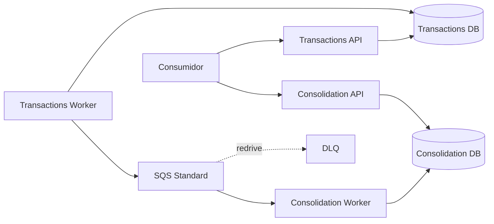

# Cash Flow Architecture

Documentação arquitetural dos desafios de **Solutions Architect** e **Software Architect** para registro de lançamentos e consolidação diária.

> **Estado:** revisão documental final. Não há implementação de código nesta etapa nem evidência de teste executada. Validar humanamente esta branch antes de PR/merge.

## Arquitetura em uma frase

**2 serviços de negócio / 4 processos executáveis**, PostgreSQL por contexto, Transactional Outbox, integração assíncrona at-least-once por **SQS Standard + DLQ**, consumidor idempotente e consolidação eventualmente consistente.

## Índice

1. Requisitos e rastreabilidade — `docs/01-requisitos/`
2. ASRs — `docs/02-asr/ASR.md`
3. Arquitetura da solução — `docs/03-arquitetura-solucao/DAS.md`
4. C4 e views — `docs/04-views/`
5. Design de software e testes — `docs/05-arquitetura-software/`
6. ADRs — `docs/06-adr/`
7. AWS e custos — `docs/07-infraestrutura/`

Leitura recomendada: `matriz-conformidade.md` → `DAS.md` → `C4.md` → `SDD.md` → ADRs → `estrategia-testes.md`.

## Decisões principais

| Tema | Decisão |
|---|---|
| decomposição | 2 serviços: Lançamentos e Consolidação |
| execução | API + Worker por serviço = 4 processos |
| persistência | PostgreSQL, ownership separado |
| dual write | Transactional Outbox |
| mensageria | SQS Standard + DLQ |
| entrega | at-least-once |
| duplicidade | idempotência HTTP + `ProcessedEvent` |
| concorrência | Outbox com `SKIP LOCKED`; consolidado com UPSERT atômico |
| data diária | `BusinessDate` calculado em Lançamentos e propagado no evento |
| recuperação | retry/backoff, DLQ/redrive, reconciliação e rebuild pela fonte de verdade |
| cloud | AWS ECS/Fargate + RDS + SQS |

## Limites conscientes

SLA, RTO, RPO, região produtiva, volume diário, retenções produtivas, IdP/RBAC de negócio, fechamento financeiro, múltiplas moedas, contas/tenants e ordenação global não são inventados.

## Implementação e execução local

Esta branch é **documental**. Implementação C#, Docker Compose, migrations e scripts k6 ainda não fazem parte desta etapa. Quando o desenvolvimento começar, esta seção deverá receber somente comandos reais e reproduzíveis.

## Status e evidência

Uma decisão `ACEITA PARA A ARQUITETURA DO DESAFIO` não equivale a `VALIDADA POR EVIDÊNCIA`. Disponibilidade, concorrência e 50 req/s só podem ser marcados como validados após testes realmente executados e registrados.