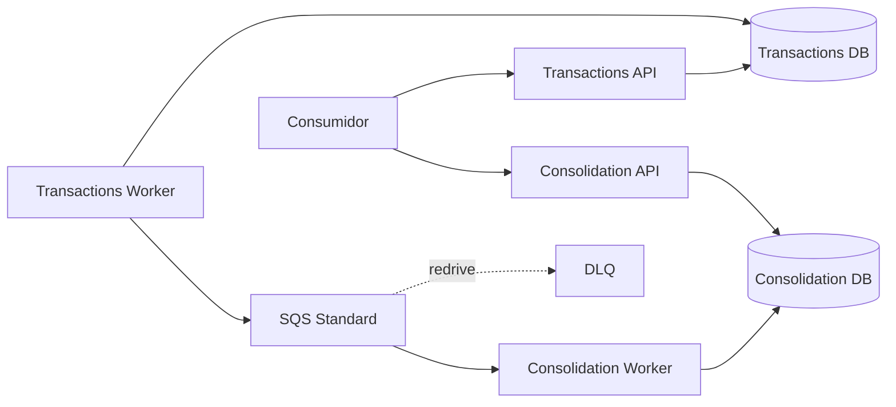

# Cash Flow Architecture

Documentação arquitetural dos desafios de **Solutions Architect** e **Software Architect** para registro de lançamentos e consolidação diária.

> **Estado:** documentação integralmente revisada em duas passagens e **pronta para validação humana**. Esta branch não contém implementação C# nem evidências de testes executados. **Não abrir PR nem fazer merge antes da validação do responsável.**

## Arquitetura em uma frase

**2 serviços de negócio / 4 processos executáveis**, PostgreSQL por contexto, Transactional Outbox, integração assíncrona at-least-once por **SQS Standard + DLQ**, consumidor idempotente e consolidação eventualmente consistente.

## Índice e ordem de leitura

1. `docs/01-requisitos/matriz-conformidade.md` — cobertura dos dois desafios;
2. `docs/01-requisitos/requisitos-funcionais.md` e `requisitos-nao-funcionais.md`;
3. `docs/01-requisitos/premissas.md` e `questoes-em-aberto.md`;
4. `docs/02-asr/ASR.md` — drivers arquiteturais;
5. `docs/03-arquitetura-solucao/DAS.md` — visão de solução;
6. `docs/04-views/C4.md`, `Data-View.md`, `Integration-View.md`, `Dynamic-Views.md` e `Security-Resilience-Observability.md`;
7. `docs/05-arquitetura-software/SDD.md` e `C4-Component.md`;
8. `docs/06-adr/ADR-001..007` — decisões e trade-offs;
9. `docs/07-infraestrutura/arquitetura-aws.md` e `estimativa-custos.md`;
10. `docs/05-arquitetura-software/estrategia-testes.md` — evidências futuras;
11. `docs/01-requisitos/matriz-rastreabilidade.md` — fechamento da cadeia requisito → evidência.

`docs/04-views/revisao-checkpoint.md` é **histórico/superado** e não deve ser usado como status atual.

## Decisões principais

| Tema | Decisão |
|---|---|
| decomposição | 2 serviços: Lançamentos e Consolidação |
| execução | API + Worker por serviço = 4 processos |
| persistência | PostgreSQL com ownership separado |
| dual write | Transactional Outbox |
| mensageria | SQS Standard + DLQ; Kafka/MSK somente evolução condicional |
| entrega | at-least-once, sem promessa de exactly-once |
| idempotência | chave HTTP + hash; `ProcessedEvent` no consumidor |
| concorrência | Outbox com `SKIP LOCKED`; consolidação com UPSERT relativo |
| data diária | `BusinessDate` calculado em Lançamentos e propagado no evento |
| recuperação | retry/backoff, DLQ/redrive, reconciliação e rebuild pela fonte de verdade |
| observabilidade | OpenTelemetry + sinais de API, Outbox, SQS/DLQ e Workers |
| cloud | AWS ECS/Fargate + RDS + SQS |

## Revisão das contribuições alternativas

Os artefatos alternativos fornecidos como insumo foram tratados como **propostas**, não como autoridade. Foram aproveitadas ideias que melhoraram simplicidade e coerência — especialmente SQS como baseline, 2 serviços/4 processos, concorrência explícita, DLQ/redrive, reconciliação e regra temporal — somente após confronto com requisitos, RNFs, ASRs e trade-offs. Propostas que adicionariam capacidade sem driver foram descartadas ou mantidas como evolução.

## Segunda revisão integral

### Perspectiva Solutions Architect

Confirmados: fronteiras de capacidades; isolamento de disponibilidade; arquitetura-alvo AWS; segurança e IAM; observabilidade; recuperação; escala; custo; transição explicitamente hipotética; ausência de SLA/RTO/RPO inventados; SQS justificado pelos requisitos e Kafka não defendido por throughput.

### Perspectiva Software Architect

Confirmados: estrutura .NET; 4 executáveis coerentes com 2 serviços; boundaries transacionais; contrato versionado; precisão monetária; idempotência HTTP/consumer; concorrência do Publisher e consolidado; retry/DLQ/redrive; reconciliação; testabilidade; SOLID/patterns com propósito; nenhum código implementado nesta etapa.

## Limites conscientes

SLA, RTO, RPO, região produtiva, volume diário, retenções produtivas, IdP/RBAC, timezone/calendário/fechamento definitivos, múltiplas moedas, contas/tenants e regras de estorno não são inventados. Premissas técnicas do MVP estão explicitamente marcadas.

## Implementação e evidência

Esta branch é documental. Implementação C#, Docker Compose, migrations e scripts k6 serão etapas posteriores. Uma decisão `ACEITA PARA A ARQUITETURA DO DESAFIO` não equivale a `VALIDADA POR EVIDÊNCIA`; disponibilidade, concorrência e 50 req/s só serão validados após testes realmente executados.

## Gate atual

**Próxima ação: validação humana desta branch.** Após essa validação, e somente se aprovada, poderá ser considerada a abertura de PR. Nenhum PR ou merge foi realizado nesta revisão.