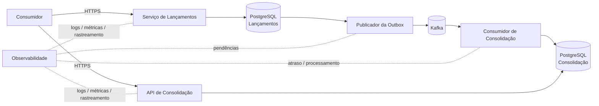

# DAS — Documento de Arquitetura da Solução

- **Status:** DOCUMENTAÇÃO ARQUITETURAL CONSOLIDADA — PENDENTE DE VALIDAÇÃO DO RESPONSÁVEL
- **Escopo:** arquitetura de solução do MVP dos desafios de Arquiteto de Soluções e Arquiteto de Software

## 1. Objetivo

Descrever a arquitetura proposta para controle de lançamentos de débito/crédito e consolidação diária, garantindo que a indisponibilidade da consolidação não interrompa novos lançamentos e considerando o requisito explícito de 50 req/s com no máximo 5% de perda de requisições no consolidado.

O enunciado não informa a operação exata à qual os 50 req/s se aplicam. A estratégia de testes registra explicitamente a hipótese adotada, sem transformá-la em requisito de negócio.

## 2. Direcionadores arquiteturais

1. O controle de lançamentos é uma capacidade de negócio independente da consolidação.
2. O consolidado diário é uma visão derivada dos lançamentos.
3. A indisponibilidade da consolidação não pode impedir a confirmação de novos lançamentos válidos.
4. Um lançamento confirmado deve permanecer recuperável para processamento posterior.
5. Reprocessamento e repetição de mensagens não podem gerar dupla contabilização.
6. A solução deve suportar o cenário de carga informado e produzir evidência por teste.
7. Segurança, observabilidade, escalabilidade e recuperação precisam estar representadas mesmo quando metas produtivas não foram fornecidas.
8. Decisões produtivas dependentes de SLA, RTO, RPO, volume e retenção não serão inventadas.

## 3. Arquitetura lógica

As decisões representadas neste desenho estão formalizadas nos ADRs do repositório e detalhadas nas visões C4, dados, integração, segurança, resiliência, observabilidade, infraestrutura e no SDD.

## 4. Responsabilidades

### Serviço de Lançamentos

- `POST /transactions` — registrar débito/crédito;
- `GET /transactions/{id}` — consultar por identificador;
- `GET /transactions` — consultar lançamentos com paginação/filtros definidos;
- persistir os fatos financeiros sob sua responsabilidade;
- persistir a intenção de publicação no mesmo compromisso transacional do lançamento;
- permitir publicação assíncrona e recuperável dos eventos.

O sucesso do `POST /transactions` depende da persistência local do lançamento e da Outbox, **não** da disponibilidade de Kafka ou da Consolidação.

### Consolidação

- consumir eventos de lançamentos;
- aplicar eventos de forma idempotente;
- manter a projeção `DailyConsolidation`;
- `GET /consolidations/{date}`;
- `GET /consolidations?from=&to=`;
- disponibilizar informação de última atualização para diagnóstico.

Não existe endpoint público para criar uma consolidação. Ela é atualizada como consequência do processamento dos lançamentos.

## 5. Modelo conceitual de dados

### FinancialTransaction

- `id`
- `type` (`DEBIT`/`CREDIT`)
- `amount`
- `description?`
- `occurredAt`
- `createdAt`

### OutboxEvent — estrutura técnica

- `id/eventId`
- `aggregateId`
- `eventType`
- `payload`
- `occurredAt`
- `publishedAt?`
- metadados de tentativas/publicação

### DailyConsolidation

- `date`
- `totalCredits`
- `totalDebits`
- `balance`
- `transactionCount`
- `lastUpdatedAt`

### ProcessedEvent — estrutura técnica

- `eventId`
- `processedAt`

Os modelos detalhados e a propriedade dos dados são tratados no SDD e na visão de dados.

## 6. Consistência e fluxo

### Registro de lançamento

1. consumidor envia um lançamento com `Idempotency-Key`;
2. o Serviço de Lançamentos valida a requisição;
3. lançamento e evento da Outbox são persistidos na mesma transação PostgreSQL;
4. a API confirma sucesso somente após esse compromisso local;
5. o Publicador da Outbox envia o evento posteriormente para Kafka;
6. falha temporária de Kafka não desfaz o lançamento confirmado.

### Consolidação

1. Kafka entrega o evento ao consumidor;
2. o consumidor verifica o `eventId`;
3. eventos já processados não têm seus efeitos reaplicados;
4. para um evento novo, a projeção e o registro de processamento são persistidos na mesma transação local;
5. o deslocamento do consumidor só é confirmado após persistência bem-sucedida;
6. a projeção converge à medida que o backlog é consumido.

A entrega é tratada como **pelo menos uma vez (at-least-once)**; não é feita promessa de exatamente uma vez.

## 7. Cenários de falha e recuperação

### Consolidação indisponível

- Lançamentos continua aceitando e persistindo transações válidas;
- eventos permanecem recuperáveis;
- o consolidado pode ficar temporariamente defasado;
- após recuperação, o backlog é processado;
- repetição de evento não altera o consolidado duas vezes.

### Kafka indisponível

- lançamento e Outbox continuam sendo persistidos;
- o Publicador da Outbox repete a publicação após recuperação;
- a API de Lançamentos não depende de Kafka para confirmar o lançamento.

### Falha após publicação e antes da marcação da Outbox

- o evento pode ser publicado novamente;
- o consumidor idempotente impede dupla contabilização.

Esses cenários são parte obrigatória da estratégia de testes.

## 8. Segurança

### Ambiente local

- configurações e segredos ficam fora do código-fonte;
- nenhum segredo real é versionado;
- a implementação deve manter separação entre configuração e código.

### Arquitetura-alvo

- HTTPS/TLS na comunicação externa;
- OAuth2/OIDC por provedor de identidade corporativo quando definido;
- autorização por escopo/política conforme requisitos corporativos;
- proteção de borda quando necessária;
- Secrets Manager/KMS para segredos e chaves;
- princípio do menor privilégio;
- bancos e broker em rede não exposta diretamente à Internet;
- criptografia em repouso suportada pelos serviços gerenciados;
- autenticação serviço-a-serviço conforme padrão da plataforma corporativa.

Não é escolhido um IdP específico porque o desafio não fornece essa informação.

## 9. Observabilidade

Sinais mínimos:

- taxa de requisições, erros e latência;
- saúde e prontidão;
- quantidade e idade dos itens pendentes da Outbox;
- atraso do consumidor e backlog;
- tentativas e falhas persistentes;
- última atualização/defasagem do consolidado;
- identificador de correlação/rastreamento do lançamento até a consolidação.

Os limiares de alerta dependem dos SLOs/SLA produtivos ainda não fornecidos.

## 10. Escalabilidade e desempenho

- serviços HTTP sem estado de sessão local;
- escala horizontal independente conforme ADR-001;
- índices orientados aos padrões de consulta;
- partições/consumidores adicionais somente quando medições justificarem;
- nenhum requisito de ordenação global foi inventado;
- cache não é introduzido sem necessidade demonstrada;
- o teste de 50 req/s será reproduzível e reportará sucesso, erro e latência;
- a estratégia de testes declara a hipótese utilizada para interpretar a operação do consolidado e os 5% de perda.

## 11. Arquitetura-alvo AWS

A arquitetura-alvo utiliza AWS como plataforma de referência, conforme ADR-006 e `docs/07-infraestrutura/arquitetura-aws.md`.

Principais componentes:

- Application Load Balancer para entrada HTTPS e balanceamento;
- Amazon ECS + AWS Fargate para os quatro componentes executáveis;
- Amazon RDS for PostgreSQL para persistência de cada contexto;
- Amazon MSK para Kafka;
- AWS Secrets Manager e KMS;
- Amazon CloudWatch e OpenTelemetry;
- Amazon ECR para imagens.

A região `us-east-1` é usada somente como referência de precificação. A região produtiva é questão aberta.

Não são declarados SLA, RTO ou RPO que o desafio não forneceu.

## 12. Arquitetura de transição — diferencial

O desafio não informa a existência de legado ou migração. Para demonstrar o diferencial solicitado sem transformar hipótese em requisito, `arquitetura-transicao-hipotetica.md` apresenta separadamente um cenário hipotético de modernização.

O cenário pressupõe, apenas para fins de análise, um sistema legado no qual Lançamentos e Consolidação compartilham ciclo de vida/persistência. A arquitetura-alvo demonstra como essas capacidades poderiam ser separadas.

Não é afirmado que esse legado existe no Banco Carrefour e não é criado plano de migração fictício.

## 13. Custos — diferencial

`docs/07-infraestrutura/estimativa-custos.md` contém a estimativa econômica da arquitetura-alvo.

Ela apresenta:

- premissas explícitas de dimensionamento;
- serviço e configuração assumida;
- quantidade;
- custo unitário estimado;
- subtotal por componente;
- total mensal estimado;
- cenário enxuto e cenário de produção de referência;
- comparação econômica de Kafka/MSK com SQS;
- licenciamento;
- limitações e informações necessárias para um orçamento produtivo.

Os valores são estimativas arquiteturais, não orçamento comercial definitivo.

## 14. Decisões arquiteturais consolidadas

| Tema | Decisão | Referência |
|---|---|---|
| Decomposição | dois serviços independentes alinhados aos contextos de Lançamentos e Consolidação | ADR-001 |
| Integração | comunicação assíncrona orientada a eventos | ADR-002 |
| Persistência | PostgreSQL com propriedade de dados por contexto | ADR-003 |
| Publicação confiável | Transactional Outbox | ADR-004 |
| Idempotência | chave na entrada e registro de eventos processados no consumidor | ADR-005 |
| Plataforma de referência | AWS ECS/Fargate | ADR-006 |
| Mensageria | Kafka/MSK mantido por retenção/reprocessamento, com SQS documentado como alternativa econômica | ADR-007 |
| Estrutura interna .NET | separação Domain/Application/Infrastructure/API e contratos de integração | SDD |
| Testes | unitários, integração, API, resiliência e carga | estratégia de testes |

Não existem, neste momento, decisões arquiteturais essenciais pendentes que impeçam o início da implementação. Questões dependentes de informações não fornecidas pelo desafio permanecem em `questoes-em-aberto.md`.

## 15. Critérios para considerar a arquitetura documental pronta

Antes do início da implementação, devem estar validados:

- capacidades e fronteiras de domínio;
- independência entre Lançamentos e Consolidação;
- integração assíncrona;
- persistência e propriedade dos dados;
- Transactional Outbox;
- idempotência na entrada e no consumo;
- cenários de falha e recuperação;
- segurança, observabilidade e escalabilidade;
- arquitetura AWS;
- estimativa de custos com premissas e total;
- SDD e C4 de componentes;
- estratégia de testes;
- matrizes de conformidade e rastreabilidade;
- ausência de regras financeiras não fornecidas pelo desafio;
- revisão transversal de todos os documentos.

A implementação somente será iniciada após a validação desta documentação pelo responsável pela entrega.