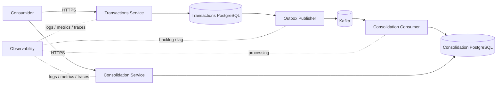

# DAS — Documento de Arquitetura da Solução

- **Status:** RASCUNHO PARA VALIDAÇÃO
- **Escopo:** arquitetura de solução do MVP do desafio

## 1. Objetivo

Descrever a arquitetura proposta para controle de lançamentos de débito/crédito e consolidado diário, garantindo que a indisponibilidade da consolidação não interrompa lançamentos e considerando o cenário explícito de 50 req/s com no máximo 5% de perda de requisições no consolidado.

## 2. Drivers principais

1. Lançamentos são a capacidade financeira primária.
2. Consolidação é uma visão derivada.
3. Consolidação indisponível não bloqueia novos lançamentos.
4. Lançamento confirmado precisa permanecer recuperável para futura consolidação.
5. Reprocessamento não pode causar dupla contabilização.
6. O consolidado precisa considerar o cenário de carga informado.
7. Segurança, observabilidade, escalabilidade e recuperação precisam aparecer na arquitetura, mesmo quando metas produtivas ainda não foram informadas.

## 3. Arquitetura lógica proposta

A figura representa a proposta resultante dos ADRs em validação; não deve ser interpretada como decisão aceita antes da aprovação dos ADRs.

## 4. Responsabilidades

### Transactions Service

- `POST /transactions` — registrar débito/crédito;
- `GET /transactions/{id}` — consultar por identificador;
- `GET /transactions` — consultar lista/página;
- persistir fatos financeiros;
- garantir que a intenção de integração sobreviva à confirmação do lançamento;
- publicar eventos de forma recuperável.

### Consolidation Service

- consumir eventos de lançamentos;
- aplicar eventos de forma idempotente;
- manter projeção `DailyConsolidation`;
- `GET /consolidations/{date}`;
- `GET /consolidations?from=&to=`;
- expor freshness/última atualização suficiente para diagnóstico.

Não haverá endpoint público para “cadastrar consolidação”; a atualização é consequência do processamento dos lançamentos.

## 5. Modelo de dados conceitual

### FinancialTransaction
- `id`
- `type` (`DEBIT`/`CREDIT`)
- `amount`
- `description?`
- `occurredAt`
- `createdAt`

### OutboxEvent — técnico
- `id/eventId`
- `aggregateId`
- `eventType`
- `payload`
- `occurredAt`
- `publishedAt?`
- `status/retry metadata` conforme design final

### DailyConsolidation
- `date`
- `totalCredits`
- `totalDebits`
- `balance`
- `transactionCount`
- `lastUpdatedAt`

### ProcessedEvent — técnico
- `eventId`
- `processedAt`

## 6. Consistência e fluxo

### Registro

1. consumidor envia lançamento com chave de idempotência;
2. Transactions valida a requisição;
3. lançamento e intenção de publicação são persistidos atomicamente;
4. API confirma sucesso após commit;
5. publicação ocorre fora do caminho crítico da requisição.

### Consolidação

1. evento é entregue ao consumidor;
2. consumidor verifica `eventId`;
3. se já processado, encerra sem reaplicar efeito;
4. se novo, atualiza consolidado e registra processamento na mesma transação local;
5. projeção converge conforme backlog é consumido.

## 7. Cenário crítico de falha

Se Consolidation Service estiver indisponível:
- Transactions continua aceitando e persistindo lançamentos;
- informação pendente permanece recuperável;
- consolidado pode ficar defasado ou sua API pode ficar indisponível — o desafio não exige disponibilidade do consolidado durante sua própria queda;
- após recuperação, backlog é processado;
- eventos repetidos não alteram o resultado duas vezes.

Esse cenário será obrigatório na estratégia de testes.

## 8. Segurança — direção da arquitetura-alvo

### Local/MVP
- APIs protegidas conforme mecanismo simples definido no SDD;
- segredos/configurações externalizados;
- nenhum segredo real versionado.

### Arquitetura-alvo
- HTTPS/TLS;
- Identity Provider OAuth2/OIDC conforme padrão corporativo;
- autorização por escopo/política quando requisitos forem conhecidos;
- WAF/API Gateway ou equivalente na borda;
- secret/key management;
- least privilege para workloads;
- rede privada para banco/broker;
- criptografia em repouso suportada pelos serviços gerenciados;
- autenticação/autorização serviço-a-serviço conforme plataforma.

## 9. Observabilidade

Sinais mínimos:
- request rate, error rate e latency;
- health/readiness;
- quantidade/idade de itens pendentes de publicação;
- consumer lag/backlog;
- retries e falhas persistentes;
- freshness do consolidado;
- correlation/trace ID do lançamento até o processamento.

Alert thresholds dependem de SLOs ainda não fornecidos.

## 10. Escalabilidade e desempenho

- serviços stateless na camada HTTP;
- scale-out independente conforme ADR-001;
- índices orientados aos padrões de consulta;
- partições/consumers do broker somente conforme necessidade de throughput e sem inventar requisito de ordenação;
- cache não será usado inicialmente sem evidência de necessidade;
- teste de 50 req/s será reproduzível e reportará sucesso/erro/latência.

## 11. Arquitetura-alvo cloud

AWS será avaliada como referência de documentação detalhada no ADR de cloud, sem impedir portabilidade conceitual.

Capacidades necessárias na arquitetura-alvo:
- edge protection/API ingress;
- execução containerizada com múltiplas instâncias quando necessário;
- PostgreSQL gerenciado;
- broker/event streaming gerenciado;
- secret/key management;
- logs, métricas e tracing;
- backups/PITR e HA conforme metas de RPO/RTO;
- rede privada e controles de acesso.

Não serão declarados RTO/RPO/SLA que o desafio não forneceu.

## 12. Arquitetura de transição

O desafio não apresenta sistema legado ou migração existente. Portanto, **não há arquitetura de transição a desenhar neste momento**. Na entrega final isso será explicitado como “não aplicável ao cenário fornecido”, em vez de inventar um legado para obter o diferencial.

A passagem de ambiente local para arquitetura-alvo será documentada como estratégia de implantação/evolução, não como migração de legado.

## 13. Custos

Estimativa de infraestrutura/licenciamento será produzida após definição da arquitetura-alvo e premissas mínimas de sizing. Valores sem volume, retenção, região e disponibilidade seriam falsa precisão.

## 14. Decisões ainda necessárias

Próximos ADRs/documentos antes da implementação:
- cloud de referência e mapeamento local→target;
- segurança/autenticação local e target;
- estratégia de tratamento de falhas persistentes/DLQ;
- contrato/schema e versionamento de eventos;
- estrutura interna .NET/Clean/Hexagonal no SDD;
- infraestrutura local e target;
- Data, Integration, Security, Resilience e Observability Views.

## 15. Critérios para aceitar esta arquitetura

Antes de considerar o DAS aprovado, validar:
- fronteiras de domínio/capacidades;
- dois deployables independentes;
- integração assíncrona;
- Kafka como escolha justificada, não por throughput;
- PostgreSQL como persistência;
- Transactional Outbox;
- idempotência na entrada e no consumo;
- ausência deliberada de regras financeiras não fornecidas pelo desafio.