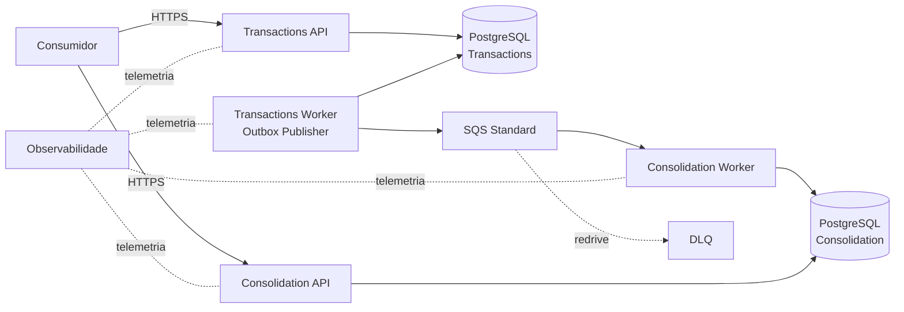

# DAS — Documento de Arquitetura da Solução

- **Status:** EM REVISÃO FINAL — aguardando validação humana
- **Escopo:** MVP dos desafios de Arquiteto de Soluções e Arquiteto de Software

## 1. Objetivo

Arquitetar controle de lançamentos de débito/crédito e consolidado diário, garantindo que indisponibilidade da Consolidação não interrompa novos lançamentos e contemplando o requisito explícito de 50 req/s com no máximo 5% de perda de requisições no consolidado.

O enunciado não identifica inequivocamente a operação à qual a carga se aplica; a estratégia de testes declara a hipótese de teste sem convertê-la em regra de negócio.

## 2. Direcionadores

1. Lançamentos e Consolidação são capacidades independentes.
2. O consolidado é projeção derivada; Lançamentos é a fonte de verdade financeira do escopo.
3. Confirmação de lançamento não depende da disponibilidade da Consolidação nem da fila.
4. Trabalho de integração precisa ser recuperável.
5. Redelivery/reprocessamento não pode duplicar efeito financeiro.
6. A carga informada precisa de evidência reproduzível.
7. Segurança, observabilidade, escalabilidade, custo e recuperação devem ser explícitos.
8. SLA, RTO, RPO, retenções e regras financeiras ausentes não serão inventados.

## 3. Arquitetura lógica

A solução possui **2 serviços de negócio e 4 processos executáveis**.

**Serviço Lançamentos:** Transactions API + Transactions Worker, com o mesmo ownership de dados.  
**Serviço Consolidação:** Consolidation API + Consolidation Worker, com o mesmo ownership de dados.

Separar API e Worker permite escala, ciclo operacional e health independentes sem criar novos bounded contexts.

## 4. Responsabilidades

### Lançamentos

- `POST /transactions` com `Idempotency-Key` obrigatório;
- `GET /transactions/{id}` e listagem paginada;
- persistir fato financeiro, idempotência e Outbox no mesmo commit;
- calcular `BusinessDate` uma vez, por regra temporal configurada;
- publicar Outbox assincronamente pelo Transactions Worker.

### Consolidação

- consumir `TransactionCreatedV1` at-least-once;
- deduplicar por `eventId`;
- atualizar `DailyConsolidation` por UPSERT atômico;
- `GET /consolidations/{date}` e consulta por intervalo;
- para data válida sem movimento, retornar `200` com totais zero;
- manter DLQ/redrive e procedimento de reconciliação.

## 5. Modelo conceitual

`FinancialTransaction`: `id`, `type`, `amount`, `description?`, `occurredAt`, `businessDate`, `createdAt`.

`IdempotencyRecord`: `key`, `requestHash`, `transactionId`, resposta lógica, timestamps/expiração.

`OutboxMessage`: `eventId`, `aggregateId`, `eventType`, `payload`, `headers`, `occurredAt`, `publishedAt?`, `attempts`, `nextAttemptAt?`, `lastError?`.

`DailyConsolidation`: `businessDate`, `totalCredits`, `totalDebits`, `balance`, `transactionCount`, `lastUpdatedAt`.

`ProcessedEvent`: `eventId`, `processedAt`.

## 6. Consistência e fluxo

### Registro

1. API valida payload e chave de idempotência;
2. reserva/valida a chave;
3. persiste lançamento + registro de idempotência + Outbox atomicamente;
4. retorna sucesso após commit local;
5. Transactions Worker captura pendências concorrentes com `SKIP LOCKED` e envia para SQS;
6. confirmação da fila permite marcar `publishedAt`.

Falha depois de `SendMessage` e antes de `publishedAt` pode duplicar a mensagem. Isso é esperado.

### Consolidação

1. SQS entrega a mensagem;
2. Worker inicia transação local;
3. `INSERT processed_event ... ON CONFLICT DO NOTHING` reserva o `eventId`;
4. evento novo atualiza o consolidado com incremento atômico; duplicata não reaplica efeito;
5. commit;
6. `DeleteMessage` somente depois do commit.

A semântica é **at-least-once**, sem promessa de exactly-once ponta a ponta e sem necessidade atual de ordenação global.

## 7. Data do consolidado

O desafio fala em consolidado diário, mas não define fuso, fechamento ou qual timestamp governa o dia. Para impedir divergência, Lançamentos deriva e persiste `BusinessDate` a partir de `OccurredAt` usando fuso configurável e inclui esse valor no evento.

O fuso usado na demonstração é premissa técnica explícita. Uma regra de fechamento bancário futura substitui essa premissa mediante nova decisão.

## 8. Falhas e recuperação

- **Consolidação indisponível:** SQS mantém backlog; Lançamentos continua funcionando.
- **SQS indisponível:** Outbox permanece pendente; Publisher aplica retry/backoff.
- **Falha transitória no consumidor:** mensagem reaparece após visibility timeout.
- **Falha persistente:** redrive policy move para DLQ após limite configurado; alerta e runbook tratam a causa.
- **Redrive:** mensagens corrigidas retornam controladamente à fila; idempotência protege duplicatas.
- **Divergência silenciosa:** reconciliação compara contagem/créditos/débitos por `BusinessDate` entre fonte de verdade e projeção.
- **Reconstrução:** parte de `financial_transactions`; não depende de retenção histórica da fila.

## 9. Segurança

Arquitetura-alvo: HTTPS/TLS, OAuth2/OIDC/JWT no limite HTTP, menor privilégio IAM, Secrets Manager/KMS, bancos/filas sem exposição pública e criptografia em repouso. Não se inventa IdP ou RBAC de negócio.

Permissões de processos são separadas: Publisher envia à fila; Consolidation Worker recebe/remove/ajusta visibilidade; operação de redrive é controlada. Segredos e descrições sensíveis não entram em logs.

## 10. Observabilidade

Todos os quatro processos produzem logs estruturados, métricas e traces OpenTelemetry. Correlação atravessa HTTP → Outbox → mensagem → Worker.

Sinais mínimos: taxa/erro/latência HTTP, pendências e idade da Outbox, falhas/tentativas do Publisher, profundidade e `ApproximateAgeOfOldestMessage` da SQS, mensagens na DLQ, falhas/tempo de consumo e idade do evento ao consolidar. `lastUpdatedAt` é diagnóstico, não indicador isolado de lag.

Limiares dependem de SLOs não fornecidos.

## 11. Escalabilidade e desempenho

APIs são stateless. Os quatro processos escalam independentemente. Publishers concorrentes usam captura segura de Outbox; consumidores concorrentes usam idempotência + UPSERT relativo para evitar lost update.

Não se introduzem cache, lock distribuído ou FIFO sem requisito/medição. O teste de 50 req/s reportará taxa de sucesso/erro e latência, declarando exatamente o endpoint e cenário exercitados.

## 12. Arquitetura AWS

- ALB para entrada HTTPS das APIs;
- ECS/Fargate para 4 processos;
- RDS PostgreSQL com ownership lógico/físico separado por contexto;
- SQS Standard + DLQ;
- ECR;
- Secrets Manager/KMS;
- CloudWatch + OpenTelemetry.

`us-east-1` pode ser usada apenas como referência de custo; região produtiva permanece aberta. Alta disponibilidade produtiva, RTO/RPO e Multi-AZ dependem de requisitos não fornecidos.

## 13. Custos e transição

A estimativa de custos deve usar SQS como mensageria principal e MSK somente como comparação/evolução. Toda estimativa precisa declarar região, dimensionamento e itens excluídos.

A arquitetura de transição permanece explicitamente hipotética porque o desafio não descreve legado; ela demonstra abordagem sem alegar fatos sobre o ambiente do cliente.

## 14. Decisões consolidadas

| Tema | Decisão | Referência |
|---|---|---|
| Decomposição | 2 serviços de negócio, 4 processos executáveis | ADR-001 / SDD |
| Integração | assíncrona, at-least-once | ADR-002 |
| Persistência | PostgreSQL com ownership por contexto | ADR-003 |
| Publicação confiável | Transactional Outbox + Publisher independente | ADR-004 |
| Idempotência | entrada HTTP + consumidor | ADR-005 / SDD |
| Plataforma | AWS ECS/Fargate | ADR-006 |
| Mensageria | SQS Standard + DLQ; Kafka como evolução condicional | ADR-007 |
| Data diária | `BusinessDate` calculado uma vez e propagado | SDD / premissas |
| Recuperação | backlog, DLQ/redrive, reconciliação e rebuild pela fonte | SDD / testes |

## 15. Gate documental

Antes de qualquer implementação, a revisão final deve confirmar coerência entre requisitos, ASRs, ADRs, DAS, C4, dados, integração, AWS, segurança/observabilidade, custos, SDD, testes, README e matrizes. Enquanto houver contradição transversal, a documentação permanece **em revisão** e não deve ser apresentada como aprovada.