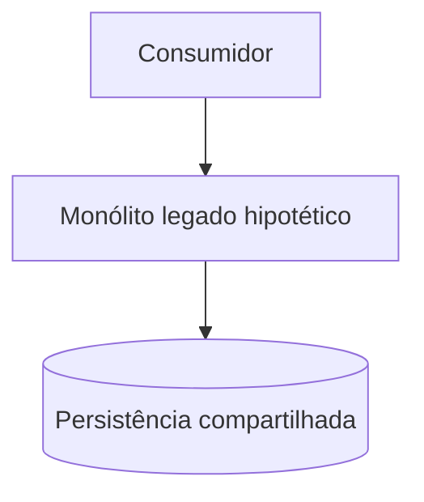
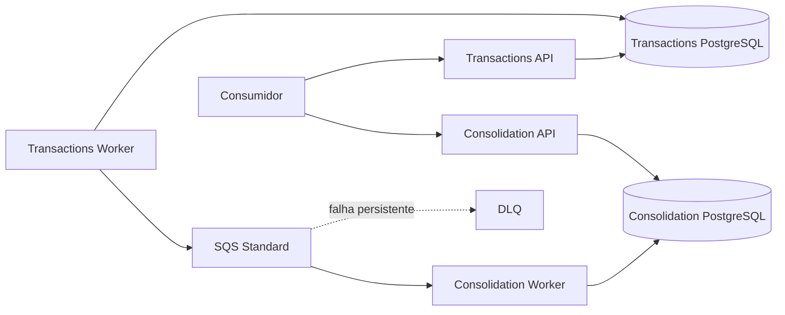

# Arquitetura de Transição — Cenário Hipotético

- **Classificação:** DIFERENCIAL do desafio de Solutions Architect
- **Status:** HIPÓTESE DOCUMENTAL — não é requisito do enunciado

## 1. Limite

O desafio não informa legado, monólito ou migração. Este cenário existe apenas para demonstrar como a arquitetura-alvo poderia orientar uma transição; não justifica as decisões principais e não afirma fatos sobre o cliente.

## 2. Estado hipotético

Considere, somente para análise, uma solução em que Lançamentos e Consolidação compartilham processo/deployment e persistência. Uma falha ou manutenção pode então afetar ambas as capacidades.

## 3. Estado-alvo do desafio

São 2 serviços de negócio e 4 processos executáveis. Outbox evita dual write ingênuo; SQS desacopla disponibilidade; consumidor idempotente tolera redelivery; reconciliação usa Lançamentos como fonte de verdade.

## 4. Relação com drivers reais

| Hipótese de problema legado | Resposta alvo | Driver real |
|---|---|---|
| falha compartilhada | serviços independentes | RNF-001 / ASR-001 |
| dual write | Transactional Outbox | RNF-004 / ASR-002 |
| Consolidação bloqueia registro | SQS/backlog | RNF-001/005/007 |
| duplicação no retry | idempotência | RNF-006 / ASR-004 |
| divergência difícil de detectar | observabilidade + reconciliação | RNF-010 / ASR-009 |

## 5. Fora do escopo

Sem cronograma, ondas, cutover, migração de dados, coexistência, CDC ou código de migração. Essas decisões exigiriam inventário e requisitos do legado inexistentes no enunciado.

O diferencial demonstra raciocínio de transição sem transformar hipótese em requisito.