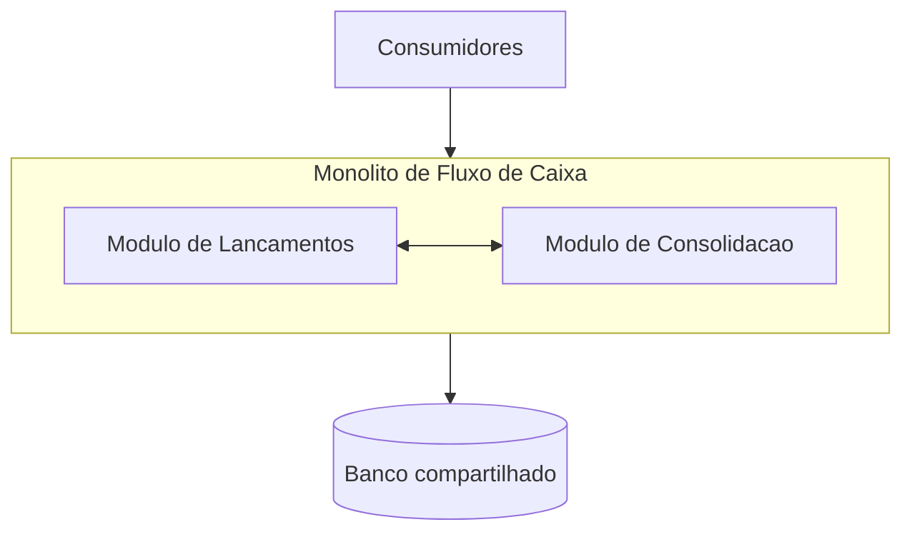
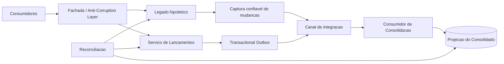
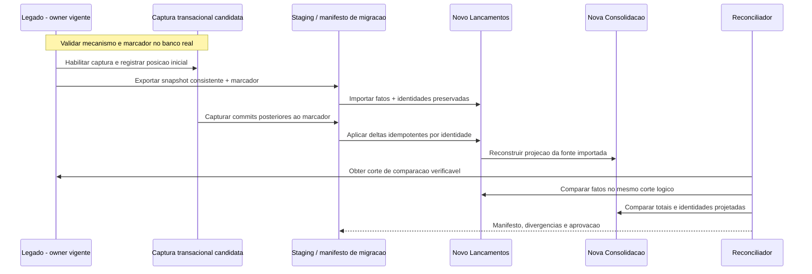
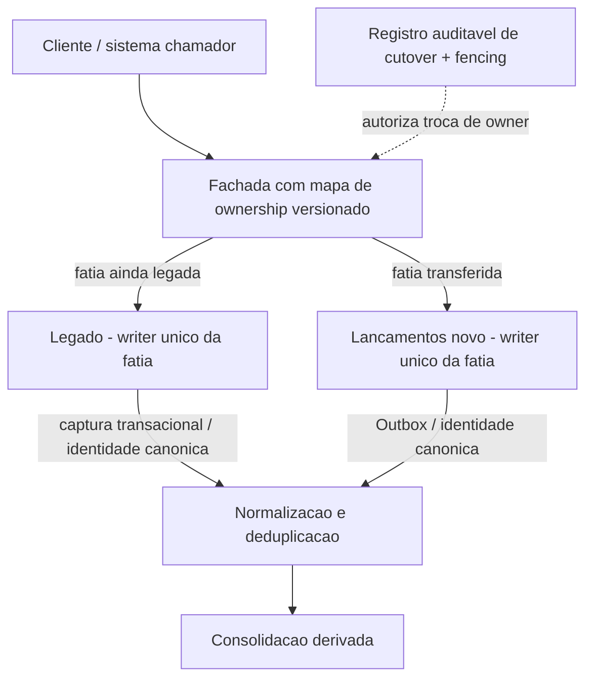

# Arquitetura de Transição — cenário hipotético de legado

O desafio de Arquitetura de Soluções apresenta como diferencial o **desenho de uma Arquitetura de Transição, se necessária, considerando uma migração de legado**. O case não informa que exista um sistema legado nem descreve sua tecnologia. Portanto, esta visão é deliberadamente **hipotética**: demonstra como eu conduziria a transição caso as capacidades de Lançamentos e Consolidação estivessem hoje em um monólito com limitações incompatíveis com os requisitos do desafio.

Este documento não descreve passagem do ambiente local para AWS e não é um roadmap futuro da solução entregue.

## Baseline hipotético — como seria o monólito atual

Para tornar a decisão de transição verificável, parte-se do menor conjunto de problemas que explica a necessidade arquitetural expressa pelo case, sem atribuí-los a um sistema real não fornecido.

Nesse baseline hipotético, Lançamentos e Consolidação fazem parte da mesma unidade de deploy e compartilham recursos de aplicação e persistência. Isso cria cinco limitações relevantes para os requisitos do case:

1. **Falha compartilhada:** uma falha, saturação ou manutenção relacionada à Consolidação pode degradar ou indisponibilizar o caminho de Lançamentos, contrariando o requisito explícito de que Lançamentos permaneça disponível quando o Consolidado cair.
2. **Escalabilidade acoplada:** o pico de consultas do Consolidado não pode ser tratado escalando apenas a capacidade de leitura; seria necessário escalar o monólito inteiro e, potencialmente, continuar disputando o mesmo banco.
3. **Competição por recursos:** consultas/agregações do Consolidado e gravações financeiras disputam CPU, conexões, locks e I/O do mesmo conjunto de recursos, tornando um pico de leitura capaz de afetar a escrita crítica.
4. **Deploy e mudança acoplados:** uma alteração no relatório/consolidação exige promover a mesma unidade que registra lançamentos, ampliando blast radius e reduzindo autonomia de evolução.
5. **Ownership de dados difuso:** com persistência compartilhada, módulos podem depender de tabelas internas uns dos outros, dificultando definir Lançamentos como fonte financeira e Consolidação como projeção reconstruível.

Essas características são **premissas do cenário hipotético**, não fatos sobre um legado fornecido pelo desafio. Se um legado real existisse, a primeira atividade seria confirmar ou refutar cada uma delas por inventário de código, banco, integrações, volume, SLAs e incidentes.

## Estado alvo da transição

A arquitetura alvo separa duas capacidades de negócio: **Controle de Lançamentos**, responsável pela fonte financeira, e **Consolidação Diária**, responsável por uma projeção eventual e reconstruível. A confirmação de um lançamento não chama a Consolidação. A propagação ocorre de forma assíncrona e recuperável, permitindo escalar, implantar e recuperar as capacidades de maneira independente.

O objetivo da transição não é “transformar monólito em microsserviços” como fim em si mesmo. É remover especificamente o acoplamento que impede independência de disponibilidade, escala e evolução exigida pelo problema.

## Estado de coexistência

A **Fachada/Anti-Corruption Layer** mantém um contrato estável para consumidores durante a coexistência e impede que o modelo do legado contamine os novos contextos. O ponto mais importante é ownership: em qualquer instante, cada lançamento possui **uma única fonte autoritativa**. Não existe período em que legado e novo serviço gravam autoritativamente o mesmo fato.

Para fatos cujo owner ainda seja o legado, mudanças destinadas à nova Consolidação saem por mecanismo confiável compatível com o sistema real — CDC, log transacional ou publicação transacional, conforme o que o inventário permitir. Não se escolhe CDC antecipadamente como dogma. Para fatos cujo owner já seja o novo serviço, a propagação usa o Transactional Outbox da arquitetura proposta.

A nova Consolidação pode ser introduzida antes de transferir a escrita de Lançamentos porque ela é uma projeção. Ela é carregada a partir da fonte autoritativa, passa a receber mudanças incrementais e é reconciliada em paralelo. Isso permite validar o comportamento de leitura sem colocar imediatamente a gravação financeira em risco.

## Estratégia incremental de extração

A sequência arquitetural é:

1. **Descobrir e estabilizar a fronteira:** inventariar contratos, tabelas, consumidores e regras do legado; introduzir fachada/ACL onde necessário e identificar a fonte financeira autoritativa.
2. **Separar a leitura derivada:** construir a nova Consolidação a partir dos fatos do owner vigente, carregar snapshot inicial, capturar deltas e reconciliar. Enquanto não houver confiança, consumidores continuam lendo pelo caminho anterior.
3. **Migrar a leitura do Consolidado:** após reconciliação e critérios de capacidade, direcionar consultas para a nova projeção. O legado ainda pode continuar owner de Lançamentos.
4. **Extrair Lançamentos:** transferir a escrita por fatias controladas de tráfego/consumidores para o novo serviço. A partir do corte de uma fatia, somente o novo serviço é owner daqueles fatos e publica via Outbox.
5. **Retirar responsabilidades antigas:** remover caminhos do legado apenas depois de comprovar ausência de consumidores dependentes, reconciliação financeira e capacidade de rollback compatível com o ownership já transferido.

Essa ordem reduz risco porque extrai primeiro a capacidade derivada e só depois muda o caminho crítico de escrita.

## Princípios e critérios de corte

- **Sem big bang:** coexistência controlada reduz blast radius.
- **Um owner por fato:** não há dual write autoritativo.
- **Sem dual write inseguro:** mudanças cruzam a fronteira por mecanismo recuperável.
- **Idempotência ponta a ponta:** redelivery não cria novo efeito financeiro.
- **Reconciliação antes do corte:** snapshot + deltas precisam convergir com a fonte autoritativa.
- **Observabilidade de transição:** uma operação precisa ser rastreável entre fronteiras enquanto houver coexistência.
- **Sem dependência permanente do schema legado:** leitura direta de tabelas pode existir somente como mecanismo transitório explicitamente controlado, nunca como contrato definitivo dos novos serviços.

Uma responsabilidade só deixa o legado quando contratos funcionais estão validados, identidades financeiras são preservadas, reconciliação não apresenta divergência inexplicada, retries/redelivery são idempotentes, capacidade exigida foi medida e não existem consumidores conhecidos dependentes do contrato a retirar.

## Rollback durante a transição

Rollback é definido por ownership, não por “voltar tudo”. Antes de transferir a autoridade de uma fatia, a fachada pode retornar tráfego ao legado. Depois que o novo serviço se torna owner e começa a confirmar fatos, esses fatos **não são apagados nem copiados de volta por rollback de aplicação**. Uma reversão deve preservar o novo owner para os fatos já confirmados ou executar um procedimento explícito de migração/reconciliação antes de alterar novamente a autoridade.

## Plano executável de migração histórica e coexistência (proposta condicionada)

> **Status:** runbook de arquitetura para um **legado hipotético**. Não há inventário real, execução de CDC, migração de histórico, gateway de roteamento, automação de cutover ou ensaio de rollback desta transição. Os passos abaixo são **critérios de projeto e homologação**, não alegações sobre o código entregue.

### 1. Inventário obrigatório antes de definir a estratégia

| Evidência a coletar no legado real | Por que importa | Saída / gate |
|---|---|---|
| Tabelas, chaves primárias, índices, transações e regras de negócio | Determinar fonte autoritativa e preservar identidade financeira | Dicionário de dados e mapa de ownership aprovados |
| Formato monetário, precisão, sinal de débito/crédito, moeda e timezone | Evitar divergência de valor e BusinessDate | Matriz de transformação com casos de borda |
| Histórico, retenção, volume diário, picos e registros inválidos | Dimensionar snapshot, captura de deltas e janela de migração | Perfil de dados, exceções classificadas e capacidade estimada |
| Canais de escrita, integrações, jobs, relatórios e usuários | Evitar writers ocultos e consumidores esquecidos | Catálogo de dependências com responsáveis |
| Mecanismo de captura disponível (CDC, log, outbox, export incremental) | Escolher captura confiável sem lacunas de commits | Prova de conceito com ordem, offsets e retenção |
| SLAs, RTO/RPO, política de corte e janela permitida | Definir parada admissível e reversão | Aprovação do negócio e da operação |
| Dados pessoais, auditoria e conformidade | Limitar acesso ao histórico e às evidências | Política de acesso, criptografia e retenção aprovada |

**Gate G0 — descoberta:** não iniciar migração de produção enquanto fonte, owners, contratos, mecanismo de captura e critérios financeiros de reconciliação não estiverem documentados. Não presumir que `updated_at` é watermark confiável: pode não refletir deletes, commits fora de ordem, backfills ou transações tardias.

### 2. Estratégia de dados históricos: snapshot + deltas sem janela perdida

A estratégia candidata é **snapshot consistente com marcador de captura durável**. O marcador deve representar uma posição transacional/log de origem adequada ao banco real (por exemplo, LSN/SCN/offset conforme tecnologia), não apenas um timestamp de aplicação. A viabilidade e a semântica de snapshot/captura precisam ser demonstradas no legado específico.

**Sequência normativa candidata:**

1. Identificar a fonte de verdade de cada partição/fatia de dados e bloquear writers não catalogados. Definir `migration_run_id`, versão de mapeamento e destino isolado.
2. Habilitar captura durável antes do snapshot; comprovar que o marcador cobre **todas** as transações que podem ficar fora da fotografia. Registrar posição inicial, retenção e lag da captura.
3. Extrair snapshot sob consistência transacional adequada, sem bloquear desnecessariamente a operação; registrar início/fim, contagem, somas, hash determinístico, partições e posição de captura.
4. Transformar e carregar em staging; rejeitar/quarentenar registros sem identidade, valores inválidos ou datas ambíguas. Não inventar chaves ou arredondar valores silenciosamente.
5. Importar no destino por lotes **idempotentes**, preservando chave legada e mapeamento estável para `transactionId`/eventId. Garantir unicidade e checkpoint por lote; repetir lote não deve duplicar fatos.
6. Reproduzir deltas **após o marcador**, incluindo updates/deletes do legado se existirem: convertê-los em semântica financeira explicitamente aprovada ou bloquear a migração desses casos. O case novo é imutável e **não suporta estorno**; não tratar mutações históricas como se fossem compatíveis automaticamente.
7. Quando o destino alcançar um marcador de corte verificável, congelar logicamente o conjunto de comparação, reconciliar fonte e destino no **mesmo horizonte** e construir a Consolidação por geração a partir do novo Lançamentos.
8. Continuar captura enquanto o legado for owner. Apenas após aprovação de reconciliação, ensaio de carga e aceite funcional liberar a próxima fatia.

**Risco fundamental:** não é seguro publicar simultaneamente todos os fatos do CDC e da Outbox nova para a mesma projeção sem uma identidade financeira canônica e regra de owner. Durante coexistência, o roteamento deve produzir **um único fluxo lógico de fatos**, mesmo que existam duas origens físicas. A transformação e o consumidor devem rejeitar colisões com payload divergente.

### 3. Manifesto, rastreabilidade e reconciliação

Cada execução deve produzir um manifesto **durável e imutável**, protegido por acesso mínimo, com: `migration_run_id`, versão do mapeamento, sistema de origem, fatia, marcador inicial/final, instante do snapshot, contagem extraída/importada/rejeitada, somas de créditos/débitos por BusinessDate, hash canônico ordenado, posição do último delta aplicado, divergências, aprovadores, timestamps e decisão final.

| Verificação | Como medir | Condição para avançar |
|---|---|---|
| Completude | Conjunto de identidades origem versus destino no mesmo marcador | Nenhuma identidade financeira inexplicadamente ausente ou extra |
| Integridade monetária | Somatório de créditos e débitos por dia e moeda; valores por identidade | Igualdade exata após regra de transformação aprovada |
| Duplicação | Unicidade da chave canônica e contagem de replay sem novo efeito | Zero duplicidade financeira |
| Correção semântica | Tipo, sinal, precisão, timezone e BusinessDate | Nenhuma transformação divergente sem aceite explícito |
| Consistência da projeção | Totais do destino versus soma dos fatos importados | Igualdade no corte e sem lacunas na geração |
| Operação incremental | Lag de captura, erro por lote, DLQ e avanço de checkpoint | Dentro de limites acordados; sem backlog irrecuperável |
| Segurança | Evidências de acesso, criptografia e rastreio de mudanças | Controles revisados por segurança/operação |

**Divergências:** classificar em (a) dado inválido de origem, (b) mapeamento incorreto, (c) delta ainda não aplicado, (d) duplicidade, (e) alteração retroativa, (f) diferença de corte. Cada ocorrência recebe identidade, responsável e decisão; **não zerar diferenças por tolerância monetária genérica**. O critério proposto para integridade financeira é **zero divergência inexplicada**. Limites de tempo/lag são definidos com o negócio após medir volume real.

### 4. Fatiamento, ownership e roteamento

O cutover pode ser por loja, conta, caixa, comerciante ou outra chave **somente se o legado real oferecer fronteira estável de ownership**. O case implementado suporta um único comerciante/caixa; fatiamento multi-tenant **não está implementado** e exigiria evolução explícita de identidade, particionamento e contratos. Na ausência de chave segura, considerar janela controlada de corte integral da escrita, em vez de prometer canário por fatias.

**Protocolo de transferência de uma fatia:**

1. Preparar a fatia e publicar versão do mapa de ownership em estado `PREPARED`; conferir que **todos** os writers usam a fachada ou um controle equivalente.
2. Suspender novas escritas da fatia no owner antigo e **drenar transações em voo**, incluindo retries e jobs. Respostas de indisponibilidade temporária devem ser explícitas e idempotentes.
3. Capturar marcador final do legado, aplicar todos os deltas até ele e reconciliar o destino. Se a reconciliação falhar, **não transferir ownership**.
4. Registrar transição atômica e auditável do owner com geração/fencing; ativar somente o novo writer para a fatia. Requisições com chave já confirmada no legado devem preservar o mesmo resultado, sem criar novo fato.
5. Executar smoke tests, observar erros, latência, Outbox, DLQ e reconciliação; aumentar exposição somente após gate de aprovação.

O mapa de ownership deve ser **durável e monotônico**; um cache desatualizado não pode permitir que o legado e o novo serviço aceitem simultaneamente a mesma fatia. O mecanismo concreto de fencing depende dos contratos e infraestrutura do legado real.

### 5. Fases, responsáveis e critérios de saída

| Fase | Estado | Trabalho verificável | Gate de saída |
|---|---|---|---|
| F0 — Descoberta | Legado owner | Inventário, qualidade, dependências, contratos e risco | G0: baseline assinado |
| F1 — Preparação | Legado owner | Fachada/ACL, captura, staging, identidades e telemetria | G1: captura sem lacuna demonstrada |
| F2 — Backfill | Legado owner | Snapshot, importação idempotente, deltas e manifesto | G2: histórico reconciliado |
| F3 — Leitura paralela | Legado owner | Projeção nova, shadow reads sem efeito no cliente, ensaio de 50 GET/s | G3: consistência e desempenho aprovados |
| F4 — Corte da leitura | Legado owner | Redirecionar consultas, monitorar e reverter rota se necessário | G4: janela de observação aprovada |
| F5 — Corte da escrita | Novo owner por fatia/corte | Drenar, checkpoint, reconciliar, fencing e abrir escrita | G5: único writer e zero divergência |
| F6 — Estabilização | Novo owner | Monitorar, reconciliar e validar consumidores dependentes | G6: janela operacional e aceite |
| F7 — Desativação | Novo owner | Arquivar evidências, remover rotas e acessos antigos | G7: aprovação de negócio, operação e segurança |

**Papéis propostos:** negócio/financeiro aprova semântica e reconciliação; responsável do legado confirma captura, writers e histórico; arquitetura define ownership e contratos; engenharia de dados executa backfill/deltas; SRE/DBA conduz backup, capacidade e cutover; segurança revisa acesso e retenção. Não se presume que essas equipes existam com tais nomes na organização do desafio.

### 6. Rollback por fase e limite de reversibilidade

| Situação | Reversão segura | Proibição |
|---|---|---|
| F1–F3, sem tráfego novo | Desativar captura/consumo novo e descartar staging/projeção candidata, preservando evidências | Alterar fatos legados para ajustar o destino |
| F4, somente leitura migrada | Retornar consultas ao legado, mantendo captura e comparações até estabilizar | Assumir que uma leitura eventual equivale à fonte autoritativa |
| F5 antes da primeira escrita confirmada no novo owner | Se fencing e checkpoint estiverem comprovados, reverter mapa de rota sob bloqueio controlado | Reabrir dois writers simultâneos |
| F5/F6 **após escrita confirmada no novo owner** | **Forward fix** ou plano de migração reversa auditado: bloquear escrita, capturar fatos novos, reconciliar e transferir owner com novo fencing | Simples rollback de rota, restauração de backup antigo ou dual write |
| Falha na nova projeção | Retornar leitura ao legado enquanto mantém a fonte financeira vigente; reconstruir projeção | Reverter lançamentos financeiros confirmados |
| Falha de banco da fonte | Acionar runbook específico de restore, com RPO/RTO e investigação de fatos pós-ponto | Tratar restore de banco como rollback de deploy |

**Ponto de não retorno operacional:** o primeiro fato confirmado pelo novo owner torna insuficiente um simples rollback de aplicação ou DNS. A reversão de autoridade requer migração reversa com identidade preservada, reconciliação e aprovação explícita.

### 7. Ensaios de falha obrigatórios antes de produção

- Snapshot interrompido, lote reexecutado e CDC retomado do checkpoint sem lacunas/duplicação.
- Evento duplicado, fora de ordem, com payload divergente e com identidade legada colidida.
- Alteração retroativa ou exclusão de origem: rejeição/quarentena até regra financeira aprovada.
- Cutover interrompido entre drenagem e ativação; fencing impede dois writers.
- Retry de requisição confirmada antes do corte; resposta preservada sem duplicar fato.
- Projeção indisponível durante a escrita; Lançamentos continua aceitando fatos.
- Falha de reconciliação: bloqueio automático do gate de cutover.
- Falha após o primeiro commit no novo owner: simular forward fix sem voltar rota inseguramente.
- Pico de consulta e ingestão concorrente; comprovar SLOs no ambiente e volume representativos.

**Evidências esperadas:** logs sem dados sensíveis, métricas de lag, relatórios de comparação, hashes/contagens, decisões de gate, versão do mapa de ownership, registros de incidente e aprovações. Esses ensaios **não foram executados** para o legado hipotético.

### 8. Condições que podem invalidar esta estratégia

A migração descrita depende de existir acesso transacional suficiente à origem e uma forma de correlacionar identidades financeiras. Se o legado não fornecer captura confiável, identidades estáveis ou bloqueio de writers, é necessário redesenhar o plano: por exemplo, exportação em janela de manutenção com escrita suspensa e comparação integral. **Não substituir ausência de CDC por polling de timestamp sem provar ausência de lacunas.** A necessidade de estorno, fechamento, múltiplos caixas ou moeda altera o modelo do case e requer nova decisão de negócio antes de migrar histórico incompatível.

**Rastreabilidade:** [capacidades e domínios](capacidades-e-dominios.md) → [DAS](das.md) → [visão de integração](../04-visoes/visao-integracao.md) → [recuperação e reconciliação](../07-infraestrutura/recuperacao-e-reconciliacao.md). Migração de legado, rebuild de projeção e restore da fonte são **três procedimentos diferentes** e não devem ser confundidos.

## O que só poderia ser decidido com um legado real

Stack, banco, volume, qualidade das identidades existentes, mecanismo de captura, possibilidade de CDC, granularidade das fatias, duração de coexistência e estratégia de cutover dependem do inventário real. O desenho deliberadamente não inventa essas respostas. Ele define as invariantes que uma migração segura precisa preservar.