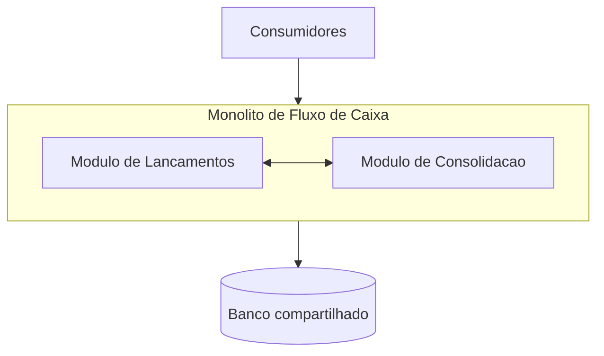

# Arquitetura de Transição — cenário hipotético de legado

O desafio de Arquitetura de Soluções apresenta como diferencial o **desenho de uma Arquitetura de Transição, se necessária, considerando uma migração de legado**. O case não informa que exista um sistema legado nem descreve sua tecnologia. Portanto, esta visão é deliberadamente **hipotética**: demonstra como eu conduziria a transição caso as capacidades de Lançamentos e Consolidação estivessem hoje em um monólito com limitações incompatíveis com os requisitos do desafio.

Este documento não descreve passagem do ambiente local para AWS e não é um roadmap futuro da solução entregue.

## Baseline hipotético — como seria o monólito atual

Para tornar a decisão de transição verificável, parte-se do menor conjunto de problemas que explica a necessidade arquitetural expressa pelo case, sem atribuí-los a um sistema real não fornecido.

Nesse baseline hipotético, Lançamentos e Consolidação fazem parte da mesma unidade de deploy e compartilham recursos de aplicação e persistência. Isso cria cinco limitações relevantes para os requisitos do case:

1. **Falha compartilhada:** uma falha, saturação ou manutenção relacionada à Consolidação pode degradar ou indisponibilizar o caminho de Lançamentos, contrariando o requisito explícito de que Lançamentos permaneça disponível quando o Consolidado cair.
2. **Escalabilidade acoplada:** o pico de consultas do Consolidado não pode ser tratado escalando apenas a capacidade de leitura; seria necessário escalar o monólito inteiro e, potencialmente, continuar disputando o mesmo banco.
3. **Competição por recursos:** consultas/agregações do Consolidado e gravações financeiras disputam CPU, conexões, locks e I/O do mesmo conjunto de recursos, tornando um pico de leitura capaz de afetar a escrita crítica.
4. **Deploy e mudança acoplados:** uma alteração no relatório/consolidação exige promover a mesma unidade que registra lançamentos, ampliando blast radius e reduzindo autonomia de evolução.
5. **Ownership de dados difuso:** com persistência compartilhada, módulos podem depender de tabelas internas uns dos outros, dificultando definir Lançamentos como fonte financeira e Consolidação como projeção reconstruível.

Essas características são **premissas do cenário hipotético**, não fatos sobre um legado fornecido pelo desafio. Se um legado real existisse, a primeira atividade seria confirmar ou refutar cada uma delas por inventário de código, banco, integrações, volume, SLAs e incidentes.

## Estado alvo da transição

A arquitetura alvo separa duas capacidades de negócio: **Controle de Lançamentos**, responsável pela fonte financeira, e **Consolidação Diária**, responsável por uma projeção eventual e reconstruível. A confirmação de um lançamento não chama a Consolidação. A propagação ocorre de forma assíncrona e recuperável, permitindo escalar, implantar e recuperar as capacidades de maneira independente.

O objetivo da transição não é “transformar monólito em microsserviços” como fim em si mesmo. É remover especificamente o acoplamento que impede independência de disponibilidade, escala e evolução exigida pelo problema.

## Estado de coexistência

A **Fachada/Anti-Corruption Layer** mantém um contrato estável para consumidores durante a coexistência e impede que o modelo do legado contamine os novos contextos. O ponto mais importante é ownership: em qualquer instante, cada lançamento possui **uma única fonte autoritativa**. Não existe período em que legado e novo serviço gravam autoritativamente o mesmo fato.

Para fatos cujo owner ainda seja o legado, mudanças destinadas à nova Consolidação saem por mecanismo confiável compatível com o sistema real — CDC, log transacional ou publicação transacional, conforme o que o inventário permitir. Não se escolhe CDC antecipadamente como dogma. Para fatos cujo owner já seja o novo serviço, a propagação usa o Transactional Outbox da arquitetura proposta.

A nova Consolidação pode ser introduzida antes de transferir a escrita de Lançamentos porque ela é uma projeção. Ela é carregada a partir da fonte autoritativa, passa a receber mudanças incrementais e é reconciliada em paralelo. Isso permite validar o comportamento de leitura sem colocar imediatamente a gravação financeira em risco.

## Estratégia incremental de extração

A sequência arquitetural é:

1. **Descobrir e estabilizar a fronteira:** inventariar contratos, tabelas, consumidores e regras do legado; introduzir fachada/ACL onde necessário e identificar a fonte financeira autoritativa.
2. **Separar a leitura derivada:** construir a nova Consolidação a partir dos fatos do owner vigente, carregar snapshot inicial, capturar deltas e reconciliar. Enquanto não houver confiança, consumidores continuam lendo pelo caminho anterior.
3. **Migrar a leitura do Consolidado:** após reconciliação e critérios de capacidade, direcionar consultas para a nova projeção. O legado ainda pode continuar owner de Lançamentos.
4. **Extrair Lançamentos:** transferir a escrita por fatias controladas de tráfego/consumidores para o novo serviço. A partir do corte de uma fatia, somente o novo serviço é owner daqueles fatos e publica via Outbox.
5. **Retirar responsabilidades antigas:** remover caminhos do legado apenas depois de comprovar ausência de consumidores dependentes, reconciliação financeira e capacidade de rollback compatível com o ownership já transferido.

Essa ordem reduz risco porque extrai primeiro a capacidade derivada e só depois muda o caminho crítico de escrita.

## Princípios e critérios de corte

- **Sem big bang:** coexistência controlada reduz blast radius.
- **Um owner por fato:** não há dual write autoritativo.
- **Sem dual write inseguro:** mudanças cruzam a fronteira por mecanismo recuperável.
- **Idempotência ponta a ponta:** redelivery não cria novo efeito financeiro.
- **Reconciliação antes do corte:** snapshot + deltas precisam convergir com a fonte autoritativa.
- **Observabilidade de transição:** uma operação precisa ser rastreável entre fronteiras enquanto houver coexistência.
- **Sem dependência permanente do schema legado:** leitura direta de tabelas pode existir somente como mecanismo transitório explicitamente controlado, nunca como contrato definitivo dos novos serviços.

Uma responsabilidade só deixa o legado quando contratos funcionais estão validados, identidades financeiras são preservadas, reconciliação não apresenta divergência inexplicada, retries/redelivery são idempotentes, capacidade exigida foi medida e não existem consumidores conhecidos dependentes do contrato a retirar.

## Rollback durante a transição

Rollback é definido por ownership, não por “voltar tudo”. Antes de transferir a autoridade de uma fatia, a fachada pode retornar tráfego ao legado. Depois que o novo serviço se torna owner e começa a confirmar fatos, esses fatos **não são apagados nem copiados de volta por rollback de aplicação**. Uma reversão deve preservar o novo owner para os fatos já confirmados ou executar um procedimento explícito de migração/reconciliação antes de alterar novamente a autoridade.

## O que só poderia ser decidido com um legado real

Stack, banco, volume, qualidade das identidades existentes, mecanismo de captura, possibilidade de CDC, granularidade das fatias, duração de coexistência e estratégia de cutover dependem do inventário real. O desenho deliberadamente não inventa essas respostas. Ele define as invariantes que uma migração segura precisa preservar.