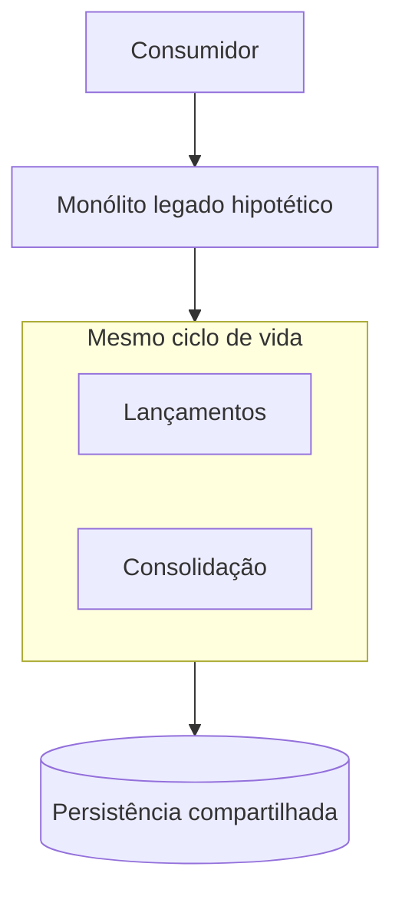
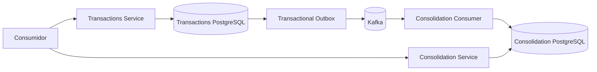

# Arquitetura de Transição — Cenário Hipotético

- **Classificação:** DIFERENCIAL do desafio de Solutions Architect
- **Status:** HIPÓTESE DOCUMENTAL — não é requisito informado pelo enunciado

## 1. Limite da hipótese

O desafio não informa a existência de sistema legado, arquitetura monolítica ou processo de migração. Este documento apresenta deliberadamente um **cenário hipotético** apenas para demonstrar o diferencial de arquitetura de transição.

A hipótese não altera os requisitos funcionais, não cria um projeto de migração e não é utilizada como justificativa primária para a arquitetura-alvo.

## 2. Estado atual hipotético

Para fins de demonstração, considera-se uma solução legada monolítica em que:

- Lançamentos e Consolidação executam no mesmo processo/ciclo de deployment;
- responsabilidades possuem alto acoplamento operacional;
- a persistência é compartilhada;
- falhas ou manutenção podem afetar simultaneamente registro e consolidação;
- existe histórico hipotético de inconsistência/perda de dados entre o registro de lançamentos e sua consolidação.

Nenhuma dessas características é afirmada pelo case; todas pertencem exclusivamente ao cenário hipotético deste diferencial.

## 3. Arquitetura-alvo

A arquitetura-alvo do desafio possui duas unidades independentes alinhadas às capacidades de negócio:

A separação permite que a indisponibilidade da consolidação não interrompa o registro de novos lançamentos. A persistência local do lançamento e da intenção de publicação reduz o risco de perda entre confirmação e integração; a entrega assíncrona permite recuperação de backlog; e o processamento idempotente evita dupla contabilização em redelivery/reprocessamento.

## 4. Relação entre transição e requisitos do desafio

| Problema do cenário hipotético | Resposta na arquitetura-alvo | Driver real do desafio |
|---|---|---|
| ciclo de falha compartilhado | serviços/deployables independentes | RNF-001 / ASR-001 |
| risco entre persistir lançamento e disponibilizá-lo à consolidação | persistência durável + Transactional Outbox | RNF-004 / ASR-002 |
| consolidação indisponível bloquear fluxo | integração assíncrona e backlog recuperável | RNF-001, RNF-005, RNF-007 |
| reprocessamento duplicar efeito | consumidor idempotente + `ProcessedEvent` | RNF-006 / ASR-004 |
| dificuldade de diagnóstico | logs, métricas, traces, backlog/lag/freshness | RNF-010 / ASR-009 |

## 5. O que este diferencial não fará

Não será definido neste desafio:

- cronograma de migração;
- ondas/fases de transformação;
- estratégia de cutover detalhada;
- migração real de banco legado;
- coexistência operacional com um sistema existente;
- regras de negócio adicionais para suportar legado;
- código específico de migração.

Esses elementos dependeriam de informações de legado que o enunciado não fornece.

## 6. Critério arquitetural

O cenário hipotético demonstra que a arquitetura-alvo suporta uma possível modernização de uma solução acoplada para capacidades operacionalmente independentes, mas **todas as decisões principais da solução continuam derivadas dos requisitos e ASRs reais do desafio**.