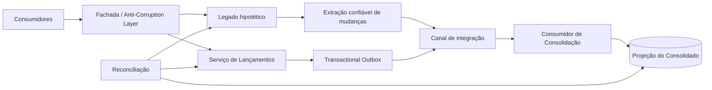

# Arquitetura de Transição — cenário hipotético de legado

O desafio de Arquitetura de Soluções apresenta como diferencial o **desenho de uma Arquitetura de Transição, se necessária, considerando uma migração de legado**. O case não informa a existência de um sistema legado. Portanto, esta visão é deliberadamente **hipotética** e serve apenas para demonstrar como a transição seria arquitetada caso o controle de lançamentos e o consolidado diário existissem em uma aplicação legada.

Este documento não descreve a passagem do ambiente local para AWS e não representa um plano de evolução futura da solução entregue.

## Cenário hipotético

Assume-se, exclusivamente para esta representação, um sistema legado monolítico no qual:

- lançamentos e consolidação compartilham aplicação e persistência;
- regras de negócio e ownership de dados não estão claramente separados;
- integrações podem depender diretamente do modelo interno do legado;
- substituir o sistema inteiro de uma vez criaria risco desnecessário para o registro financeiro.

O objetivo da transição é permitir a coexistência controlada entre o legado e a arquitetura-alvo enquanto se preservam identidade dos lançamentos, rastreabilidade e uma única fonte autoritativa para cada dado.

## Desenho de transição

A **Fachada/Anti-Corruption Layer** impede que consumidores precisem conhecer simultaneamente contratos internos do legado e dos novos serviços. O ownership deve ser explícito: durante qualquer coexistência, um lançamento não pode ter dois sistemas gravando-o como fonte autoritativa.

Para dados ainda pertencentes ao legado, alterações destinadas à nova projeção devem sair por um mecanismo confiável compatível com as capacidades reais do sistema existente — por exemplo, CDC ou publicação transacional quando tecnicamente possível — evitando dual write não atômico. Para lançamentos já pertencentes ao novo serviço, o mecanismo é o Transactional Outbox da arquitetura-alvo.

A Consolidação é tratada como projeção reconstruível. Eventos provenientes da fronteira de transição precisam manter identidade estável e processamento idempotente, permitindo redelivery sem duplicar efeito financeiro. A reconciliação compara a fonte autoritativa com a projeção antes de retirar qualquer responsabilidade do legado.

## Princípios de decisão

- **Sem big bang:** a arquitetura permite coexistência para reduzir risco, mas este case não define cronograma ou fases de migração.
- **Um owner por dado:** não existe escrita concorrente autoritativa no legado e no novo serviço para o mesmo lançamento.
- **Sem dual write inseguro:** propagação para a nova arquitetura usa mecanismo confiável de captura/publicação.
- **Idempotência ponta a ponta:** a mesma mudança pode ser entregue novamente sem produzir novo efeito financeiro.
- **Reconciliação antes da retirada do legado:** divergências precisam ser detectáveis e explicáveis.
- **Rollback arquitetural:** enquanto uma responsabilidade ainda não tiver sido definitivamente retirada do legado, a fachada mantém a possibilidade de direcionamento ao owner vigente sem reverter dados já assumidos pelo novo owner.
- **Sem acesso cruzado a tabelas:** novos serviços não passam a depender diretamente do schema interno do legado como solução permanente.

## Critérios para retirada de uma responsabilidade do legado

A responsabilidade só pode deixar o legado quando houver evidência de que:

1. a nova fonte preserva as identidades financeiras necessárias;
2. os contratos funcionais correspondentes estão validados;
3. a projeção pode ser reconciliada com a fonte autoritativa;
4. retries/redelivery não geram duplicidade;
5. observabilidade permite rastrear uma operação entre as duas fronteiras;
6. não há consumidor conhecido dependente do contrato ou da tabela legada que será retirada.

A tecnologia exata de captura do legado não é fixada neste desenho porque o case não fornece stack, banco, volume, contratos ou restrições do sistema hipotético. Escolher CDC, adaptador, fila ou outro mecanismo sem esse inventário seria inventar uma característica que o desafio não informou.