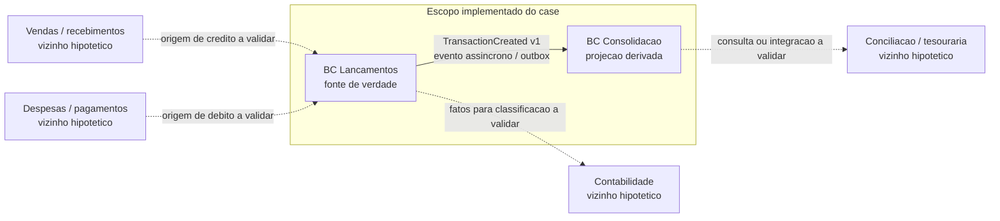
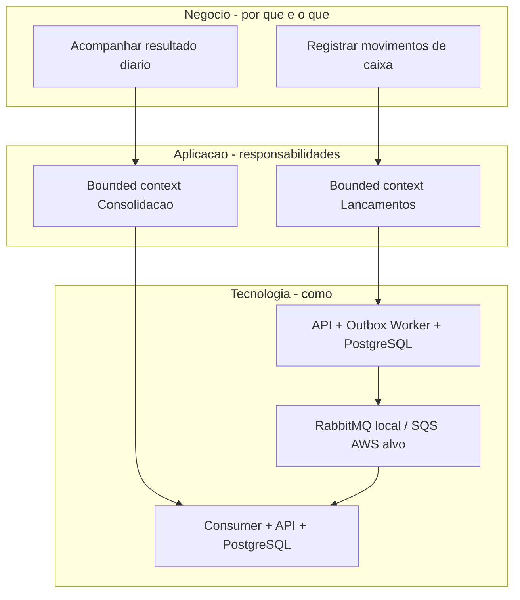

# Capacidades de negócio, cadeia de valor e domínios funcionais

> **Natureza da visão:** modelo de negócio de referência para o case de um comerciante, e **não** descoberta realizada com uma organização real. Os dois desafios especificam registro de débitos/créditos e consulta do consolidado diário; não identificam ERP, PDV, bancos, estrutura organizacional, canais de venda ou legado existentes. Toda integração ou área corporativa adicional abaixo é uma **hipótese a validar**, não funcionalidade entregue.

## 1. Objetivo e cadeia de valor do comerciante

**Objetivo de negócio coberto pelo case:** registrar movimentações financeiras de entrada e saída de forma confiável e permitir ao comerciante acompanhar o resultado do movimento por dia, mesmo que o relatório fique temporariamente indisponível.

A cadeia de valor abaixo é **ilustrativa** e serve para posicionar o recorte do desafio no contexto da operação comercial; suas etapas externas não são escopo implementado.

**Resultado de negócio:** confiabilidade do registro e visibilidade do saldo do movimento diário. O saldo apresentado é **créditos menos débitos do próprio dia**, não saldo bancário, saldo disponível para pagamento, previsão de caixa ou posição contábil conciliada. A disponibilidade de Lançamentos é independente da Consolidação; uma consulta pode estar defasada.

## 2. Mapa de capacidades de negócio (L1 → L2 → L3)

Capacidade de negócio descreve **o que a organização precisa conseguir fazer**, independentemente de API, banco, fila, cloud ou equipe de desenvolvimento. Os níveis abaixo são uma decomposição **proposta** para discussão com stakeholders, não capacidades organizacionais comprovadas.

| L1 — Macrocapacidade | L2 — Capacidade | L3 — Desdobramento de negócio | Cobertura neste case |
|---|---|---|---|
| Gestão financeira operacional | Gestão de movimentos de caixa | Registrar entrada/saída; identificar e consultar movimentações | **Implementado:** débito/crédito imutável, identidade, consultas |
| Gestão financeira operacional | Acompanhamento do movimento diário | Apurar entradas, saídas, quantidade e resultado líquido por dia | **Implementado:** projeção e consulta de consolidação diária |
| Gestão financeira operacional | Confiabilidade das informações financeiras | Preservar fatos confirmados; evitar contabilização duplicada; recuperar visão derivada | **Implementado tecnicamente:** outbox, idempotência e rebuild local; processo de negócio de conferência a validar |
| Gestão financeira operacional | Conferência e conciliação financeira | Comparar registros internos com comprovantes, extratos e fontes externas | **Vizinha hipotética:** não implementada; integrações e responsáveis a validar |
| Gestão financeira operacional | Planejamento e gestão de liquidez | Projetar entradas/saídas futuras e disponibilidade financeira | **Vizinha hipotética:** não implementada; saldo diário não equivale a previsão |
| Operação comercial | Gestão de vendas e recebimentos | Identificar eventos comerciais que podem originar créditos | **Vizinha hipotética:** origem e contrato a validar |
| Operação comercial | Gestão de despesas e pagamentos | Identificar eventos operacionais que podem originar débitos | **Vizinha hipotética:** origem e contrato a validar |
| Gestão e controle corporativo | Contabilidade e obrigações | Classificar fatos, gerar lançamentos contábeis e cumprir obrigações | **Vizinha hipotética:** não implementada; regras fiscais/contábeis a validar |

**Fora do mapa de capacidades de negócio:** JWT, ALB, NAT Gateway, PostgreSQL, SQS, monitoramento e deploy. São capacidades técnicas, mecanismos ou componentes de suporte. Segurança, observabilidade, backup e operação são **habilitadores transversais**; não substituem capacidades financeiras no mapa.

### Relação capacidade → valor → requisito → solução

| Capacidade do recorte | Valor para o comerciante | Requisitos | Responsabilidade da solução |
|---|---|---|---|
| Registrar movimentações | Não perder fatos financeiros confirmados | RN-001; RF-001/002/003 | Contexto Lançamentos, transação local, idempotência e Outbox |
| Apurar movimento diário | Visualizar créditos, débitos e saldo do dia | RN-002; RF-004/005/006 | Contexto Consolidação, projeção por data e consultas |
| Preservar continuidade de registro | Continuar recebendo fatos quando o relatório falhar | RNF de independência de disponibilidade | Confirmação local sem chamada síncrona à Consolidação |
| Preservar integridade da visão derivada | Evitar efeito financeiro duplicado e reconstruir resultado | Refinamento de integridade e recuperação | Consumidor idempotente, DLQ, geração de projeção e rebuild |
| Atender pico de consulta | Consultar consolidado sob carga exigida | RNF de 50 req/s e perda máxima de 5% | API de consulta e validação local de carga, sem extrapolação para AWS |

## 3. Domínios e subdomínios — modelo proposto

Os **subdomínios** abaixo descrevem responsabilidades de negócio. Os **bounded contexts implementados** são somente Lançamentos e Consolidação; não se presume que cada subdomínio precise virar microsserviço.

| Domínio / subdomínio | Responsabilidade e conceitos | Relação com o recorte | Situação |
|---|---|---|---|
| **Movimentação financeira — Registro de movimentos** | Fato financeiro, crédito, débito, valor, data de negócio, identidade | Origem autoritativa dos fatos do case | **Bounded context Lançamentos implementado** |
| **Informação financeira — Apuração diária** | Totais de créditos/débitos, contagem, saldo do movimento, data e geração | Projeção derivada dos fatos de Lançamentos | **Bounded context Consolidação implementado** |
| Movimentação financeira — Correções e estornos | Reversão, ajuste e justificativa de fatos | Possível evolução do registro; não inferir edição destrutiva | **Não implementado; decisão de negócio pendente** |
| Tesouraria — Conciliação | Correspondência entre movimentos, extratos e liquidação | Pode consumir ou questionar a completude dos dados | **Domínio vizinho hipotético** |
| Tesouraria — Previsão e liquidez | Saldos projetados, compromissos futuros e posição disponível | Não é atendido pelo saldo do movimento diário | **Domínio vizinho hipotético** |
| Comercial — Vendas/recebimentos | Venda, cobrança, recebimento e origem de crédito | Possível produtor de comandos; não demonstrado | **Domínio vizinho hipotético** |
| Compras/financeiro — Despesas/pagamentos | Despesa, obrigação e desembolso | Possível produtor de comandos; não demonstrado | **Domínio vizinho hipotético** |
| Contabilidade | Plano de contas, classificação, lançamentos contábeis | Possível consumidor de eventos ou relatórios; não demonstrado | **Domínio vizinho hipotético** |

**Lançamentos** decide se um comando de débito/crédito é válido conforme as regras adotadas e registra o fato. **Consolidação** deriva uma visão de leitura, sem alterar fatos nem autorizar novos lançamentos. Autenticação e observabilidade são responsabilidades transversais, **não subdomínios financeiros**.

## 4. Context map: limites, relações e ownership

**Relação efetiva entre contextos:** Lançamentos publica fatos confirmados; Consolidação os consome de modo assíncrono, com entrega pelo menos uma vez e deduplicação por identidade financeira. Lançamentos é **upstream autoritativo**; Consolidação é **downstream derivado**. O evento não representa liquidação bancária ou lançamento contábil. Não há escrita cruzada entre bancos de contextos.

**Linhas pontilhadas:** possibilidades de relacionamento empresarial que **não existem como integrações comprovadas**. A natureza do contrato (API, evento, arquivo, batch), ownership e SLA dependeria de descoberta com as áreas.

## 5. Processos e stakeholders a validar

| Processo / decisão | Stakeholder de referência — hipótese | Pergunta de descoberta | Consequência arquitetural |
|---|---|---|---|
| Origem dos créditos e débitos | Operação comercial e financeiro | Quem cria cada movimento e qual evento de negócio o justifica? | Identidade da origem, contratos e autorização |
| Data e fechamento de caixa | Tesouraria/financeiro | Dia financeiro segue calendário, turno ou fechamento? | BusinessDate, retroativos e reprocessamento |
| Ajustes e estornos | Financeiro e auditoria | Como corrigir um lançamento confirmado? | Modelo de eventos compensatórios, trilha de auditoria |
| Conciliação | Tesouraria e contabilidade | O que prova que o saldo está completo e reconciliado? | Indicadores de completude, reconciliação e exceções |
| Contas, lojas e unidades | Operação e controladoria | Há múltiplos caixas, filiais, moedas ou comerciantes? | Chaves, segregação e modelo de dados |
| Consumo do consolidado | Financeiro, gestão e BI | Quem consulta, em qual horário, e qual defasagem é tolerável? | SLO, escala, cache, apresentação e alertas |
| Integração corporativa | Arquitetura corporativa e responsáveis por sistemas | Existem ERP, PDV, bancos, adquirentes ou data platform? | Mapa de integrações, contratos e anticorrupção |
| Governança e conformidade | Segurança, jurídico e compliance | Quais requisitos de retenção, LGPD, auditoria e residência? | Política de dados, acesso e implantação |

Esses stakeholders são **papéis sugeridos**, não áreas confirmadas do comerciante do desafio. Nenhuma dessas respostas é pré-requisito para executar o recorte técnico já entregue; **são gates de descoberta para adoção corporativa**, não lacunas a esconder como simples exclusões de escopo.

## 6. Separação entre negócio, aplicação e tecnologia

O mapa de capacidades **não determina** por si só o número de serviços, bancos ou filas. A separação em dois bounded contexts foi escolhida para atender autonomia do registro e recuperação da projeção. A decisão de infraestrutura e seus custos requer análise separada: [DAS](das.md), [ADR-001](../06-adr/adr-001-estilo-arquitetural-e-decomposicao.md) e [estimativa AWS](../07-infraestrutura/estimativa-custos.md).

## 7. Premissas do desafio versus validação empresarial

- **Confirmado pelos desafios:** controle de lançamentos e relatório diário; independência do registro quando Consolidação falha; requisito de carga do Consolidado.
- **Decisões adotadas para implementar o case:** comerciante único, BRL, um caixa lógico, dia em America/Sao_Paulo, sem estorno, sem fechamento e sem saldo transportado. São premissas de solução, **não políticas corporativas verificadas**.
- **Hipóteses de ecossistema:** vendas, despesas, ERP, PDV, conciliação, tesouraria, bancos e contabilidade. Não constam como integrações reais dos PDFs e **não foram implementadas**.
- **Validação futura necessária:** processo real de origem, semântica de saldo, responsabilidades, eventos, reconciliação, dados históricos, controles de acesso, custos e metas operacionais.

**Critério de aceite desta visão:** o avaliador consegue seguir cadeia de valor → capacidade → subdomínio → bounded context → requisito → serviço, e identificar visualmente o que é real, adotado ou hipotético, sem confundir capacidade de negócio com componente técnico.
