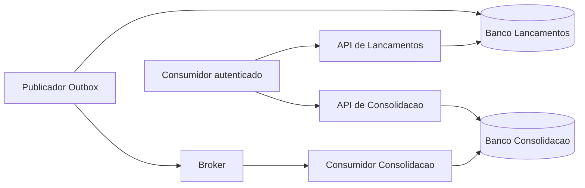

# DAS — Documento de arquitetura da solução

Escopo: controle de lançamentos e relatório diário dos dois desafios de arquitetura. O objetivo é preservar registro de fatos durante indisponibilidade da Consolidação, com operação local reproduzível e caminho de implantação demonstrável na AWS.

## Direcionadores e limites

Os desafios exigem as duas capacidades, independência de disponibilidade, 50 req/s no consolidado e perda de requisições até 5%. Exigem ainda implementação, testes e execução local na entrega final. A arquitetura-alvo está documentada e sua implementação segue o corte definido em [escopo de implementação](../01-requisitos/escopo-implementacao.md). Hipóteses aprovadas: comerciante único, BRL, calendário America/Sao_Paulo e saldo do movimento diário. Não há estorno, edição ou multi-tenant no escopo.

## Decomposição

Dois serviços de negócio e quatro processos implantáveis: API de Lançamentos, publicador da Outbox, API de Consolidação e consumidor. Cada contexto possui seu banco. APIs e Workers podem escalar separadamente; o custo de processos extras é aceito para isolar caminho HTTP, integração e consulta.

Os detalhes normativos permanecem nas demais visões, SDD, ADRs e contratos. Esta visão estabelece a decomposição e os limites entre capacidades; não substitui as fontes normativas específicas.
