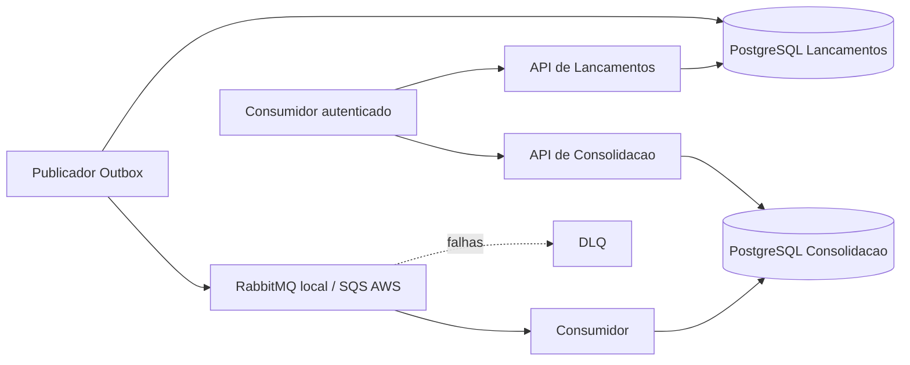

# DAS — Documento de arquitetura da solução

**Estado: DOCUMENTAÇÃO APROVADA.** Escopo: controle de lançamentos e relatório diário dos dois desafios Keyrus. O objetivo é preservar registro de fatos durante indisponibilidade da Consolidação, com operação local reproduzível e implantação demonstrável na AWS.

## Direcionadores e limites

Os PDFs exigem as duas capacidades, independência de disponibilidade, 50 req/s no consolidado e perda de requisições até 5%. Exigem ainda implementação/testes/execução local na entrega final; esta branch conclui apenas o desenho. Hipóteses aprovadas: comerciante único, BRL, calendário America/Sao_Paulo e saldo do movimento diário. Não há estorno, edição ou multi-tenant no escopo.

## Decomposição

Dois serviços de negócio e quatro processos implantáveis: API de Lançamentos, publicador da Outbox, API de Consolidação e consumidor. Cada contexto possui seu banco. APIs e Workers podem escalar separadamente; o custo de processos extras é aceito para isolar caminho HTTP, integração e consulta.

## Fluxo e consistência

A API valida comando e identidade, grava fato financeiro, idempotência e Outbox atomicamente e retorna 201. Publicador reserva trabalho em transação curta e envia fora dela; confirma publicação com token de reserva. O consumidor insere identidade financeira e atualiza totais na mesma transação; ack/delete somente após commit.

A integração é pelo menos uma vez, sem ordenação global necessária. Soma de fatos imutáveis é comutativa, mas depende de deduplicação por transactionId. A projeção é eventualmente consistente: zero significa nenhum fato refletido, não ausência comprovada de movimento. Completude permanece desconhecida no contrato de consulta.

## Recuperação e dados

Lançamentos são fonte de verdade; eventId permanece no fato mesmo após limpeza da Outbox. Identidades HTTP e da geração ativa não expiram. Falhas persistentes são isoladas, sem descarte. Reconciliação usa snapshot após pausa controlada do consumo; reconstrução cria geração nova, valida e troca atomicamente. Escrita financeira continua durante manutenção da projeção. Restore da própria fonte bloqueia escrita e isola a fila anterior até reconstrução completa. [Procedimento normativo](../07-infraestrutura/recuperacao-e-reconciliacao.md).

## Ambientes e segurança

Local: Docker Compose, bancos separados, RabbitMQ e Keycloak. AWS: ECS/Fargate em duas zonas, RDS por contexto Multi-AZ, SQS/DLQ, Cognito, ALB/WAF e serviços de operação. O domínio permanece o mesmo; adaptadores e ensaios diferem por broker. [ADR-010](../06-adr/adr-010-mensageria-local-rabbitmq-e-aws-sqs.md).

APIs autenticam e autorizam conforme o [ADR-011](../06-adr/adr-011-autenticacao-e-autorizacao-das-apis.md); TLS na AWS, IAM mínimo, secrets externos, criptografia, logs sanitizados e auditoria de cliente técnico. [Visão de segurança](../04-visoes/seguranca-resiliencia-observabilidade.md). Observabilidade correlaciona API, Outbox, mensagem e consumo; mede atraso e falhas sem interpretar lastUpdatedAt como completude.

## Capacidade, disponibilidade e custo

Metas internas e configurações estão nos [parâmetros operacionais](../07-infraestrutura/parametros-operacionais.md). A [arquitetura AWS](../07-infraestrutura/arquitetura-aws.md) define réplicas, rede, failover e limites de escala; [custos](../07-infraestrutura/estimativa-custos.md) tornam explícita a topologia e as hipóteses tarifárias. Não há garantia de capacidade ou SLA medido nesta etapa.

## Decisões e fontes

| Tema | Fonte normativa |
|---|---|
| Decomposição e integração | ADR-001/002 |
| Banco e integridade | ADR-003; visão de dados |
| Publicação e idempotência | ADR-004/005 |
| AWS e escolha de fila | ADR-006/007 |
| Evento e versionamento | ADR-008 |
| Falhas e recuperação | ADR-009; procedimento operacional |
| RabbitMQ/SQS | ADR-010 |
| Autenticação e autorização | ADR-011 |
| API e software | Contratos HTTP; SDD |

A [matriz de conformidade](../01-requisitos/matriz-conformidade.md) separa cobertura documental de evidências futuras. Sem legado informado, transição de legado não é necessária; o caminho local→AWS está definido no plano de implantação.
