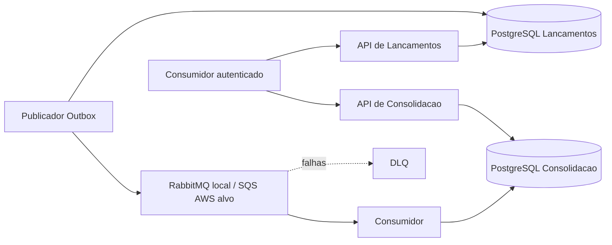

# DAS — Documento de arquitetura da solução

Escopo: controle de lançamentos e relatório diário dos dois desafios de arquitetura. O objetivo é preservar o registro de fatos durante indisponibilidade da Consolidação, com operação local reproduzível e **arquitetura-alvo de implantação definida para AWS**. A AWS não foi provisionada nem demonstrada nesta entrega.

## Direcionadores e limites

Os desafios exigem as duas capacidades, independência de disponibilidade, 50 req/s no Consolidado e perda de requisições de no máximo 5%. Exigem também implementação, testes, execução local documentada e repositório público. A implementação local e a arquitetura-alvo são distinguidas no [escopo de implementação](../01-requisitos/escopo-implementacao.md). Hipóteses adotadas para fechar o caso: comerciante único, BRL, calendário America/Sao_Paulo e saldo do movimento diário. Não há estorno, edição ou multi-tenant no escopo.

## Decomposição

Dois serviços de negócio e quatro processos implantáveis: API de Lançamentos, publicador da Outbox, API de Consolidação e consumidor. Cada contexto possui seu banco. APIs e Workers podem escalar separadamente; o custo de processos extras é aceito para isolar caminho HTTP, integração e consulta.

## Fluxo e consistência

A API valida comando e identidade, grava fato financeiro, idempotência e Outbox atomicamente e retorna 201. O publicador reserva trabalho em transação curta e envia fora dela; confirma publicação com token de reserva. O consumidor insere identidade financeira e atualiza totais na mesma transação; confirmação do transporte ocorre somente após commit.

A integração é pelo menos uma vez, sem necessidade de ordenação global. Soma de fatos imutáveis é comutativa, mas depende de deduplicação por transactionId. A projeção é eventualmente consistente: zero significa nenhum fato refletido, não ausência comprovada de movimento. Completude permanece desconhecida no contrato de consulta.

## Recuperação e dados

Lançamentos são a fonte de verdade; eventId permanece associado ao fato. Identidades HTTP e da geração ativa não expiram no escopo do caso. Falhas persistentes são isoladas, sem descarte silencioso. A reconstrução local implementada cria geração nova sob lease renovável, valida o resultado e troca a geração ativa com fencing. Se o processo administrativo morrer, a lease expira e o Worker volta a processar; um novo rebuild deve ser iniciado pelo operador. A API continua servindo a geração anterior até a troca.

Restore da própria fonte é procedimento de arquitetura-alvo e exige controles adicionais de escrita, fila e backup. [Procedimento normativo](../07-infraestrutura/recuperacao-e-reconciliacao.md).

## Ambientes e segurança

**Local implementado:** Docker Compose, dois PostgreSQL, RabbitMQ, Keycloak, Jaeger, quatro processos de aplicação e jobs transitórios de migration. RabbitMQ é o único transporte implementado.

**AWS alvo:** ECS/Fargate em duas zonas, RDS por contexto Multi-AZ, SQS/DLQ, Cognito, ALB/WAF e serviços operacionais. SQS/Cognito/AWS não foram implementados ou homologados nesta entrega. [ADR-007](../06-adr/adr-007-estrategia-de-mensageria.md) e [ADR-010](../06-adr/adr-010-mensageria-local-rabbitmq-e-aws-sqs.md).

APIs autenticam e autorizam conforme o [ADR-011](../06-adr/adr-011-autenticacao-e-autorizacao-das-apis.md). T13 demonstra o fluxo local com Keycloak; TLS, IAM, KMS, Cognito e controles equivalentes pertencem à arquitetura-alvo AWS. Observabilidade local usa OpenTelemetry/Jaeger e foi exercitada em T14; observabilidade produtiva permanece dependente da implantação AWS.

## Arquitetura de Transição — diferencial do desafio de Soluções

O PDF de Soluções solicita Arquitetura de Transição apenas **se necessária, considerando migração de legado**. Nenhum legado real é descrito no case. Para demonstrar a abordagem sem transformar hipótese em fato, foi criada uma [visão de transição hipotética](arquitetura-transicao-hipotetica.md): parte de um monólito plausível no qual Lançamentos e Consolidação estão acoplados e descreve coexistência, ownership de dados, Anti-Corruption Layer, captura/publicação confiável, idempotência e reconciliação até a extração das capacidades.

Essa transição hipotética de legado é uma preocupação diferente da escolha de infraestrutura. **Local→AWS não é tratado como Arquitetura de Transição de legado.** A AWS é a topologia de implantação alvo da solução já decomposta.

## Capacidade, disponibilidade e custo

O requisito explícito de 50 req/s com perda máxima de 5% foi exercitado localmente em T15 durante 120 segundos: 6.000 requisições emitidas, 6.000 concluídas, 0 falhas e 0 dropped iterations. Esse resultado é evidência da janela local executada, não SLA ou prova de capacidade AWS.

Metas internas e configurações estão nos [parâmetros operacionais](../07-infraestrutura/parametros-operacionais.md). A [arquitetura AWS](../07-infraestrutura/arquitetura-aws.md) define topologia, escala e disponibilidade pretendidas; [custos](../07-infraestrutura/estimativa-custos.md) registram uma estimativa de referência, não uma fatura ou cotação vinculante.

## Decisões e fontes

| Tema | Fonte normativa |
|---|---|
| Decomposição e integração | ADR-001/002 |
| Banco e integridade | ADR-003; visão de dados |
| Publicação e idempotência | ADR-004/005 |
| Plataforma AWS | ADR-006 |
| Estratégia de mensageria | ADR-007 |
| Evento e versionamento | ADR-008 |
| Falhas e recuperação | ADR-009; procedimento operacional |
| Semântica RabbitMQ/SQS | ADR-010 |
| Autenticação e autorização | ADR-011 |
| API e software | Contratos HTTP; SDD |
| Transição hipotética de legado | Arquitetura de Transição hipotética |

A [matriz de conformidade](../01-requisitos/matriz-conformidade.md) separa cobertura documental de evidências. A transição de legado é apresentada como cenário hipotético porque o case não fornece um sistema legado real; a arquitetura-alvo AWS permanece documentada separadamente como decisão de implantação.