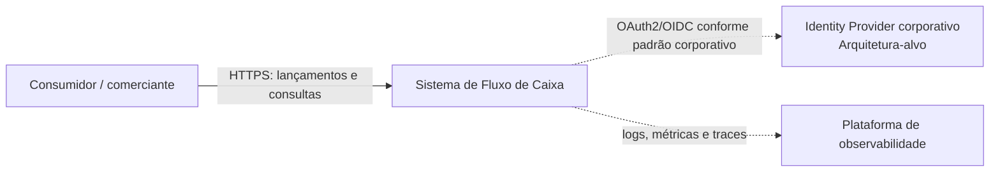
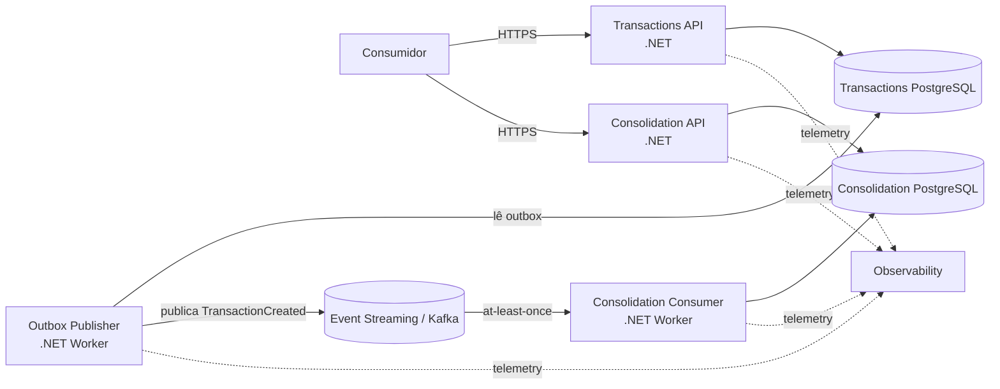

# C4 — Visões de Contexto e Containers

- **Status:** PROPOSTO PARA VALIDAÇÃO
- **Escopo:** arquitetura-alvo do desafio

## 1. Contexto

O sistema de fluxo de caixa oferece duas capacidades principais: registrar/consultar lançamentos financeiros e consultar o consolidado diário. A consolidação é derivada dos lançamentos e sua indisponibilidade não pode interromper o registro de novos lançamentos.

O Identity Provider é uma capacidade técnica da arquitetura-alvo, não um domínio de negócio inventado pelo desafio.

## 2. Containers

### Responsabilidades

| Container | Responsabilidade |
|---|---|
| Transactions API | validar, registrar e consultar lançamentos; persistir lançamento + Outbox atomicamente |
| Outbox Publisher | publicar eventos pendentes sem participar do caminho síncrono do POST |
| Transactions PostgreSQL | source of record dos lançamentos e estado técnico do Outbox |
| Event Streaming | desacoplar temporalmente publicação e processamento; permitir backlog/recovery |
| Consolidation Consumer | consumir eventos, garantir idempotência e atualizar a projeção diária |
| Consolidation API | consultar consolidados por data/período |
| Consolidation PostgreSQL | armazenar projeção `DailyConsolidation` e controle `ProcessedEvent` |

## 3. Fronteira de disponibilidade

Transactions e Consolidation são deployables e domínios operacionais independentes. A confirmação de `POST /transactions` depende do commit local em Transactions, não da disponibilidade do broker ou da Consolidação. A intenção de publicação permanece no Outbox para recuperação posterior.

## 4. O que o C4 não afirma

- não define SLA/RTO/RPO não fornecidos;
- não afirma que Kafka é necessário por throughput de 50 req/s;
- não inventa usuários, perfis ou autorização de negócio;
- não exige bancos fisicamente separados no ambiente local, embora o ownership seja separado;
- não define ordenação global de eventos.