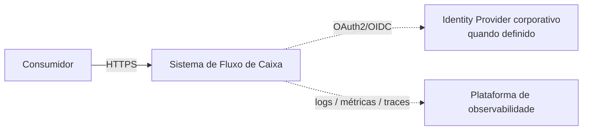
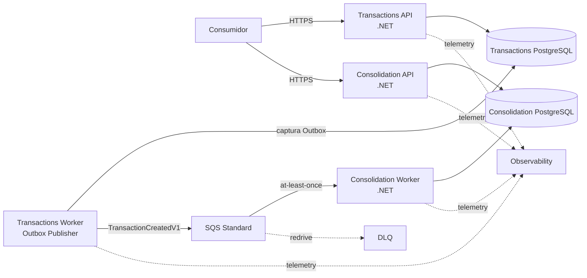

# C4 — Visões de Contexto e Containers

- **Status:** EM REVISÃO FINAL — aguardando validação humana
- **Escopo:** arquitetura-alvo do desafio

## 1. Contexto

O sistema oferece registro/consulta de lançamentos e consulta do consolidado diário. A Consolidação é derivada e sua indisponibilidade não interrompe o registro de lançamentos.

## 2. Containers/processos

Há **2 serviços de negócio** e **4 processos executáveis**:

| Serviço | Processo | Responsabilidade |
|---|---|---|
| Lançamentos | Transactions API | validar, registrar e consultar; commit de lançamento + idempotência + Outbox |
| Lançamentos | Transactions Worker | capturar Outbox e publicar na fila com retry |
| Consolidação | Consolidation Worker | consumir idempotentemente e atualizar projeção |
| Consolidação | Consolidation API | consultar consolidado por data/período |

Os dois processos de cada serviço compartilham ownership do respectivo banco, mas possuem escala e health independentes.

## 3. Containers de dados/integração

| Container | Responsabilidade |
|---|---|
| Transactions PostgreSQL | fonte de verdade de lançamentos, idempotência e Outbox |
| SQS Standard | desacoplamento temporal e backlog durante indisponibilidade |
| DLQ | isolamento de mensagens que excederam política de recebimento |
| Consolidation PostgreSQL | projeção diária e `ProcessedEvent` |

## 4. Fronteira de disponibilidade

`POST /transactions` depende apenas do commit local em Transactions. SQS, Consolidation Worker e Consolidation API podem estar indisponíveis sem invalidar o lançamento. O Transactions Worker recupera publicação pendente posteriormente.

## 5. Limites conscientes

- sem SLA/RTO/RPO inventados;
- SQS foi escolhido por adequação aos requisitos, não por throughput;
- sem perfis/RBAC de negócio inventados;
- ownership dos bancos é separado mesmo que desenvolvimento local compartilhe uma instância física;
- sem ordenação global exigida;
- Identity Provider é integração técnica da arquitetura-alvo, não domínio criado pelo desafio.