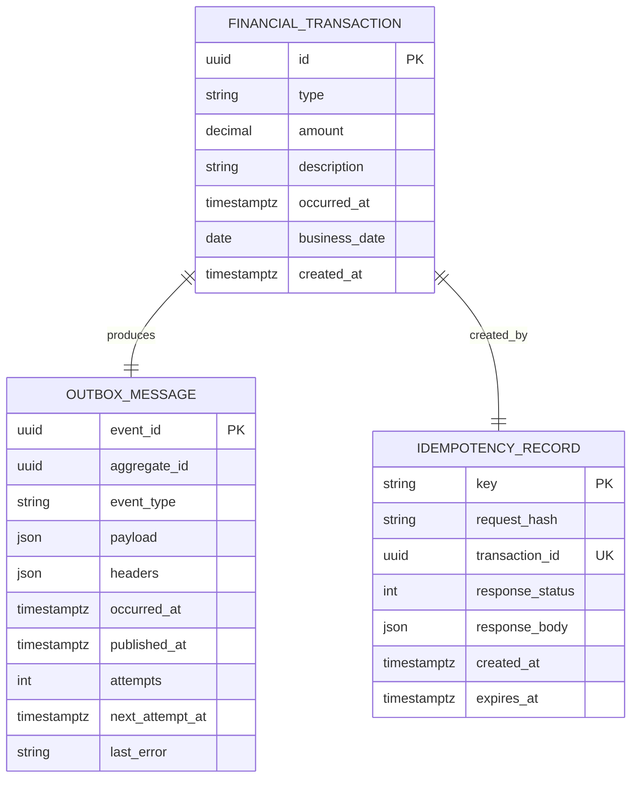
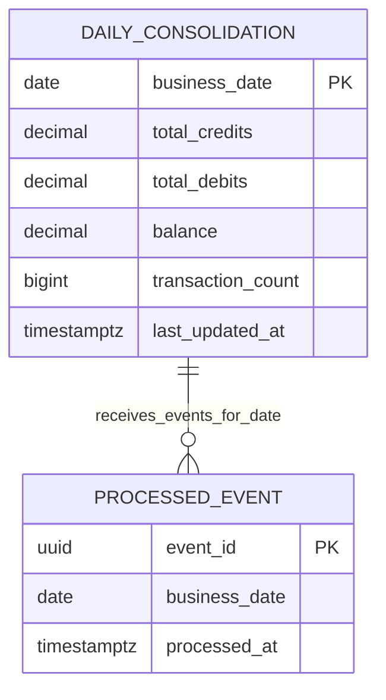

# Data View

- **Status:** EM REVISÃO FINAL — aguardando validação humana

## 1. Princípios

1. `financial_transactions` é a fonte de verdade financeira deste escopo.
2. O consolidado diário é uma projeção reconstruível a partir dos lançamentos.
3. Cada contexto possui ownership de dados; não há leitura cruzada no fluxo normal.
4. Lançamento + idempotência + Outbox são atômicos localmente.
5. `ProcessedEvent` + atualização da projeção são atômicos localmente.
6. Dados técnicos de confiabilidade têm ciclo de vida próprio e não contaminam a entidade financeira.

## 2. Modelo lógico — Transactions

A chave de idempotência não pertence a `FinancialTransaction`: ela é estado técnico da operação HTTP e possui retenção própria.

## 3. Modelo lógico — Consolidation

A relação acima é conceitual para rastreabilidade; `ProcessedEvent` não precisa de FK física para a projeção. Isso evita acoplamento desnecessário e permite registrar eventos com segurança dentro da mesma transação.

## 4. Integridade e precisão

- `amount > 0`;
- `type IN ('DEBIT','CREDIT')`;
- valores monetários usam decimal/`numeric`, nunca `float`/`double`;
- precisão/escala física devem ser explicitadas na migration e testadas nos limites; como o case não fornece valor máximo, o limite adotado será premissa técnica documentada;
- `balance = total_credits - total_debits`;
- `event_id` é único;
- lançamentos confirmados são imutáveis no MVP;
- `business_date` é calculado em Transactions e propagado no evento.

## 5. Idempotência HTTP

A tabela técnica armazena hash SHA-256 de uma representação canônica do payload. Mesma chave + mesmo hash reproduz a resposta lógica original; mesma chave + hash diferente gera `409`. A restrição única também resolve corrida entre requisições simultâneas.

A janela de retenção/expiração é configurável porque não foi definida pelo desafio.

## 6. Concorrência

### Outbox

Publishers capturam pequenos lotes elegíveis com `FOR UPDATE SKIP LOCKED` (ou equivalente PostgreSQL), reduzindo trabalho duplicado entre instâncias. A semântica continua at-least-once porque falha após envio pode causar republicação.

### Consolidado

O consumidor primeiro tenta inserir `processed_events.event_id`. Para evento novo, atualiza `daily_consolidations` com `INSERT ... ON CONFLICT DO UPDATE` e incrementos relativos. As duas operações pertencem à mesma transação, evitando `lost update` e dupla contabilização.

## 7. Índices orientadores

Além de PK/UK:
- `financial_transactions(business_date, id)` para consultas/reconciliação;
- `financial_transactions(occurred_at, id)` se a API filtrar pelo instante;
- índice parcial de Outbox em itens `published_at IS NULL` ordenáveis por `next_attempt_at/occurred_at`;
- `idempotency_records(expires_at)` para limpeza;
- `processed_events(business_date)` somente se reconciliação/diagnóstico justificar.

Índices adicionais dependem de plano de consulta medido.

## 8. Consistência e recuperação

Há consistência eventual entre os contextos. Backlog/idade da fila e Outbox tornam a defasagem operacional observável. A reconstrução excepcional não depende de retenção da SQS: `financial_transactions` é a fonte de verdade.

Outbox publicada, registros de idempotência expirados e `ProcessedEvent` exigem políticas de retenção/limpeza configuráveis. Itens Outbox não publicados nunca são removidos pela limpeza.

## 9. Backup e isolamento

Retenção de backup, RPO e RTO não foram fornecidos. A arquitetura-alvo usa PostgreSQL gerenciado com backup/PITR quando objetivos forem definidos. Em produção, os contextos devem ter isolamento suficiente para que carga/falha de Consolidação não comprometa Lançamentos; localmente podem compartilhar instância física com databases/schemas e credenciais separados.