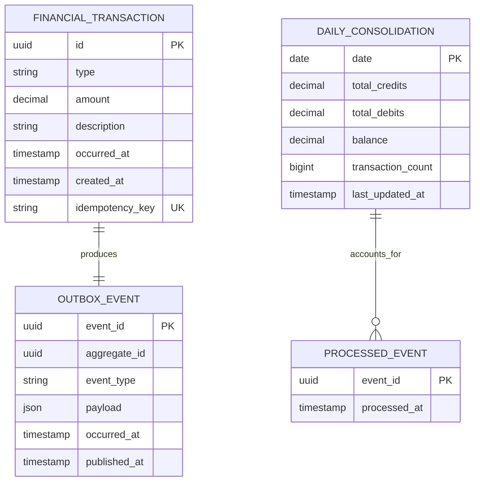

# Data View

- **Status:** PROPOSTO PARA VALIDAÇÃO

## 1. Princípios

1. Lançamentos são dados financeiros primários da solução proposta.
2. O consolidado diário é uma projeção derivada e reconstruível a partir dos lançamentos/eventos disponíveis conforme retenção definida.
3. Cada contexto possui ownership de seus dados; não há leitura direta de tabelas entre serviços.
4. Confirmação de lançamento e intenção de publicação são atômicas localmente.
5. Atualização do consolidado e marcação do evento processado são atômicas localmente.

## 2. Modelo lógico

O diagrama é lógico. Tipos/tamanhos físicos serão refinados no SDD e migrations.

## 3. Integridade

- `amount > 0` e tipo `DEBIT|CREDIT` são invariantes do MVP;
- `idempotency_key` deve impedir duplicação lógica no registro; mesma chave com payload incompatível deverá ser rejeitada no contrato final;
- `event_id` único em `ProcessedEvent` impede reaplicação do mesmo evento;
- `balance = totalCredits - totalDebits`;
- lançamentos confirmados são imutáveis no MVP;
- nenhuma transação distribuída entre bancos é necessária.

## 4. Consistência

O sistema assume consistência eventual entre Transactions e Consolidation. Após o commit do lançamento, pode existir uma janela em que o lançamento está confirmado e o consolidado ainda não o reflete. Essa defasagem é observável por backlog/lag/freshness e converge após recuperação do processamento.

## 5. Retenção, backup e recuperação

O desafio não fornece retenção, RPO ou RTO. A arquitetura-alvo prevê PostgreSQL gerenciado com backup/PITR configurados quando esses objetivos forem definidos. Retenção de eventos e Outbox deverá ser dimensionada para suportar recuperação e auditoria sem crescimento ilimitado.

## 6. Isolamento

Em produção de referência, bancos de Transactions e Consolidation devem possuir isolamento de recursos suficiente para que carga/falha da consolidação não comprometa a persistência dos lançamentos. No ambiente local, uma única instância PostgreSQL pode hospedar databases separados para reduzir custo e complexidade sem violar ownership lógico.