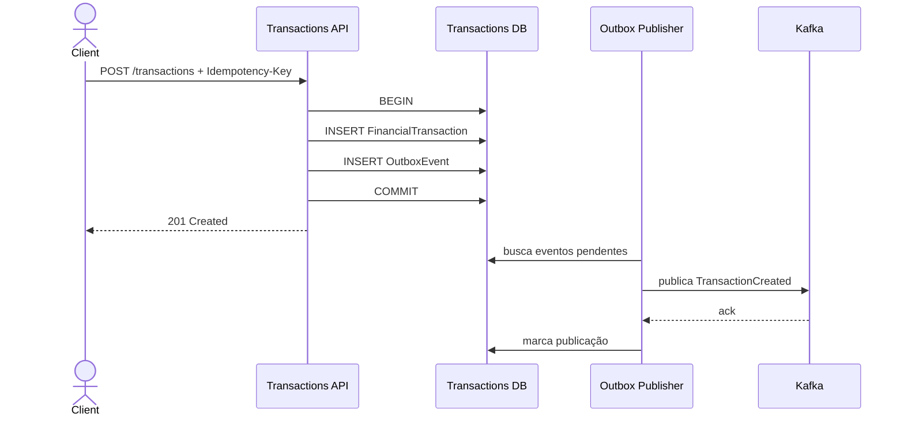
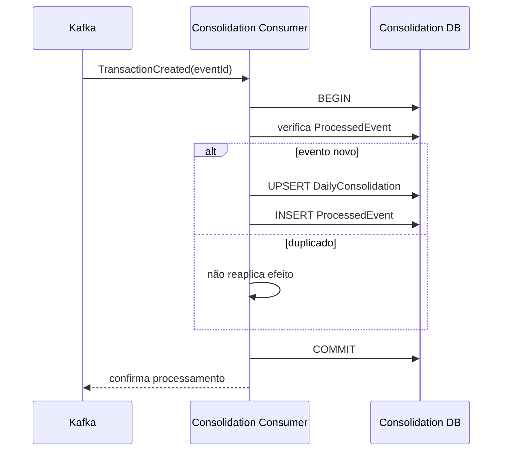
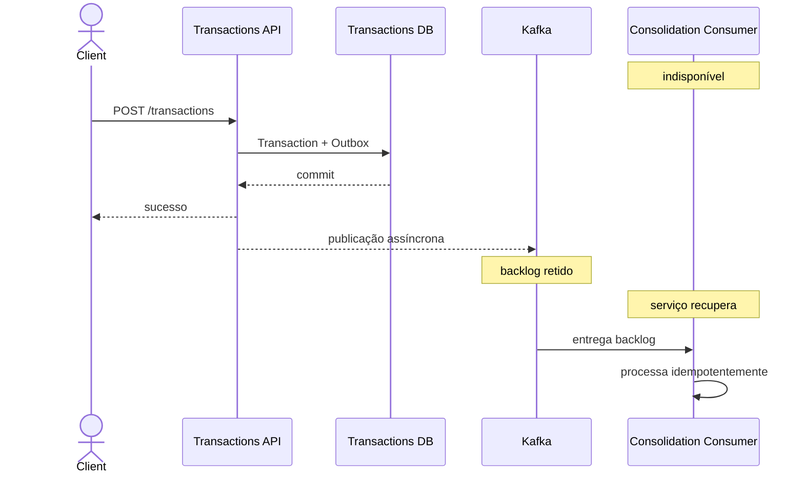

# Dynamic Views — Fluxos críticos

## 1. Registro de lançamento

O sucesso HTTP depende do commit local, não da disponibilidade da Consolidação.

## 2. Consolidação normal

## 3. Consolidação indisponível

Esse é o fluxo que evidencia RNF-001/ASR-001: falha da consolidação não interrompe confirmação de novos lançamentos.

## 4. Falha de publicação

Se o banco confirma lançamento/outbox e o broker está indisponível, o publisher mantém o evento pendente e tenta novamente com backoff. O lançamento não é revertido por uma falha posterior de integração.

## 5. Redelivery

Se houver entrega repetida após falha entre commit do consumidor e confirmação ao broker, `ProcessedEvent(eventId)` impede que o lançamento seja somado novamente.

## 6. Limites

- não se promete exactly-once ponta a ponta;
- não se exige ordenação global para a operação atual de soma de débitos/créditos;
- eventual necessidade futura de regras dependentes de sequência exigirá nova decisão de particionamento/ordenação.