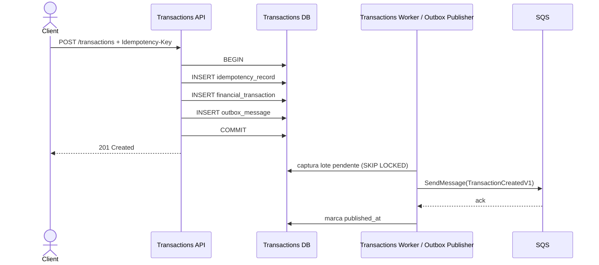
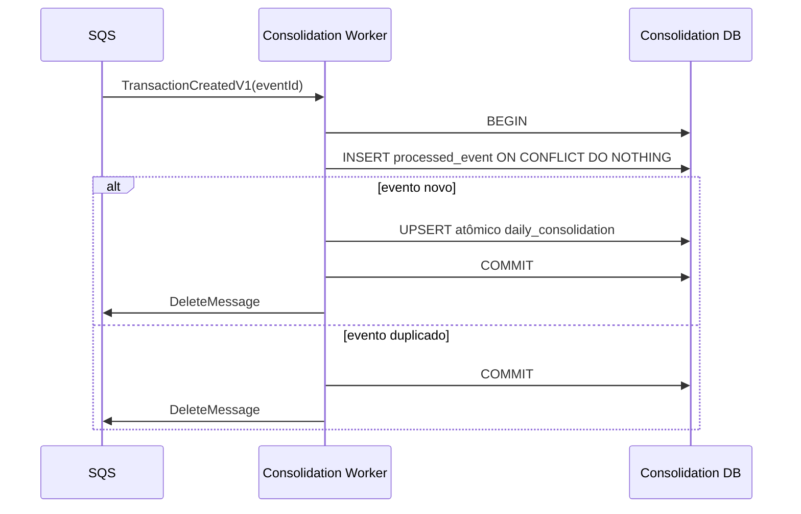
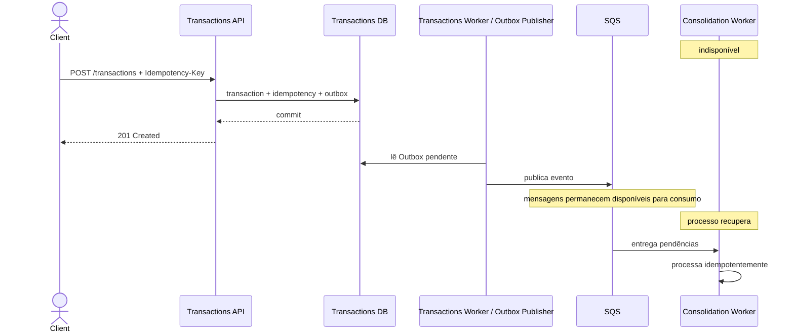
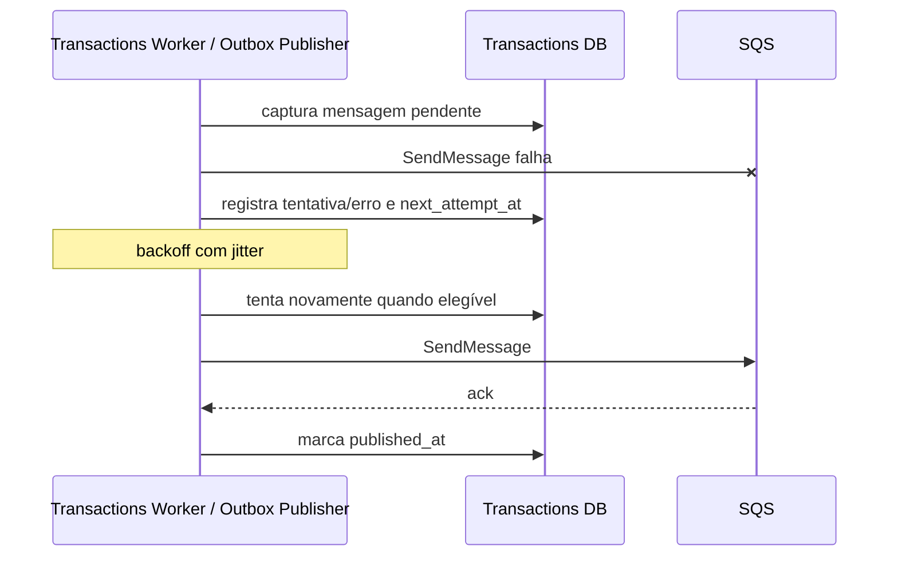
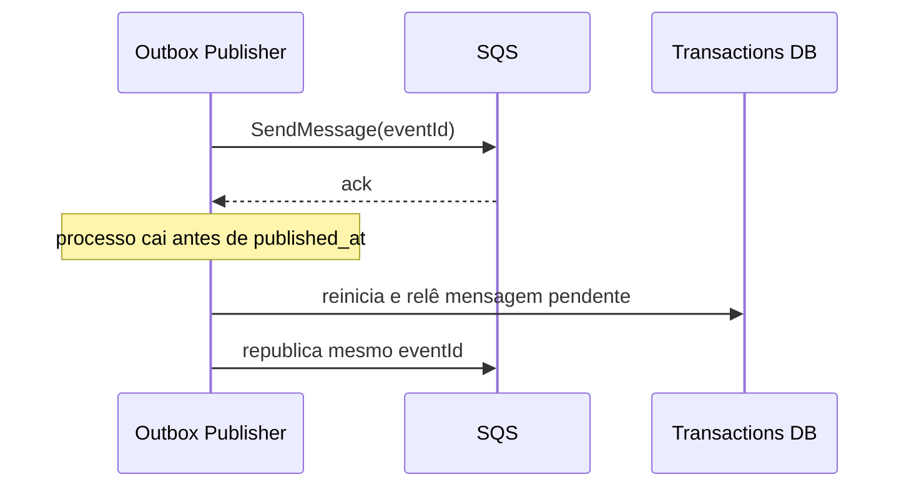
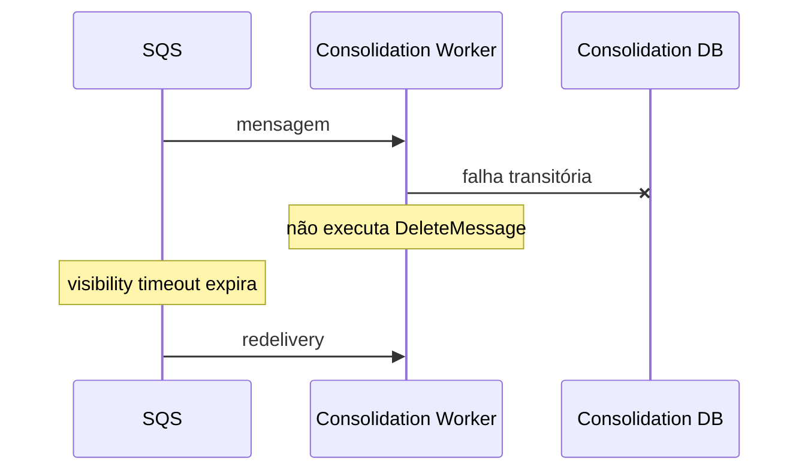
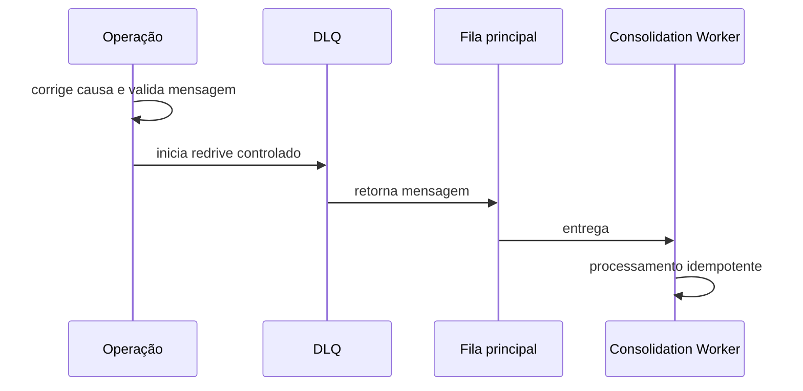
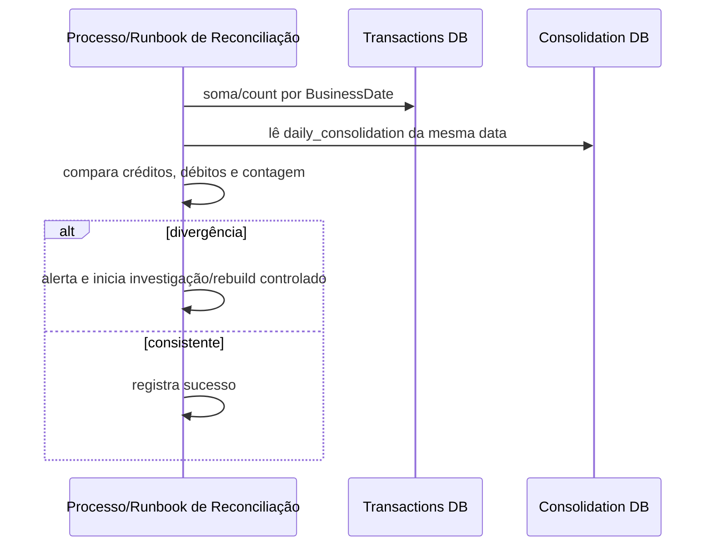

# Dynamic Views — Fluxos críticos

- **Status:** EM REVISÃO FINAL — aguardando validação humana

## 1. Registro de lançamento

O sucesso HTTP depende apenas do commit local. A indisponibilidade da fila ou da Consolidação não invalida um lançamento já confirmado.

## 2. Consolidação normal

A remoção da mensagem ocorre somente depois do commit. Se o processo cair entre commit e `DeleteMessage`, a mensagem pode reaparecer e será neutralizada por `processed_event`.

## 3. Consolidação indisponível

Esse fluxo evidencia RNF-001/ASR-001: a indisponibilidade da Consolidação não interrompe a confirmação de novos lançamentos. A API de Lançamentos nunca publica diretamente na fila.

## 4. Fila indisponível

Falha de integração posterior ao commit nunca reverte o lançamento financeiro.

## 5. Falha após envio e antes de marcar Outbox

Duplicação é permitida pela semântica at-least-once e tratada no consumidor.

## 6. Falha transitória no consumidor

Após o limite configurado de recebimentos, a redrive policy move a mensagem para a DLQ e dispara alerta operacional.

## 7. Redrive da DLQ

## 8. Reconciliação

## 9. Limites

- não se promete exactly-once ponta a ponta;
- não se exige ordenação global para soma de créditos/débitos;
- `BusinessDate` viaja no evento para manter a mesma regra temporal nos dois serviços;
- eventual regra futura dependente de sequência exige nova decisão arquitetural;
- reconstrução integral não depende de retenção histórica da fila: a fonte de verdade é o banco de Lançamentos.