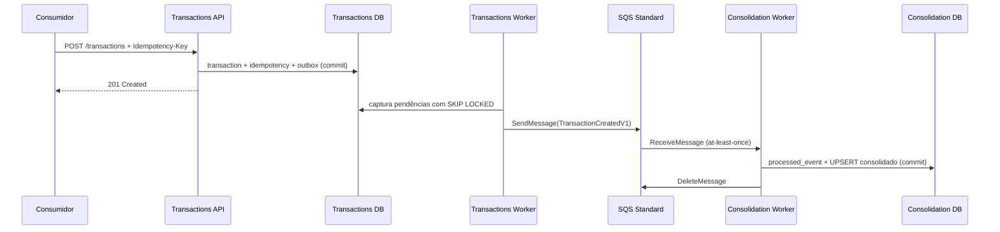

# Integration View

- **Status:** EM REVISÃO FINAL — aguardando validação humana

## 1. Integrações síncronas

APIs externas usam HTTPS/JSON. `POST /transactions` confirma somente após commit local de lançamento + idempotência + Outbox e nunca aguarda fila ou Consolidação.

## 2. Integração assíncrona



## 3. Contrato `TransactionCreatedV1`

```json
{
  "schemaVersion": 1,
  "eventId": "uuid",
  "eventType": "TransactionCreated",
  "eventOccurredAt": "2026-10-22T12:00:00Z",
  "transactionId": "uuid",
  "transactionType": "DEBIT",
  "amount": "100.00",
  "businessDate": "2026-10-22"
}
```

O payload contém apenas informação necessária à projeção. `amount` usa representação decimal textual para evitar ponto flutuante. `traceparent`/`correlation-id` são metadados técnicos da mensagem, não domínio financeiro.

Mudança compatível adiciona campo opcional; mudança incompatível exige nova versão e período de compatibilidade do consumidor.

## 4. Semântica de entrega

- SQS Standard: **at-least-once**;
- duplicação é esperada;
- exatamente uma vez ponta a ponta não é prometido;
- falha após envio e antes de `published_at` pode republicar;
- falha após commit do consumidor e antes de `DeleteMessage` pode redeliver;
- `eventId` + transação local tornam ambos seguros.

## 5. Retry e DLQ

Publisher mantém tentativas, `next_attempt_at` e erro na Outbox; usa backoff com jitter para falhas transitórias.

No consumidor, falha não executa `DeleteMessage`. Após `VisibilityTimeout`, a mensagem volta a ficar disponível. A redrive policy envia mensagens que excedem `maxReceiveCount` à DLQ. Valores são configurações operacionais, pois o desafio não fornece limites.

Redrive da DLQ ocorre somente após correção/triagem e é seguro pela idempotência.

## 6. Ordenação e concorrência

SQS Standard não garante ordem. O MVP soma créditos/débitos e conta lançamentos imutáveis; essas operações são comutativas. O UPSERT usa incrementos atômicos e o consumidor deduplica por `eventId`, portanto não existe requisito atual para FIFO.

Se surgirem estornos/correções dependentes de sequência ou chave de conta/caixa, a decisão deve ser reaberta em vez de inventar `MessageGroupId` agora.

## 7. Recuperação e reconciliação

A fila fornece recuperação do backlog normal e a DLQ isola poison messages. Ela não é fonte de verdade histórica. Reconciliação compara `financial_transactions` com `daily_consolidations` por `BusinessDate`; reconstrução excepcional parte dos lançamentos.

## 8. Por que SQS, não Kafka

ADR-007 registra a decisão. Kafka oferece capacidades úteis de log/replay/múltiplos consumidores, mas elas não são exigidas pelos dois desafios. SQS atende independência, durabilidade temporária, retry e escala conhecida com menor custo e superfície operacional. Kafka permanece opção de evolução condicionada a novos requisitos.