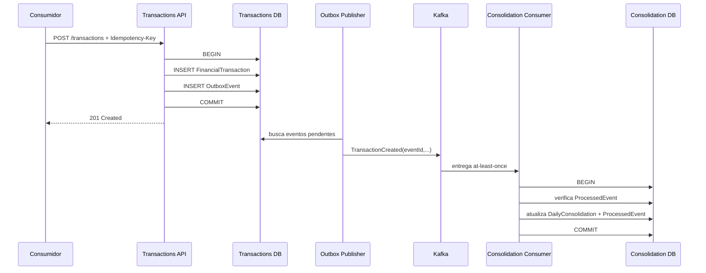

# Integration View

- **Status:** PROPOSTO PARA VALIDAÇÃO

## 1. Integrações síncronas

As APIs externas usam HTTPS/JSON. O registro de lançamento retorna sucesso após o commit local de `FinancialTransaction` + `OutboxEvent`; não aguarda consolidação.

## 2. Integração assíncrona



## 3. Contrato de evento

Contrato mínimo proposto para `TransactionCreated`:

```json
{
  "schemaVersion": 1,
  "eventId": "uuid",
  "eventType": "TransactionCreated",
  "occurredAt": "ISO-8601",
  "transaction": {
    "id": "uuid",
    "type": "DEBIT|CREDIT",
    "amount": 100.00,
    "transactionOccurredAt": "ISO-8601"
  }
}
```

O contrato evita transportar campos desnecessários para a consolidação. Evolução deve ser compatível quando possível; breaking changes exigem nova versão contratual.

## 4. Semântica de entrega

- entrega: **at-least-once**;
- duplicação: esperada e neutralizada por `eventId` persistente;
- exactly-once ponta a ponta: não prometido;
- falha após publish e antes de marcar Outbox como publicado pode gerar redelivery;
- falha persistente deve ser isolada e observável, com política de retry/DLQ definida antes da implementação.

## 5. Ordenação

A projeção atual é composta por somas e contagem de lançamentos imutáveis. Com idempotência, essas operações são comutativas; portanto, o resultado diário correto não exige ordenação global dos eventos.

Não será inventada partition key de negócio. Se o domínio evoluir para correções/reversões ou invariantes dependentes de sequência, a estratégia de particionamento/ordenação deverá ser reavaliada.

## 6. Kafka e alternativa de menor custo

Kafka permanece a tecnologia de referência do ADR-002 por retenção, replay, consumer offsets e visibilidade de lag. O requisito de 50 req/s, isoladamente, não justifica Kafka.

Na arquitetura AWS/custos, Kafka gerenciado será comparado com uma fila gerenciada mais simples. Se replay de longo prazo e múltiplos consumidores não forem necessários, uma fila como Amazon SQS pode reduzir custo e operação mantendo o desacoplamento necessário. Essa comparação é um trade-off arquitetural, não uma mudança silenciosa de requisito.