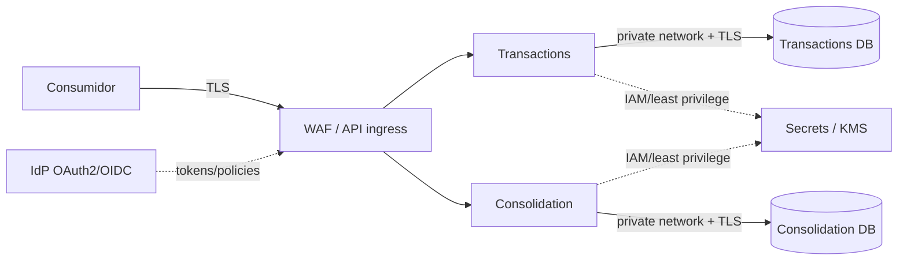

# Security, Resilience e Observability Views

- **Status:** PROPOSTO PARA VALIDAÇÃO

## 1. Security View

### Local/MVP

- nenhum segredo real versionado;
- configuração por environment/secrets;
- autenticação técnica simples poderá ser usada para demonstração, documentada no SDD;
- validação de entrada e tratamento seguro de erros;
- containers/bancos sem exposição pública desnecessária.

### Arquitetura-alvo

Critérios:
- TLS em trânsito e criptografia em repouso;
- workloads e bancos em rede privada quando aplicável;
- least privilege via IAM/workload identity;
- segredos em serviço de secret management;
- OAuth2/OIDC conforme padrão corporativo, sem inventar RBAC de negócio;
- logs não devem expor payload financeiro sensível ou segredos;
- trilha/correlation ID para diagnóstico e auditoria técnica.

LGPD/compliance específicos permanecem questão em aberto porque o case não fornece classificação de dados nem obrigações regulatórias.

## 2. Resilience View

| Falha | Comportamento esperado |
|---|---|
| Consolidation API/worker indisponível | Transactions continua registrando; consolidado pode ficar stale |
| Broker indisponível | lançamento é confirmado após commit local; Outbox mantém intenção de publicação |
| Outbox Publisher reinicia | retoma itens pendentes; duplicatas são toleradas |
| Evento entregue mais de uma vez | `ProcessedEvent` impede dupla contabilização |
| Evento inválido/falha persistente | retry limitado + isolamento/DLQ; alerta e diagnóstico |
| Transactions DB indisponível | não confirmar lançamento que não foi persistido |
| Consolidation DB indisponível | consumo falha/retry; Transactions não é afetado |

Retries devem usar backoff e jitter e possuir limite. Retry infinito sem isolamento não é aceitável.

Não declaramos RTO/RPO/SLA sem requisitos. Backups/PITR, Multi-AZ e capacidade redundante são capacidades da arquitetura-alvo a serem dimensionadas conforme objetivos definidos.

## 3. Observability View

### Métricas

**Transactions**
- request rate/error rate/latency;
- taxa de criação de lançamentos;
- quantidade e idade do Outbox pendente;
- falhas/retries de publicação.

**Integration**
- publish rate/error;
- consumer lag/backlog;
- retries;
- mensagens isoladas/DLQ.

**Consolidation**
- processamento por segundo;
- erros/retries;
- freshness do consolidado;
- latência e taxa de erro das consultas.

### Logs e traces

- logs estruturados;
- `correlationId`, `transactionId` e `eventId` quando aplicáveis;
- trace do request de criação até a publicação/processamento assíncrono;
- sanitização de dados sensíveis;
- timestamps consistentes.

### Alertas

Thresholds numéricos dependem de SLOs não fornecidos. Mesmo assim, devem existir alertas baseados em sintomas como crescimento contínuo do Outbox, consumer lag crescente, falhas persistentes, indisponibilidade de dependências e freshness acima do objetivo que vier a ser definido.

## 4. Evidência obrigatória futura

O ambiente executável deverá permitir desligar a Consolidação, registrar lançamentos com sucesso, religar o processamento e comprovar convergência sem dupla contabilização. Essa evidência conecta resiliência, observabilidade, Outbox e idempotência ao RNF principal do case.