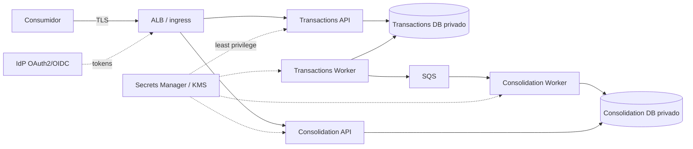

# Security, Resilience e Observability Views

- **Status:** EM REVISÃO FINAL — aguardando validação humana

## 1. Security View

### Local/MVP

Sem segredos reais versionados; configuração externalizada; validação de entrada; autenticação de desenvolvimento opcional e claramente identificada; bancos/filas não expostos desnecessariamente; erros não retornam detalhes internos.

### Arquitetura-alvo

Critérios: TLS externo; criptografia em repouso; IAM Task Roles separados; Publisher somente envia à fila; Consumer recebe/remove/ajusta visibilidade; redrive administrativo separado quando possível; Secrets Manager/KMS; OAuth2/OIDC/JWT quando IdP for definido; sem RBAC de negócio inventado; logs não contêm token, segredo ou descrição financeira desnecessária.

LGPD/compliance específicos dependem da classificação de dados ausente no case.

## 2. Resilience View

| Falha | Comportamento esperado |
|---|---|
| Consolidation API/Worker indisponível | Transactions continua; SQS acumula backlog |
| SQS indisponível | lançamento confirma localmente; Outbox permanece pendente |
| Transactions Worker reinicia | retoma Outbox; duplicata é tolerada |
| falha após SendMessage | possível republicação, absorvida por idempotência |
| evento redelivered | `ProcessedEvent` impede dupla contabilização |
| falha transitória no consumo | sem DeleteMessage; nova entrega após visibility timeout |
| falha persistente | DLQ por redrive policy + alerta + runbook |
| Transactions DB indisponível | lançamento não é confirmado |
| Consolidation DB indisponível | consumo falha; Transactions não é afetado |
| divergência silenciosa | reconciliação detecta e rebuild parte de Transactions |

Retries usam backoff/jitter e limites configurados. Retry infinito sem isolamento não é aceitável. SLA/RTO/RPO, Multi-AZ e DR dependem de objetivos não fornecidos.

## 3. Observability View

### APIs

Request rate, error rate, latência, status, health/readiness e saturação.

### Transactions Worker / Outbox

Quantidade pendente, idade do item mais antigo, publish rate/error, tentativas, tempo até publicação e limpeza.

### SQS/DLQ

`ApproximateNumberOfMessagesVisible`, `ApproximateAgeOfOldestMessage`, mensagens em voo, taxa de recebimento/remoção e DLQ > 0. Não usar terminologia de `consumer lag`/offset Kafka na arquitetura atual.

### Consolidation Worker

Taxa/erro/tempo de processamento, redelivery, duplicatas detectadas e idade do evento ao ser consolidado.

### Consolidation API

Taxa/erro/latência. `lastUpdatedAt` auxilia diagnóstico, mas não mede sozinho se existe backlog; a defasagem operacional vem dos sinais da Outbox/fila/event age.

### Logs e traces

Logs estruturados com `correlationId`, `transactionId` e `eventId` quando aplicáveis. W3C trace context deve atravessar request, Outbox e atributos SQS. Sanitização de payloads e timestamps UTC.

## 4. Alertas

Sem SLOs não há thresholds produtivos responsáveis. Devem existir alertas parametrizáveis para: Outbox crescendo/envelhecendo, falhas persistentes de publicação, idade/profundidade da fila acima do objetivo definido, DLQ não vazia, erros sustentados e indisponibilidade de banco/processos.

## 5. Evidência futura

Testes precisam desligar Consolidação, falhar SQS, provocar redelivery/DLQ e concorrência, e então demonstrar recuperação/reconciliação sem dupla contabilização. A evidência deve mostrar também que os sinais acima permitem diagnosticar cada cenário.