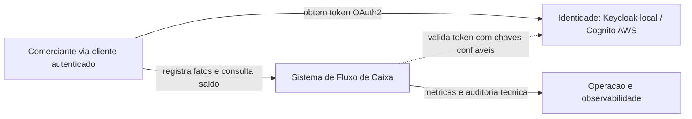
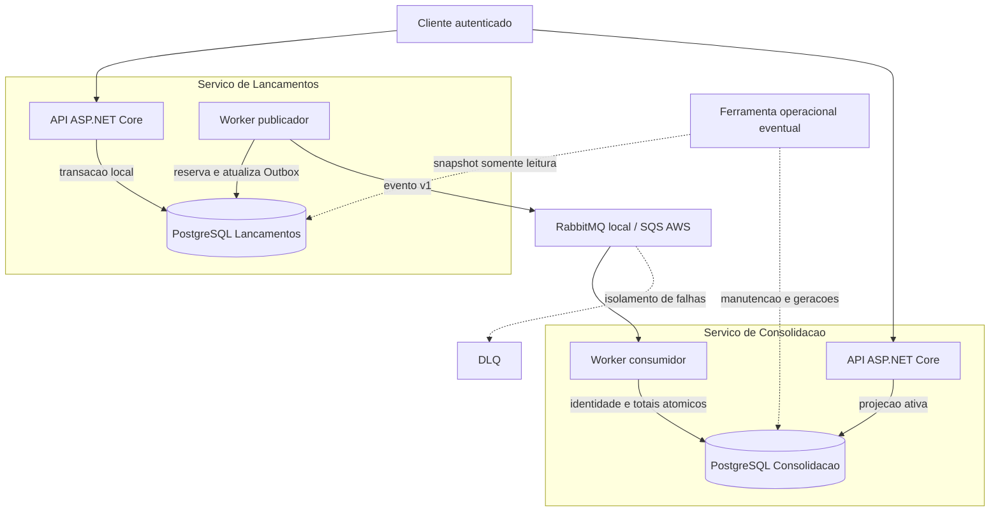

# C4 — Contexto e contêineres

Contêiner no C4 representa unidade executável ou armazenamento, não necessariamente um Docker container.

## Nível 1 — Contexto

O sistema oferece controle de lançamentos e relatório diário por API. O provedor de identidade é suporte técnico; não é domínio financeiro. Consulta é eventual; escrita não espera a consolidação.

## Nível 2 — Contêineres

Dois serviços de negócio, quatro processos permanentes. A ferramenta de recuperação é job administrativo, sem endpoint público e sem criar novo domínio. Cada processo possui credencial mínima; somente a ferramenta autorizada acessa os dois bancos.

## Disponibilidade e implantação

Lançamentos depende de seu banco, configuração e validação de identidade; não depende da Consolidação ou broker para confirmar. Readiness respeita essa fronteira. Identidade valida localmente JWT com cache de chaves; indisponibilidade de chaves desconhecidas falha fechada.

A [visão AWS](../07-infraestrutura/arquitetura-aws.md) mostra réplicas e zonas; o [guia local](../07-infraestrutura/execucao-local.md) mostra serviços e portas. O [C4 de componentes](../05-arquitetura-software/c4-componentes.md) detalha responsabilidades internas.
