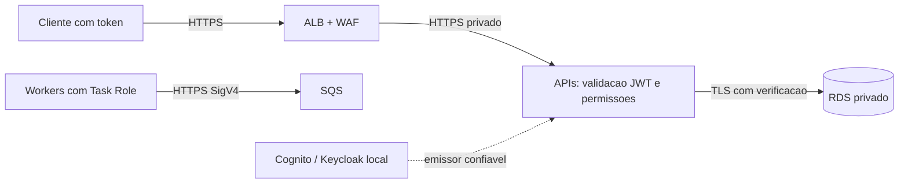

# Visões de segurança, resiliência e observabilidade

**Estado: DOCUMENTAÇÃO APROVADA.** Controles especificados para implementação e verificação.

## Segurança de consumo

As APIs validam JWT; o ALB termina TLS e encaminha tráfego, sem assumir validação de bearer token. Local: Keycloak, realm cashflow. AWS: Cognito User Pool com resource server `cashflow` e clientes técnicos OAuth2 client credentials. Permissões lógicas `transactions.write`, `transactions.read`, `consolidations.read`; no Cognito, scopes `cashflow/transactions.write`, `cashflow/transactions.read`, `cashflow/consolidations.read`. O adaptador de autorização normaliza esses valores. São escolhas técnicas aprovadas, não perfis de negócio atribuídos ao enunciado.

Validar assinatura com algoritmo permitido RS256, emissor exato, expiração/not-before com tolerância de relógio de 60 s e token de acesso, nunca aceitar ID token. No Keycloak validar audience cashflow-api e client_id emitido pelo mapper configurado no bootstrap local. No Cognito validar `token_use=access`, client_id permitido e scopes do resource server; se o token trouxer aud por configuração de recurso, validar o valor configurado. Não exigir cegamente claim aud ausente em fluxos Cognito; não aceitar token de outro pool/cliente. Tokens duram 15 min; cliente renova antes de expirar. JWKS em cache com renovação controlada e tratamento de rotação; chave desconhecida sem resolução confiável falha fechada.

Criação exige escrita; consultas exigem leitura correspondente. Falta de autenticação retorna 401 e de permissão 403. Idempotência usa issuer/client_id validados. Este escopo é de cliente técnico e comerciante único; não oferece isolamento multi-tenant.

## Fronteiras e proteção

AWS: TLS 1.2+ externo, TLS ALB→tasks e verificação de certificado na conexão PostgreSQL. O ALB não fornece autenticação mútua do certificado do target; Security Groups e isolamento da rede completam a fronteira. Broker e APIs AWS via HTTPS. Bancos sem endpoint público, tasks sem IP público. Criptografia RDS/SQS/segredos por KMS; proibir transporte inseguro em políticas aplicáveis.

Rate limit inicial por cliente: 100 req/s nas leituras com burst 200 e 20 req/s nas escritas com burst 40, aplicado por instância e documentado como limite local, não quota global. WAF limita abuso por IP e usa regras gerenciadas; referência inicial 20.000 requests/5 min por IP para não bloquear o ensaio de 50 req/s. Validar falsos positivos em homologação. Corpo, paginação e datas limitados no contrato; queries parametrizadas; CORS negado por padrão; APIs sem cookies de sessão.

## Privilégios e segredos

Cada processo tem credencial de banco própria, restrita às tabelas e operações necessárias. Conta de migration separada; API de consulta somente leitura. Publisher pode reservar/atualizar Outbox e enviar mensagens; não pode consumir. Consumer recebe/remove/ajusta visibilidade, grava projeção e lê controle; não opera redrive administrativo. Task Roles restritas a ARNs do ambiente; Execution Role de imagens/logs/segredos separada. KMS inclui GenerateDataKey/Decrypt conforme papel e uso de SSE-KMS, sem wildcard indiscriminado. Administrador de recuperação é identidade separada.

Secrets Manager para senhas e OAuth secrets, rotação coordenada com pools de conexão; nenhuma chave AWS estática na aplicação. Imagens sem root, filesystem somente leitura quando compatível, varredura de dependências/imagens e atualização de patches. HTTP/AMQP sem TLS são exceção exclusivamente local em loopback/rede Docker isolada, com dados sintéticos e sem credenciais produtivas.

## Resiliência

| Falha | Resposta |
|---|---|
| Consolidação API/Worker/banco | Lançamentos continua; transporte acumula; recuperação por backlog ou rebuild |
| Broker | Outbox preserva trabalho; retry/suspensão observável; API não depende do envio |
| Publicador cai após envio | Republicação com identidade estável |
| Consumidor cai após commit | Reentrega sem efeito adicional |
| Banco de Lançamentos | Sem confirmação; erro retentável com chave original |
| Mensagem inválida | Isolamento em DLQ, investigação; sem descarte silencioso |
| Perda/expiração do transporte | Reconciliação e reconstrução da fonte |
| Falha de zona AWS | Réplicas ECS e RDS Multi-AZ; medir failover |
| Corrupção/restore | PITR e reconstrução coordenada, RPO/RTO medidos |

Backlog não é ilimitado. Alarmes de armazenamento, reservas e conexões previnem falhas indiretas. Credenciais, ALB, região e infraestrutura compartilhada continuam domínios de falha comuns; a independência exigida não equivale a imunidade a toda falha da AWS.

## Observabilidade

OpenTelemetry nos quatro processos, correlação HTTP→Outbox→broker→consumidor. Logs estruturados com ids técnicos, sem tokens, secrets, descrição ou corpo financeiro. Persistir issuer/clientId e instante no fato para auditoria; trilha de operação em recovery_runs e CloudTrail na AWS. Não colocar transactionId/eventId como labels de métricas de alta cardinalidade.

Métricas HTTP: volume, erros por classe, duração e readiness. Outbox: pendentes, idade, suspensos, taxa de publicação, leases vencidas. RabbitMQ: ready, unacked, redeliveries, confirmações e DLQ; idade complementar medida pelo timestamp do evento. SQS: visible/in-flight, idade aproximada e DLQ. Consumidor: duração, falhas, duplicatas e idade do evento. Processamento mede atraso desde createdAt/eventOccurredAt, não desde data retroativa do negócio.

`lastUpdatedAt` não mede completude. Relatórios de reconciliação e métricas de integração complementam o diagnóstico. Thresholds, retenções e metas estão nos [parâmetros](../07-infraestrutura/parametros-operacionais.md). Alertas são encaminhados ao canal operacional configurado na implantação; nesta etapa não há envio de notificações.

Referências: [validação de tokens Cognito](https://docs.aws.amazon.com/cognito/latest/developerguide/amazon-cognito-user-pools-using-the-access-token.html), [HTTPS em target groups ALB](https://docs.aws.amazon.com/elasticloadbalancing/latest/application/load-balancer-target-groups.html).
