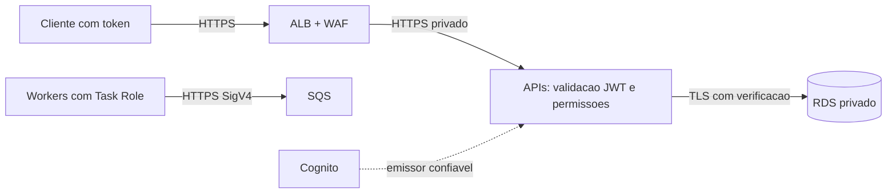

# Visões de segurança, resiliência e observabilidade

Esta visão separa controles **implementados/demonstrados localmente** de controles da **arquitetura-alvo AWS**. A decisão normativa de identidade está no [ADR-011](../06-adr/adr-011-autenticacao-e-autorizacao-das-apis.md).

## Segurança de consumo

As APIs locais validam JWT emitido pelo Keycloak e aplicam permissões por rota: criação exige `transactions.write`, consultas de lançamentos exigem `transactions.read` e consultas da consolidação exigem `consolidations.read`. Falta de autenticação retorna 401 e de permissão retorna 403. O fluxo local usa OAuth 2.0 client credentials. Claims, audience, issuer, tempo de token e composição da identidade auditável são definidos no ADR-011. Este escopo é de cliente técnico e comerciante único; não oferece isolamento multi-tenant.

Na arquitetura-alvo AWS, Cognito substitui o Keycloak como emissor e ALB/WAF compõem a borda. O ALB termina TLS e encaminha tráfego; a autorização bearer continua responsabilidade das APIs.

## Fronteiras e proteção da arquitetura-alvo AWS

O desenho AWS requer TLS 1.2+ externo, TLS ALB→tasks, verificação de certificado na conexão PostgreSQL, bancos sem endpoint público e tasks sem IP público. O ALB não fornece autenticação mútua do certificado do target; Security Groups e isolamento da rede completam a fronteira. RDS/SQS/segredos usam criptografia gerenciada/KMS conforme o recurso. Esses controles são arquitetura-alvo; não foram homologados em uma implantação AWS nesta entrega.

Rate limiting de borda e WAF pertencem ao desenho de produção. **A entrega local não implementa rate limiter HTTP/429 nas APIs.** Limites de corpo, paginação e datas são aplicados pelo contrato/código onde documentados; queries usam parâmetros e as APIs não dependem de cookies de sessão.

## Privilégios e segredos

Localmente, credenciais/configurações são separadas por componentes no Compose e os segredos de demonstração vêm do `.env`; são credenciais locais e não produtivas. A entrega não demonstra IAM AWS, KMS, Secrets Manager ou rotação de credenciais.

Na arquitetura-alvo, cada processo deve receber privilégio mínimo: credenciais de banco por papel, migration separada, publisher autorizado apenas à publicação necessária, consumer autorizado ao consumo e projeção, e identidade administrativa distinta para Recovery. Task Roles devem ser restritas aos ARNs do ambiente; Execution Role de imagens/logs/segredos fica separada. Secrets Manager e KMS fazem parte desse desenho, sem chaves AWS estáticas na aplicação.

HTTP/AMQP sem TLS são exceção exclusivamente local em loopback/rede Docker com dados sintéticos. Hardening de imagem, filesystem somente leitura, varredura de dependências/imagens e patching são requisitos de produção, não evidência executada pelo Compose.

## Resiliência

| Falha | Resposta |
|---|---|
| Consolidação API/Worker/banco | Lançamentos continua; transporte acumula; recuperação por backlog ou rebuild |
| Broker RabbitMQ local | Outbox preserva trabalho; circuit breaker do publisher pausa falha sistêmica; API não depende do envio |
| Publicador cai após envio | Republicação possível com identidade estável; consumidor idempotente |
| Consumidor cai após commit | Reentrega possível sem efeito financeiro adicional |
| Banco de Lançamentos | Sem confirmação da escrita; retry deve reutilizar a chave de idempotência |
| Mensagem inválida | Isolamento em DLQ, sem descarte silencioso |
| Banco de Consolidação/manutenção | Consumer perde readiness e mantém entrega sem ACK até recuperação/reconexão |
| Perda/expiração do transporte | Rebuild a partir da fonte financeira é a estratégia de recuperação |
| Falha de zona AWS | ECS/RDS Multi-AZ são arquitetura-alvo; failover deve ser medido antes de produção |
| Corrupção/restore AWS | PITR e reconstrução coordenada são procedimentos-alvo ainda não ensaiados |

Backlog não é ilimitado. Alarmes de armazenamento, reservas e conexões são controles operacionais necessários em produção. Credenciais, região e infraestrutura compartilhada continuam domínios de falha comuns; independência entre Lançamentos e Consolidação não significa imunidade a toda falha de infraestrutura.

## Observabilidade

Localmente há OpenTelemetry nos quatro processos, correlação HTTP→Outbox→RabbitMQ→consumidor, métricas em `/metrics` e exportação OTLP para Jaeger. O ensaio T14 demonstrou a propagação distribuída pelo caminho assíncrono. O trace de uma consulta posterior à Consolidation API é independente do trace assíncrono do lançamento. Tokens e secrets não devem ser registrados; identificadores financeiros não devem virar labels de alta cardinalidade.

A aplicação expõe métricas próprias de HTTP/processamento, Outbox e consumer, enquanto RabbitMQ/infraestrutura possuem sinais operacionais próprios. `lastUpdatedAt` não mede completude. Thresholds, retenções e metas estão nos [parâmetros](../07-infraestrutura/parametros-operacionais.md). Nesta entrega não há envio configurado de alertas/notificações nem CloudWatch/CloudTrail AWS demonstrados.

Na arquitetura-alvo, métricas de fila/SQS, DLQ, idade, disponibilidade, banco, ALB e tarefas ECS devem compor dashboards e alarmes. CloudTrail e controles de auditoria AWS pertencem ao desenho de produção, não à execução local.

Referências de arquitetura-alvo: [validação de tokens Cognito](https://docs.aws.amazon.com/cognito/latest/developerguide/amazon-cognito-user-pools-using-the-access-token.html), [HTTPS em target groups ALB](https://docs.aws.amazon.com/elasticloadbalancing/latest/application/load-balancer-target-groups.html).