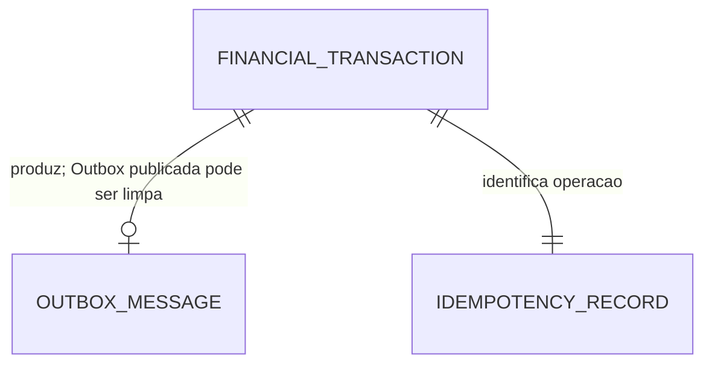

# Visão de dados

Cada serviço possui banco, credenciais e migrations próprios. Não há leitura cruzada no fluxo de negócio. Acesso excepcional de recuperação usa identidade operacional dedicada.

## Lançamentos

| Tabela | Chaves e dados principais | Ciclo de vida |
|---|---|---|
| financial_transactions | id UUID PK; creation_event_id UUID UNIQUE; type; amount numeric(14,2); description; occurred_at; business_date; created_at; actor_issuer; actor_client_id | Imutável, sem limpeza automática |
| idempotency_records | PK (issuer, client_id, key); request_hash; canonical_version; transaction_id UNIQUE; response_status; response_body mínimo; created_at | Retido junto ao fato, sem expiração |
| outbox_messages | event_id PK; aggregate_id FK; payload; headers; state; published_at; attempts; next_attempt_at; lease_token; lease_until; last_error | Limpar apenas publicados há mais de 30 dias |

Estados normativos da Outbox: `PENDING` para item elegível ou aguardando nova tentativa, `PUBLISHED` após confirmação do broker e persistência de `published_at`, e `SUSPENDED` quando o item deixa o ciclo automático após falhas persistentes e exige ação operacional. Lease não cria um quarto estado: `lease_token` e `lease_until` representam apenas a reserva temporária de um item `PENDING`.

A cardinalidade da Outbox considera a limpeza posterior; no commit de criação existe exatamente um evento. A chave de idempotência e o fato são inseridos atomicamente. Identificador do lançamento pode ser gerado antes da reserva; FK da resposta para o fato deve ser diferível até commit ou preenchida após inserção do fato dentro da mesma transação. Não deixar reserva órfã confirmada.

## Consolidação

| Tabela | Chaves e dados principais |
|---|---|
| projection_control | Linha única; active_generation_id; maintenance; maintenance_run_id; maintenance_started_at; maintenance_expires_at (migration 002) |
| projection_generations | generation_id PK; status; created_at; activated_at; snapshot_manifest |
| daily_consolidations | PK (generation_id, business_date); total_credits numeric(28,2); total_debits numeric(28,2); transaction_count bigint; last_updated_at |
| processed_transactions | PK (generation_id, transaction_id); UNIQUE (generation_id, event_id); business_date; type; amount; fact_hash; processed_at |
| recovery_runs (alvo futuro) | run_id PK; operador; motivo; estado; geração anterior/nova; manifesto; contagens; hashes; horários; não criada pelas migrations locais |

A migration inicial cria uma geração vazia ACTIVE e a linha única de controle apontando para ela, com maintenance=false; a segunda acrescenta a expiração da lease. O Recovery local usa essa linha para ownership e fencing. A trilha `recovery_runs` completa permanece projetada.

`ProcessedTransaction` é o registro durável do efeito financeiro e substitui a proposta anterior de deduplicação somente por eventId. Reconstrução popula totais e identidades na mesma geração. Retenção da geração ativa acompanha os fatos; gerações inativas ficam 7 dias para auditoria e são removidas somente após encerramento operacional.

Saldo é calculado como créditos menos débitos na leitura, sem coluna mutável independente. Valor individual entre 0,01 e 999.999.999,99, reforçado por CHECK; tipo CREDIT/DEBIT; transactionCount não negativo. Rejeitar escala acima de duas casas antes de persistir para impedir arredondamento implícito do numeric. Overflow de total/contagem aborta transação e gera incidente. Auditoria operacional tem retenção própria; identidades financeiras não são logs descartáveis.

## Transações e concorrência

Criação: fato + idempotência + Outbox no mesmo commit. Publicação: reserva curta com SKIP LOCKED e token; chamada externa fora da transação (ADR-004). Consumo: trava FOR SHARE no controle, identidade e UPSERT relativo no mesmo commit (ADR-005). Manutenção: FOR UPDATE no controle para escoar consumo e persistir pausa; troca de geração atômica. Consulta usa uma única instrução/snapshot com geração ativa.

## Índices e isolamento

Índices `(business_date,id)` e `(type,business_date,id)` em lançamentos; parcial na Outbox elegível por state/next_attempt_at/lease_until; `(generation_id,business_date)` no registro de processamento para reconciliação. PK de consolidação atende consulta diária. Avaliar planos com massa de referência antes de adicionar índices.

READ COMMITTED no fluxo normal e REPEATABLE READ nos snapshots operacionais. Timestamps técnicos em UTC. Limites e contratos no [SDD](../05-arquitetura-software/sdd.md) e [parâmetros](../07-infraestrutura/parametros-operacionais.md). Backup e restauração seguem o [procedimento operacional](../07-infraestrutura/recuperacao-e-reconciliacao.md); Outbox não substitui backup.
