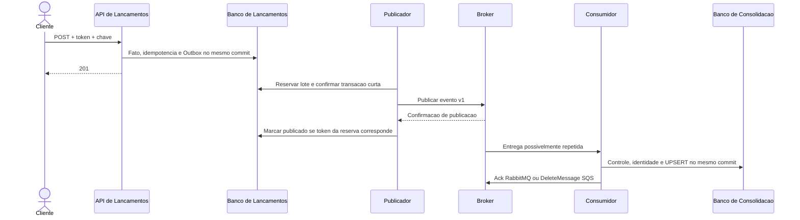

# Visão de integração

**Estado: DOCUMENTAÇÃO APROVADA.** Contrato HTTP em [contratos-http](../05-arquitetura-software/contratos-http.md); identidade no [ADR-011](../06-adr/adr-011-autenticacao-e-autorizacao-das-apis.md); payload de evento exclusivamente no [ADR-008](../06-adr/adr-008-contrato-e-versionamento-de-eventos.md); semântica por broker no [ADR-010](../06-adr/adr-010-mensageria-local-rabbitmq-e-aws-sqs.md).

## Fronteiras

Cliente→API: HTTPS/JSON na AWS, bearer token validado na API. API→banco: transação local. Publicador→broker: AMQP com confirmação no local ou HTTPS/SigV4 SQS na AWS. Consumidor→banco: identidade financeira e projeção no mesmo commit. Ferramenta operacional→bancos: acesso excepcional autenticado para snapshot e recuperação.

## Garantias e limites

Entrega pelo menos uma vez, sem dependência de ordenação. O consumidor reconhece a identidade financeira mesmo se evento for reemitido em outra versão. Perda da confirmação pode gerar duplicata; hash divergente é incidente. Contexto de trace via metadados não altera o fato.

Retentativas e DLQ não são equivalentes entre produtos. RabbitMQ usa repasse confirmado para filas de espera; SQS usa visibilidade e redrive policy. A homologação usa SQS real; testes locais não demonstram IAM, KMS ou retenção gerenciada.

A publicação confirmada não comprova efeito na projeção. Expiração do transporte requer reconciliação/rebuild pela fonte. Valores de timeout, retenção e rate de redrive têm uma única fonte nos parâmetros operacionais. Kafka é alternativa analisada no ADR-007, sem componente adicional nesta arquitetura.
