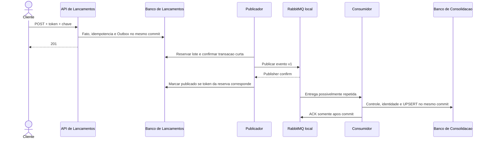

# Visão de integração

Contrato HTTP em [contratos-http](../05-arquitetura-software/contratos-http.md); identidade no [ADR-011](../06-adr/adr-011-autenticacao-e-autorizacao-das-apis.md); payload de evento exclusivamente no [ADR-008](../06-adr/adr-008-contrato-e-versionamento-de-eventos.md); semântica por broker no [ADR-010](../06-adr/adr-010-mensageria-local-rabbitmq-e-aws-sqs.md).

## Fronteiras

Cliente→API: HTTP no ambiente local e HTTPS na arquitetura AWS, bearer token validado na API. API→banco: transação local. Publicador→broker: **AMQP/RabbitMQ implementado localmente**; **HTTPS/SigV4/SQS pertence à arquitetura-alvo AWS**. Consumidor→banco: identidade financeira e projeção no mesmo commit. Ferramenta Recovery→bancos: acesso administrativo excepcional para snapshot e reconstrução.

O diagrama representa o fluxo **executável local**. Na AWS, RabbitMQ será substituído pelo adaptador SQS especificado no ADR-010; esse adaptador não existe no código entregue.

## Garantias e limites

O fluxo local trabalha com entrega pelo menos uma vez e não depende de ordenação. O consumidor usa identidade financeira durável por geração e absorve redelivery quando o fato é idêntico; identidade com hash divergente é conflito/incidente. Contexto de trace via metadados não altera a identidade financeira.

Retentativas e DLQ não são equivalentes entre produtos. RabbitMQ local usa filas de espera/TTL e DLQ conforme a implementação do consumer. SQS deverá usar visibility timeout, `DeleteMessage` após commit e redrive policy, mas essas propriedades são requisitos futuros e **não foram homologadas em AWS**. Os testes locais não demonstram IAM, KMS, retenção gerenciada ou comportamento real do SQS.

A publicação confirmada não comprova efeito na projeção. Perda ou expiração do transporte não pode ser a única estratégia de recuperação: os fatos persistidos em Transactions são a fonte para rebuild. Valores operacionais têm sua fonte em [parâmetros operacionais](../07-infraestrutura/parametros-operacionais.md). Kafka é alternativa analisada e rejeitada para este corte no ADR-007, sem componente Kafka na solução.
