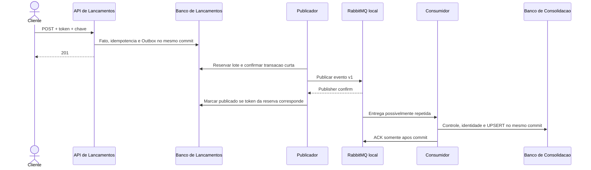
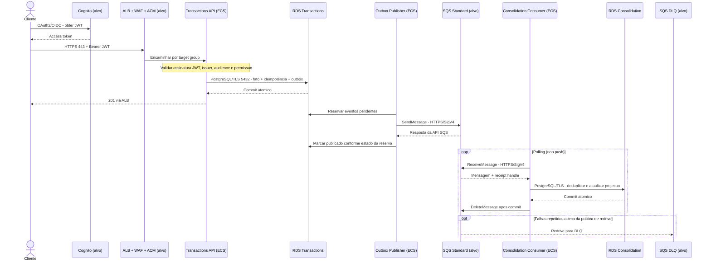

# Visão de integração

Contrato HTTP em [contratos-http](../05-arquitetura-software/contratos-http.md); identidade no [ADR-011](../06-adr/adr-011-autenticacao-e-autorizacao-das-apis.md); payload de evento exclusivamente no [ADR-008](../06-adr/adr-008-contrato-e-versionamento-de-eventos.md); semântica por broker no [ADR-010](../06-adr/adr-010-mensageria-local-rabbitmq-e-aws-sqs.md).

## Fronteiras

Cliente→API: HTTP no ambiente local e HTTPS na arquitetura AWS, bearer token validado na API. API→banco: transação local. Publicador→broker: **AMQP/RabbitMQ implementado localmente**; **HTTPS/SigV4/SQS pertence à arquitetura-alvo AWS**. Consumidor→banco: identidade financeira e projeção no mesmo commit. Ferramenta Recovery→bancos: acesso administrativo excepcional para snapshot e reconstrução.

O diagrama representa o fluxo **executável local**. Na AWS, RabbitMQ será substituído pelo adaptador SQS especificado no ADR-010; esse adaptador não existe no código entregue.

## Visão de protocolos — arquitetura-alvo AWS (não implementada)

A sequência acima documenta **o fluxo local real com RabbitMQ**. O diagrama a seguir mostra **o contrato de integração esperado para AWS**, sem afirmar que o adaptador SQS ou o Cognito já existem no código. A topologia de rede, incluindo ALB e NAT por zona, está em [arquitetura-alvo AWS](../07-infraestrutura/arquitetura-aws.md).

**Precisões importantes:** a resposta bem-sucedida de `SendMessage` confirma aceite pela API SQS, não consumo nem persistência na Consolidação. `ReceiveMessage` pode entregar novamente; `DeleteMessage` usa o receipt handle da entrega e deve ocorrer somente após o commit. A fila DLQ não é uma saída alternativa de sucesso: é um mecanismo de isolamento após tentativas conforme a política configurada. A indisponibilidade de SQS/Consolidação não pode bloquear o commit de Lançamentos, pois a Outbox é persistida na transação local.

| Fronteira | Protocolo local implementado | Protocolo AWS alvo | Comprovação |
|---|---|---|---|
| Cliente → API | HTTP + JWT, Keycloak | HTTPS 443 via WAF/ALB/ACM + JWT, Cognito | Local validado; AWS não executado |
| API/Worker → banco do contexto | PostgreSQL via Npgsql | PostgreSQL/TLS 5432 em RDS privado | Persistência local testada; TLS/RDS não homologados |
| Publicador → transporte | AMQP / RabbitMQ, publisher confirms | API SQS / HTTPS SigV4, SendMessage | Somente RabbitMQ implementado |
| Transporte → consumidor | Entrega RabbitMQ, ACK após commit | Polling ReceiveMessage, DeleteMessage após commit | Semântica SQS ainda não implementada |
| Erro persistente → DLQ | Retry/DLQ RabbitMQ | Redrive policy / SQS DLQ | Somente comportamento local validado |
| API → provedor de identidade | Validação JWT/JWKS Keycloak | Validação JWT/JWKS Cognito | Cognito não integrado |
| Task privada → endpoint público | Não aplicável ao Compose | Rota por NAT Gateway da AZ, salvo endpoint privado | Topologia AWS não provisionada |

O diagrama de protocolos representa a **sequência lógica**. Não implica que todas as chamadas atravessem o ALB ou o NAT: o ALB é apenas o ponto de entrada das APIs; chamadas AWS SDK saem da subnet privada conforme suas rotas e endpoints. O S3 Gateway Endpoint tem rota específica e não substitui o NAT para serviços públicos distintos.

## Garantias e limites

O fluxo local trabalha com entrega pelo menos uma vez e não depende de ordenação. O consumidor usa identidade financeira durável por geração e absorve redelivery quando o fato é idêntico; identidade com hash divergente é conflito/incidente. Contexto de trace via metadados não altera a identidade financeira.

Retentativas e DLQ não são equivalentes entre produtos. RabbitMQ local usa filas de espera/TTL e DLQ conforme a implementação do consumer. SQS deverá usar visibility timeout, `DeleteMessage` após commit e redrive policy, mas essas propriedades são requisitos futuros e **não foram homologadas em AWS**. Os testes locais não demonstram IAM, KMS, retenção gerenciada ou comportamento real do SQS.

A publicação confirmada não comprova efeito na projeção. Perda ou expiração do transporte não pode ser a única estratégia de recuperação: os fatos persistidos em Transactions são a fonte para rebuild. Valores operacionais têm sua fonte em [parâmetros operacionais](../07-infraestrutura/parametros-operacionais.md). Kafka é alternativa analisada e rejeitada para este corte no ADR-007, sem componente Kafka na solução.
