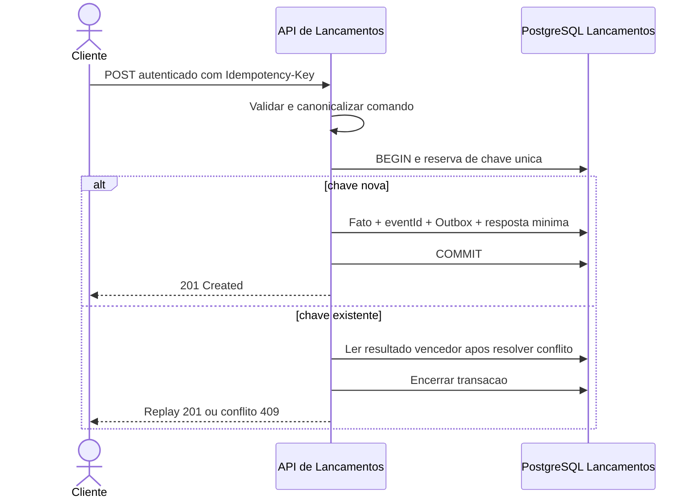
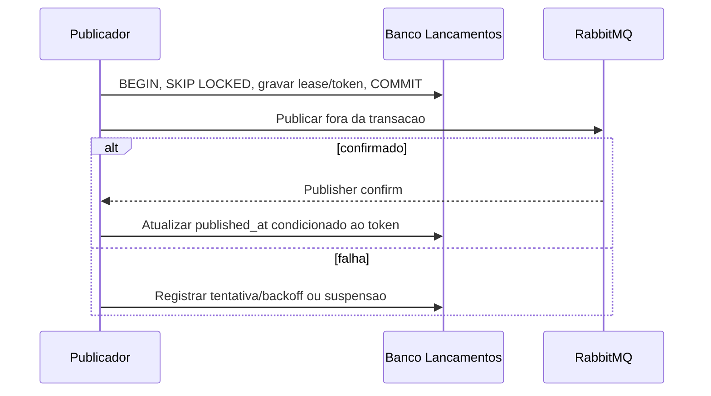
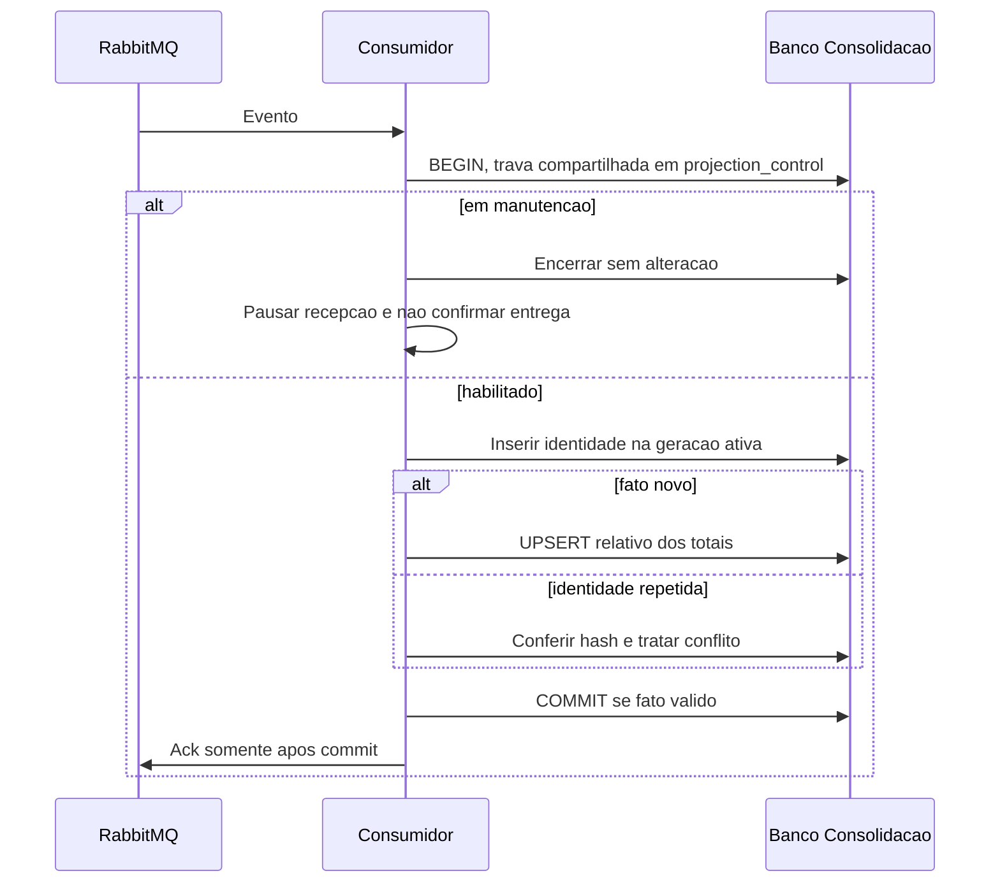
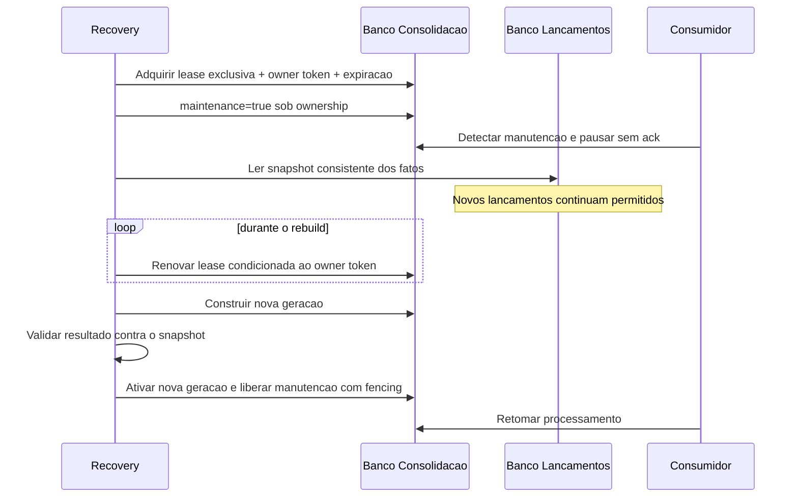

# Visões dinâmicas — fluxos críticos

## Registro e concorrência de chave

Falha em qualquer passo antes do commit reverte tudo. Timeout pode deixar cliente sem resposta após commit; retry com a mesma chave recupera a resposta. Ausência de confirmação nunca autoriza gerar nova chave automaticamente.

## Publicação com reserva

Queda após envio permite republicação. Reserva vencida admite captura por outra instância; atualização por token antigo é rejeitada. Item suspenso preserva trabalho e exige operação. Este fluxo descreve a implementação RabbitMQ local; SQS pertence à arquitetura-alvo.

## Consumo idempotente

Identidade divergente provoca rollback e fluxo de erro definitivo; não confirmar como duplicata válida. Falha transitória permite retry; permanente segue DLQ. O ADR-010 distingue esse comportamento RabbitMQ da especificação futura de SQS.

## Reconstrução com lease e fencing

A lease impede dois rebuilds administrativos válidos simultaneamente. Renovação e liberação exigem o mesmo owner token; um processo antigo que perdeu a lease não pode ativar, renovar ou liberar a manutenção depois que outro owner assumiu.

Se o processo Recovery morrer, o estado não é automaticamente retomado pelo próprio processo. Após expirar `maintenance_expires_at`, o Worker deixa de considerar a manutenção válida e volta ao processamento normal. O operador deve iniciar um novo rebuild, que adquire nova lease e novo token. Esse comportamento de expiração/fencing foi exercitado no T10 local em escopo limitado.

A API de Consolidação serve a geração ativa anterior durante a construção e passa à nova somente após a troca válida, evitando mistura entre gerações. O snapshot é materializado em memória na ferramenta local como trade-off aceitável para o estudo de caso; uma implementação produtiva com volume elevado deve processar incrementalmente sem abandonar lease, geração e fencing. Reconciliação e restore seguem o [procedimento completo](../07-infraestrutura/recuperacao-e-reconciliacao.md).

## Falhas de disponibilidade

Se toda a Consolidação parar, Lançamentos continua e o transporte acumula. Se RabbitMQ parar, a Outbox acumula e o caminho HTTP de Lançamentos continua dependente apenas de seu próprio banco e identidade já validável. Se a retenção do transporte produtivo expirar, a estratégia de recuperação depende dos fatos persistidos na origem. Se o banco de Lançamentos falhar, a API não confirma novo lançamento. Alertas de capacidade evitam interpretar acumulação como armazenamento infinito.

A dependência de `jaeger` saudável usada no Docker Compose é conveniência de bootstrap determinístico do ambiente local; observabilidade não deve ser dependência de disponibilidade dos processos na arquitetura de produção.