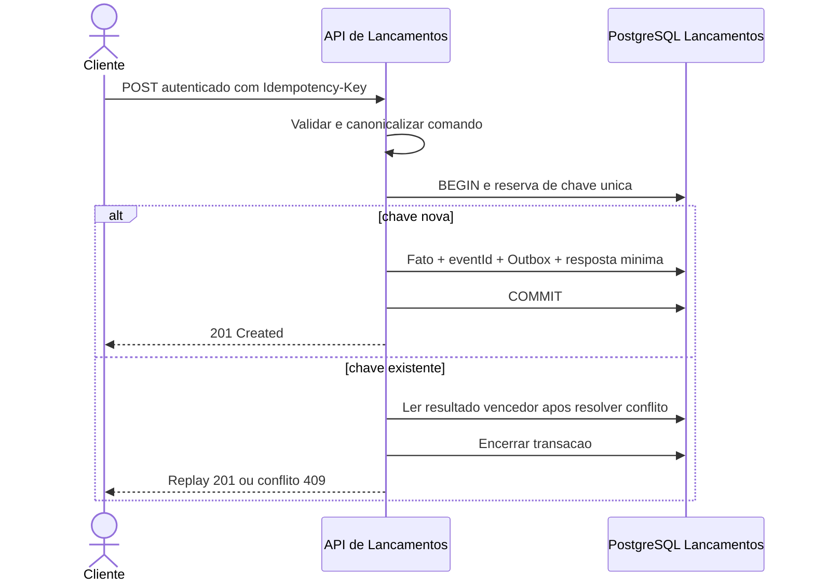
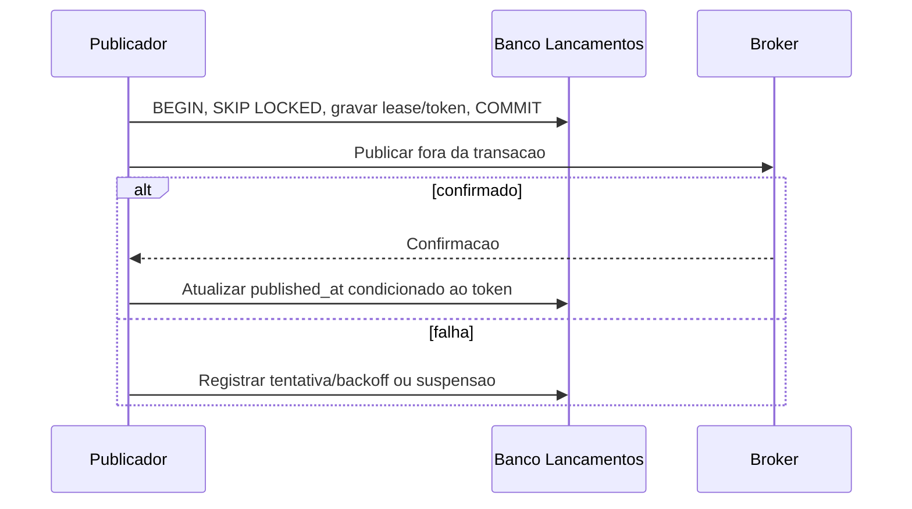
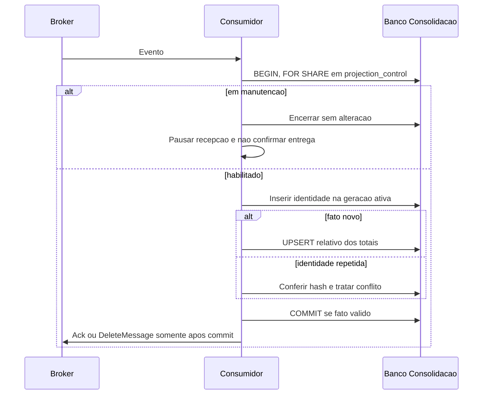
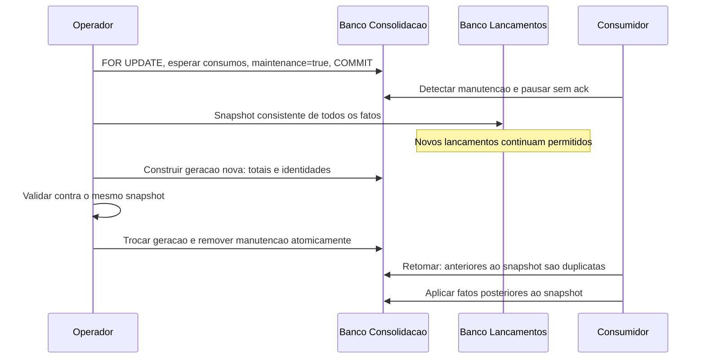

# Visões dinâmicas — fluxos críticos

## Registro e concorrência de chave

Falha em qualquer passo antes do commit reverte tudo. Timeout pode deixar cliente sem resposta após commit; retry com mesma chave recupera a resposta. Ausência de confirmação nunca autoriza gerar uma nova chave automaticamente.

## Publicação com reserva

Queda após envio permite republicação. Reserva vencida admite captura por outra instância; atualização por token antigo é rejeitada. Item suspenso preserva trabalho e exige operação.

## Consumo idempotente

Identidade divergente provoca rollback e fluxo de erro definitivo; não confirmar como duplicata válida. Falha transitória permite retry; permanente segue DLQ. O ADR-010 detalha repasse confirmado RabbitMQ e política SQS.

## Reconstrução e eventos em trânsito

A pausa precede o snapshot para não perder eventos já confirmados durante a construção. Crash mantém estado persistente recuperável. A API lê geração antiga durante manutenção e nova após troca, sem mistura. Reconciliação e restore seguem o [procedimento completo](../07-infraestrutura/recuperacao-e-reconciliacao.md).

## Falhas de disponibilidade

Se toda Consolidação parar, Lançamentos continua e o transporte acumula. Se broker parar, Outbox acumula. Se retenção expirar, reconstrução usa fatos da origem. Se o banco de Lançamentos falhar, API não confirma e devolve erro retentável. Alertas de capacidade evitam interpretar acumulação como armazenamento infinito.
