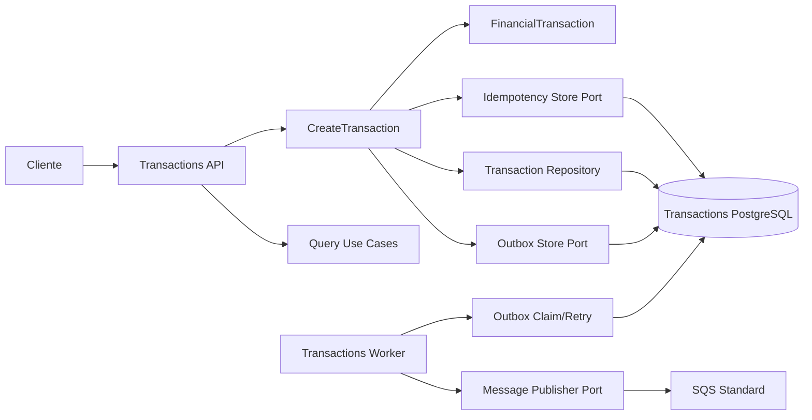
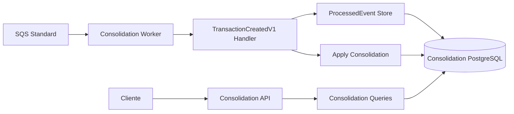

# C4 — Component View

- **Status:** EM REVISÃO FINAL — aguardando validação humana

## Serviço de Lançamentos

Dois processos executam componentes do mesmo serviço.



O boundary transacional de `CreateTransaction` inclui lançamento, idempotência e Outbox. O Worker não participa da resposta HTTP. Publishers concorrentes capturam pendências de forma segura (`SKIP LOCKED` ou equivalente).

## Serviço de Consolidação



`ProcessedEvent` e UPSERT relativo da projeção pertencem ao mesmo commit. `DeleteMessage` ocorre somente depois desse commit.

## Componentes transversais

- `CashFlow.Contracts`: contratos de integração versionados, sem entidades de domínio;
- clock/time-zone abstraction: permite derivar/testar `BusinessDate` deterministicamente;
- OpenTelemetry instrumentation: HTTP, banco e mensageria;
- Problem Details: erros HTTP consistentes;
- configuração: retry, retenções e parâmetros operacionais externalizados.

## Dependências permitidas

```text
Api/Worker ------> Application ---> Domain
Infrastructure --> Application
Infrastructure --> Domain (mapeamento estritamente necessário)
Contracts -------> boundaries de integração
```

Domain não referencia ASP.NET Core, EF Core, SDK AWS ou PostgreSQL. Application depende de portas, não do broker concreto.

## Rastreabilidade

- independência: API confirma por commit local; Workers são assíncronos;
- confiabilidade: Outbox + SQS + DLQ;
- idempotência: registro HTTP + `ProcessedEvent`;
- concorrência: unicidade, `SKIP LOCKED`, UPSERT atômico;
- recuperação: retry/redrive/reconciliação;
- observabilidade: componentes e processos instrumentados independentemente.