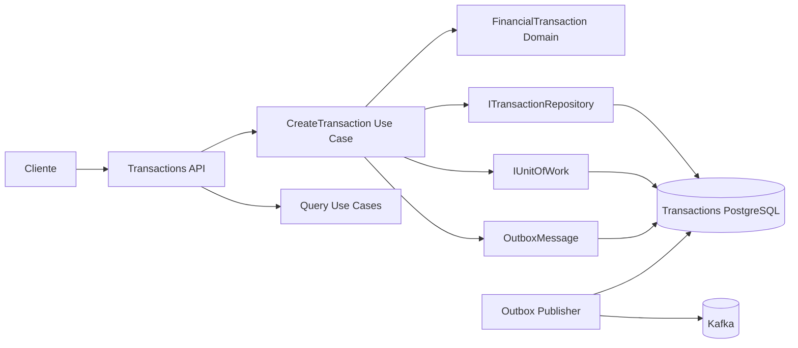
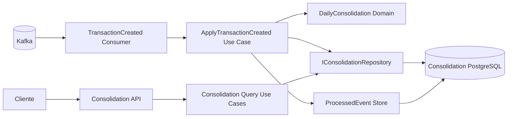

# C4 — Component View

## Transactions Service



### Responsabilidades

- **API**: protocolo HTTP, validação de formato e status codes;
- **Application**: coordenação do caso de uso e boundary transacional;
- **Domain**: invariantes financeiras do escopo;
- **Repository/DbContext**: persistência;
- **Outbox Publisher**: entrega assíncrona recuperável ao broker.

O publisher não faz parte do caminho síncrono de confirmação do lançamento.

## Consolidation Service



### Boundary transacional

Para cada evento, atualização de `DailyConsolidation` e registro de `ProcessedEvent` pertencem ao mesmo commit local. O offset do broker não deve ser confirmado antes desse commit.

## Dependências permitidas

```text
Api ------------> Application ---> Domain
Infrastructure -> Application
Infrastructure -> Domain (mapeamento/implementação quando necessário)
Contracts ------> somente boundaries de integração
```

`Domain` não referencia `Infrastructure`, `Api`, EF Core ou Kafka.

## Relação com os requisitos

- RNF-001/ASR-001: publisher/consumer desacoplados do POST de lançamento;
- RNF-004/ASR-002: commit local antes da confirmação ao cliente;
- RNF-006/ASR-004: idempotência na API e consumer;
- RNF-007/ASR-005: Outbox + backlog recuperável;
- RNF-009/ASR-009: componentes instrumentáveis de forma independente.