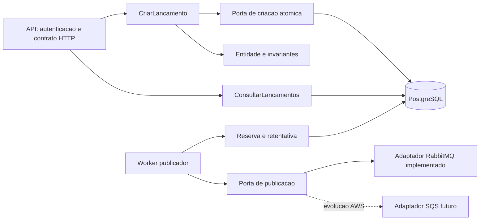
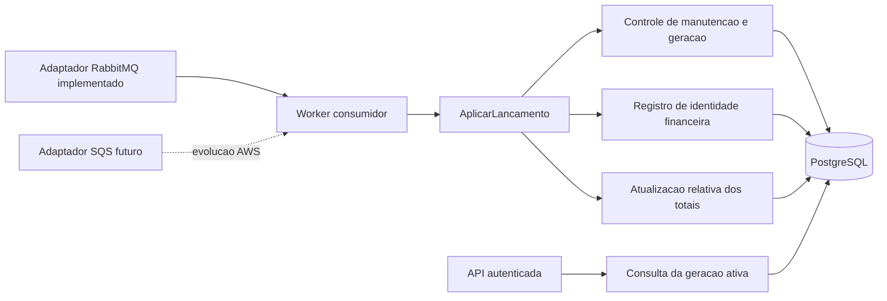

# C4 — Componentes de software

Cada diagrama decompõe os processos de um serviço. Interfaces são portas; adaptadores de infraestrutura realizam acesso externo. A visão distingue o adaptador **implementado localmente** da substituição prevista na arquitetura-alvo AWS.

## Lançamentos

`CriarLancamento` delega ao store transacional a persistência atômica da chave de idempotência, fato financeiro e Outbox em uma transação PostgreSQL local. A reserva do publicador é transação diferente e curta; chamada de rede ocorre fora dela. Autenticação e autorização antecedem o caso de uso, e a identidade confiável é passada para auditoria/idempotência.

## Consolidação

Controle, identidade e totais participam da mesma transação. No RabbitMQ local, o adaptador confirma somente após o commit da projeção; falhas isoladas/permanentes usam retry/DLQ e indisponibilidade compartilhada da projeção pausa o consumo sem ACK. A ferramenta administrativa de Recovery usa componentes próprios para snapshot e gerações, sem transformar as APIs de negócio em acesso cruzado entre bancos.

## Dependências e componentes transversais

API/Worker → Application → Domain. Infrastructure → Application/Domain quando necessário ao mapeamento. A raiz de composição referencia Infrastructure para injeção. O contrato de evento v1 é versionado no payload e validado pelo consumidor; o projeto `CashFlow.Contracts` não contém DTO compartilhado do evento nesta entrega. Configuração validada, serialização/canonicalização determinística onde necessária, Problem Details e OpenTelemetry são componentes transversais. O acesso PostgreSQL implementado usa Npgsql diretamente; não há ORM no domínio nem EF Core nesta entrega.

Detalhamento no [SDD](sdd.md); contratos e decisões são referenciados em vez de reproduzidos integralmente nesta visão.