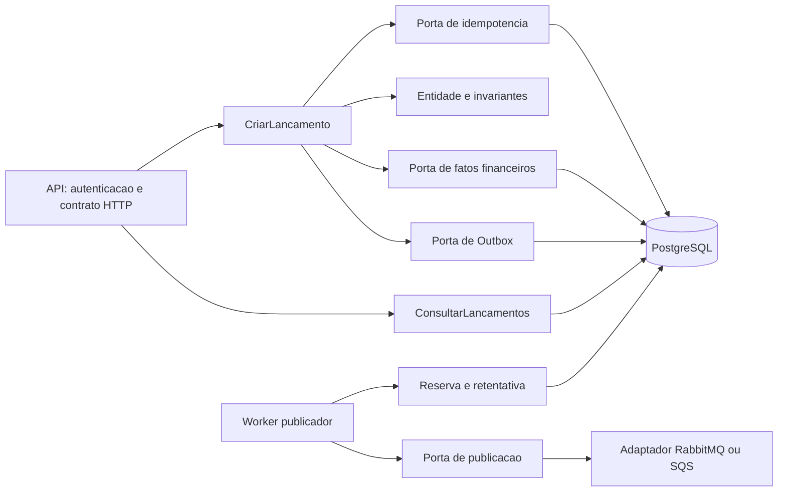
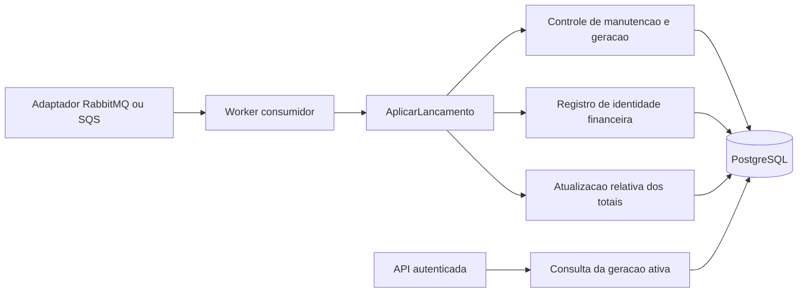

# C4 — Componentes de software

Cada diagrama decompõe os processos de um serviço. Interfaces são portas; adaptadores de infraestrutura realizam acesso externo.

## Lançamentos

CriarLancamento usa uma Unit of Work para chave, fato e Outbox. Reserva do publicador é transação diferente e curta; chamada de rede ocorre fora dela. Autenticação e autorização antecedem o caso de uso, e a identidade confiável é passada para auditoria/idempotência.

## Consolidação

Controle, identidade e totais participam da mesma transação. O adaptador confirma somente após resultado comprometido no banco; erro transitório/permanente é traduzido em operação de transporte específica. Ferramenta administrativa usa portas próprias para snapshots/gerações, sem expor acesso cruzado no serviço.

## Dependências e componentes transversais

API/Worker → Application → Domain. Infrastructure → Application/Domain quando necessário ao mapeamento. A raiz de composição referencia Infrastructure para injeção. Contratos versionados não contêm regras compartilhadas. Clock, serialização canônica, configuração validada, Problem Details e OpenTelemetry são componentes transversais. Testes de arquitetura verificam ausência de dependência de SDK/ORM no domínio.

Detalhamento no [SDD](sdd.md); contratos e decisões são referenciados em vez de reproduzidos integralmente nesta visão.
