# Arquitetura-alvo na AWS

> **Status:** arquitetura de referência para produção. Nenhum recurso AWS, adaptador SQS ou integração Cognito foi provisionado, implementado ou homologado nesta entrega. A evidência executada é exclusivamente local.

## Topologia de referência

VPC com duas zonas de disponibilidade, duas subnets públicas para ALB/NAT e subnets privadas para aplicações e bancos. Um NAT Gateway por zona, rotas de saída na mesma zona e endpoint gateway S3. Sem IP público em tasks/RDS. Essa escolha torna o custo de conectividade explícito; endpoints de interface são otimização futura mediante medição.

Quatro ECS Services Fargate Linux x86, um por processo. Cada serviço inicia com duas tasks de 0,5 vCPU/1 GiB distribuídas entre zonas. APIs mínimo 2/máximo 6; Workers mínimo 2/máximo 4. Rolling deployment com minimumHealthyPercent 100 e maximumPercent 150, circuit breaker e rollback de deployment; capacidade temporária adicional prevista. Não confundir quatro ECS Services com quatro domínios de negócio.

Dois RDS PostgreSQL 17 separados, cada um Multi-AZ com standby, classe inicial db.t4g.small e 100 GiB gp3 por banco. CPU credit de instância burstable é risco monitorado; trocar classe após medição se carga sustentada exigir. Backups/PITR 35 dias, criptografia, proteção contra exclusão e parâmetros de conexão TLS. Instância por contexto evita falha/saturação causada pela Consolidação no banco de Lançamentos.

SQS Standard principal com retenção inicial proposta de 7 dias e DLQ de 14 dias; SSE-KMS, políticas por papel, long polling e visibility timeout a validar na homologação. Os nomes são lógicos e a infraestrutura deve permitir criar uma geração física nova de fila/DLQ em restore da fonte. Cognito é a escolha de identidade técnica para a referência AWS conforme ADR-011; ALB/ACM, WAF, ECR, Secrets Manager, CloudWatch e OpenTelemetry/X-Ray completam a topologia projetada.

```mermaid
flowchart TB
    CLIENT["Cliente HTTPS 443"] --> IGW["Internet Gateway / entrada publica"]
    CLIENT -. "OAuth2 / OIDC" .-> COG["Amazon Cognito - emissor JWT"]

    subgraph VPC["VPC - duas zonas de disponibilidade"]
      subgraph PUBLIC["Subnets publicas - AZ-A e AZ-B"]
        ALB["ALB publico + ACM / WAF associado"]
        NATA["NAT Gateway AZ-A / Elastic IP"]
        NATB["NAT Gateway AZ-B / Elastic IP"]
      end
      subgraph PRIVATEA["Subnet privada aplicacao AZ-A"]
        TAA["Transactions API A"]
        TWA["Outbox Worker A"]
        CAA["Consolidation API A"]
        CWA["Consumer Worker A"]
      end
      subgraph PRIVATEB["Subnet privada aplicacao AZ-B"]
        TAB["Transactions API B"]
        TWB["Outbox Worker B"]
        CAB["Consolidation API B"]
        CWB["Consumer Worker B"]
      end
      subgraph DATABASE["DB subnet group privado - duas AZs"]
        TDB[("RDS Transactions - Multi-AZ")]
        CDB[("RDS Consolidation - Multi-AZ")]
      end
      S3EP["S3 Gateway Endpoint"]
    end

    IGW --> ALB
    ALB -->|"Target group Transactions / HTTPS"| TAA
    ALB -->|"Target group Transactions / HTTPS"| TAB
    ALB -->|"Target group Consolidation / HTTPS"| CAA
    ALB -->|"Target group Consolidation / HTTPS"| CAB
    TAA & TAB & TWA & TWB -->|"PostgreSQL / TLS 5432"| TDB
    CAA & CAB & CWA & CWB -->|"PostgreSQL / TLS 5432"| CDB
    TWA & TWB -->|"SendMessage HTTPS / SigV4"| SQS["SQS Standard - servico regional"]
    CWA & CWB -->|"ReceiveMessage HTTPS / SigV4"| SQS
    CWA & CWB -. "DeleteMessage apos commit" .-> SQS
    SQS -. "redrive policy" .-> DLQ["SQS DLQ - servico regional"]
    PRIVATEA -. "rota padrao 0.0.0.0/0" .-> NATA
    PRIVATEB -. "rota padrao 0.0.0.0/0" .-> NATB
    NATA & NATB -->|"egress via Internet Gateway"| IGW
    PRIVATEA -. "rota especifica S3" .-> S3EP
    PRIVATEB -. "rota especifica S3" .-> S3EP
    PRIVATEA -. "HTTPS via NAT ou endpoint privado" .-> EXT["Endpoints AWS e externos"]
    PRIVATEB -. "HTTPS via NAT ou endpoint privado" .-> EXT
```

## Como ler a topologia e suas fronteiras

Este é um **diagrama de implantação-alvo**, não um C4 de componentes e não um ambiente provisionado. As réplicas A/B tornam explícita a distribuição mínima por zona dos quatro ECS Services; cada ECS Service pode escalar acima de duas tasks conforme os limites declarados. Os bancos são desenhados como **instâncias lógicas Multi-AZ**, e não como duas instâncias independentes por AZ: o standby e a localização física do writer são gerenciados pelo RDS. A opção por **dois RDS independentes, um por contexto**, é a decisão de referência atual, sujeita à revisão de custo/isolamento; o diagrama não a apresenta como única solução viável.

**Entrada:** o ALB é internet-facing, associado às duas subnets públicas e protegido por AWS WAF; termina TLS com certificado ACM e distribui chamadas apenas para as APIs por target groups. O Internet Gateway fornece conectividade pública à VPC; o WAF é uma Web ACL **associada ao ALB**, e não um roteador intermediário na VPC; **NAT não recebe tráfego HTTP de clientes**. As tasks ECS e os RDS permanecem sem IP público. Os Workers não são targets do ALB. A autenticação do cliente usa tokens emitidos pelo Cognito; as APIs validam JWT/JWKS e autorização, sem afirmar que o ALB substitui a autorização de negócio.

**Saída:** cada subnet privada de aplicação tem rota padrão para o NAT Gateway **da mesma AZ**; cada NAT reside em subnet pública e utiliza o Internet Gateway para alcançar destinos públicos. As setas pontilhadas de rota indicam **configuração de encaminhamento**, não chamadas diretas entre cada processo e o NAT. O SQS é serviço regional **fora da VPC**, não está instalado dentro das subnets. As linhas de SQS/Cognito representam dependências **lógicas**; o tráfego HTTPS pode usar NAT quando não existir endpoint privado aplicável. O S3 Gateway Endpoint tem rota própria para S3 e não substitui NAT para SQS, Cognito, ECR, CloudWatch ou outros serviços. Interface endpoints são alternativa a avaliar por custo, segurança e volume; não estão desenhados como implantados.

**Dados e mensageria:** somente APIs/Workers autorizados alcançam os respectivos RDS via PostgreSQL/TLS 5432. O publicador usa a API SQS via HTTPS/SigV4, o consumidor busca mensagens por polling e só solicita `DeleteMessage` após commit da projeção; a DLQ recebe mensagens conforme redrive policy. Diferentemente de RabbitMQ local, SQS não envia mensagens por push nem oferece publisher confirms AMQP. O contrato de eventos e a deduplicação permanecem requisitos da aplicação.

**Controles omitidos intencionalmente do desenho de rede:** security groups, NACLs, roles IAM, chaves KMS, CloudWatch/X-Ray, ECR, Secrets Manager e alarmes são descritos nesta página e nas visões de segurança/operação. Para evitar a falsa impressão de que tudo é uma conexão de runtime, esses serviços não foram ligados indiscriminadamente a todas as tasks. A ausência de uma seta de observabilidade não significa ausência do requisito; a [visão de segurança, resiliência e observabilidade](../04-visoes/seguranca-resiliencia-observabilidade.md) documenta os controles.

### Inventário visual de componentes e protocolos

| Elemento citado | Representação | Papel / protocolo | Status |
|---|---|---|---|
| WAF, ALB e ACM | WAF, ALB e legenda HTTPS/ACM | Proteção e entrada TLS 443; roteamento por target group | AWS alvo |
| Internet Gateway | IGW | Caminho público da VPC | AWS alvo |
| NAT Gateway por AZ | NAT A/B e rotas padrao A/B nas conexoes pontilhadas | Egress de subnets privadas por zona; não é ingresso | AWS alvo |
| Subnets públicas/privadas e AZs | Agrupamentos PUB/PRIV/DBNET e AZ-A/AZ-B | Separação de rede e placement | AWS alvo |
| ECS/Fargate | APIs e Workers com réplica A/B | Quatro serviços ECS, duas tasks iniciais por serviço | AWS alvo |
| RDS PostgreSQL Multi-AZ | TDB/CDB | PostgreSQL TLS/5432, standby gerenciado | AWS alvo |
| SQS Standard e DLQ | SQS/DLQ | HTTPS SigV4, polling, delete após commit, redrive | AWS alvo, adaptador não implementado |
| S3 Gateway Endpoint | S3EP | Rota S3 sem NAT | AWS alvo |
| Cognito | COG | OAuth2/OIDC, JWT/JWKS | AWS alvo, não integrado |
| ECR, Secrets Manager, CloudWatch, KMS | Descritos em controles, não conexões de negócio | Build/pull, segredos, telemetria, criptografia | AWS alvo |

**Regra de rastreabilidade visual:** todo elemento de rede essencial à compreensão do fluxo de entrada, saída, dados ou mensageria deve aparecer no diagrama; detalhes de controle que tornariam o desenho ilegível devem aparecer em tabela ou visão complementar, com referência explícita. Os protocolos de negócio são detalhados na [visão de integração](../04-visoes/visao-integracao.md).

## Rede e acesso

Security Group do ALB aceita 443 externo; tasks aceitam tráfego de aplicação apenas do ALB quando aplicável; RDS aceita 5432 somente dos security groups autorizados de seu contexto. Workers não possuem entrada pública. Administração deve ocorrer por mecanismo autorizado, sem SSH público. O certificado público do ALB é gerenciado pelo ACM; segredos e chaves não ficam nas imagens.

Task Role por processo; Execution Role separada; permissões KMS/SQS/ECR/logs/secrets conforme [segurança](../04-visoes/seguranca-resiliencia-observabilidade.md). Identidade de clientes segue o [ADR-011](../06-adr/adr-011-autenticacao-e-autorizacao-das-apis.md). Não usar fila pública ou credenciais AWS em arquivos. Health do ALB direcionado à readiness; a API de Lançamentos não deve depender de fila ou Consolidação para permanecer pronta.

## Escala e capacidade

APIs escalam inicialmente por CPU e métricas de latência; Workers por sinais relacionados ao trabalho pendente: idade/volume da Outbox para o publicador e backlog/idade SQS para o consumidor. Thresholds são parâmetros iniciais e precisam ser calibrados em ensaio no ambiente AWS.

Pools de conexão, limites de tasks e `max_connections` devem ser dimensionados em conjunto. Os valores propostos nos [parâmetros operacionais](parametros-operacionais.md) são ponto de partida, não capacidade comprovada. A projeção diária pode gerar contenção de escrita; os testes locais demonstram correção, não capacidade AWS. As 50 consultas/s do enunciado são requisito de leitura do Consolidado e não dimensionam, por si só, broker, banco ou Workers.

## Alta disponibilidade e recuperação

Duas tasks por processo e RDS Multi-AZ são decisões da referência de produção, ainda não homologadas. Objetivos internos e ensaios estão nos [parâmetros](parametros-operacionais.md). Failover de zona não substitui PITR; Multi-AZ não impede erro lógico. Restore da fonte requer isolamento do transporte anterior e reconstrução da projeção conforme o [procedimento](recuperacao-e-reconciliacao.md). DR automático entre regiões não está no escopo; não se promete RPO zero.

## Passagem do local para AWS

O domínio e os contratos permanecem, mas o transporte muda. Hoje existe **somente o adaptador RabbitMQ executável localmente**. A passagem para AWS requer implementar o adaptador SQS, configurar filas/ARNs, IAM/KMS e identidade Cognito, executar migrations em RDS e homologar as invariantes com SQS real antes de promover. Não existe nesta entrega uma configuração `Messaging__Provider=Sqs` funcional.

O [ADR-007](../06-adr/adr-007-estrategia-de-mensageria.md) registra a escolha tecnológica e o [ADR-010](../06-adr/adr-010-mensageria-local-rabbitmq-e-aws-sqs.md) descreve as diferenças semânticas. O fluxo de implantação projetado está em [implantação e operação](implantacao-e-operacao.md); a [estimativa de custos](estimativa-custos.md) corresponde a esta topologia de referência e deve ser recalculada antes de uma implantação real.
