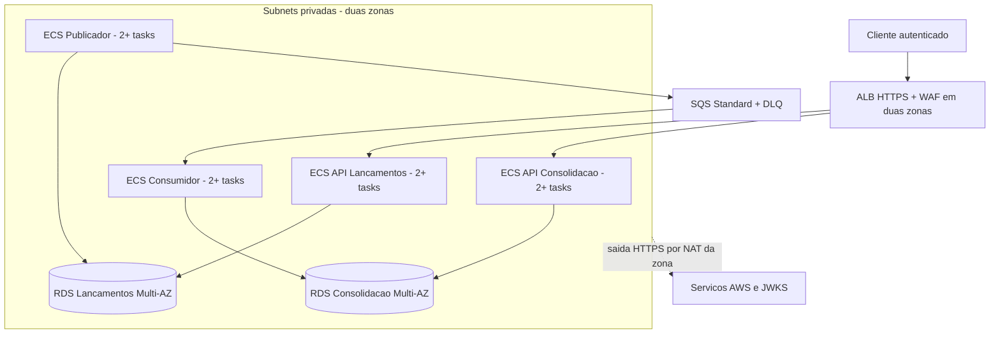

# Arquitetura-alvo na AWS

> **Status:** arquitetura de referência para produção. Nenhum recurso AWS, adaptador SQS ou integração Cognito foi provisionado, implementado ou homologado nesta entrega. A evidência executada é exclusivamente local.

## Topologia de referência

VPC com duas zonas de disponibilidade, duas subnets públicas para ALB/NAT e subnets privadas para aplicações e bancos. Um NAT Gateway por zona, rotas de saída na mesma zona e endpoint gateway S3. Sem IP público em tasks/RDS. Essa escolha torna o custo de conectividade explícito; endpoints de interface são otimização futura mediante medição.

Quatro ECS Services Fargate Linux x86, um por processo. Cada serviço inicia com duas tasks de 0,5 vCPU/1 GiB distribuídas entre zonas. APIs mínimo 2/máximo 6; Workers mínimo 2/máximo 4. Rolling deployment com minimumHealthyPercent 100 e maximumPercent 150, circuit breaker e rollback de deployment; capacidade temporária adicional prevista. Não confundir quatro ECS Services com quatro domínios de negócio.

Dois RDS PostgreSQL 17 separados, cada um Multi-AZ com standby, classe inicial db.t4g.small e 100 GiB gp3 por banco. CPU credit de instância burstable é risco monitorado; trocar classe após medição se carga sustentada exigir. Backups/PITR 35 dias, criptografia, proteção contra exclusão e parâmetros de conexão TLS. Instância por contexto evita falha/saturação causada pela Consolidação no banco de Lançamentos.

SQS Standard principal com retenção inicial proposta de 7 dias e DLQ de 14 dias; SSE-KMS, políticas por papel, long polling e visibility timeout a validar na homologação. Os nomes são lógicos e a infraestrutura deve permitir criar uma geração física nova de fila/DLQ em restore da fonte. Cognito é a escolha de identidade técnica para a referência AWS conforme ADR-011; ALB/ACM, WAF, ECR, Secrets Manager, CloudWatch e OpenTelemetry/X-Ray completam a topologia projetada.

## Rede e acesso

Security Group do ALB aceita 443 externo; tasks aceitam tráfego de aplicação apenas do ALB quando aplicável; RDS aceita 5432 somente dos security groups autorizados de seu contexto. Workers não possuem entrada pública. Administração deve ocorrer por mecanismo autorizado, sem SSH público. O certificado público do ALB é gerenciado pelo ACM; segredos e chaves não ficam nas imagens.

Task Role por processo; Execution Role separada; permissões KMS/SQS/ECR/logs/secrets conforme [segurança](../04-visoes/seguranca-resiliencia-observabilidade.md). Identidade de clientes segue o [ADR-011](../06-adr/adr-011-autenticacao-e-autorizacao-das-apis.md). Não usar fila pública ou credenciais AWS em arquivos. Health do ALB direcionado à readiness; a API de Lançamentos não deve depender de fila ou Consolidação para permanecer pronta.

## Escala e capacidade

APIs escalam inicialmente por CPU e métricas de latência; Workers por sinais relacionados ao trabalho pendente: idade/volume da Outbox para o publicador e backlog/idade SQS para o consumidor. Thresholds são parâmetros iniciais e precisam ser calibrados em ensaio no ambiente AWS.

Pools de conexão, limites de tasks e `max_connections` devem ser dimensionados em conjunto. Os valores propostos nos [parâmetros operacionais](parametros-operacionais.md) são ponto de partida, não capacidade comprovada. A projeção diária pode gerar contenção de escrita; os testes locais demonstram correção, não capacidade AWS. As 50 consultas/s do enunciado são requisito de leitura do Consolidado e não dimensionam, por si só, broker, banco ou Workers.

## Alta disponibilidade e recuperação

Duas tasks por processo e RDS Multi-AZ são decisões da referência de produção, ainda não homologadas. Objetivos internos e ensaios estão nos [parâmetros](parametros-operacionais.md). Failover de zona não substitui PITR; Multi-AZ não impede erro lógico. Restore da fonte requer isolamento do transporte anterior e reconstrução da projeção conforme o [procedimento](recuperacao-e-reconciliacao.md). DR automático entre regiões não está no escopo; não se promete RPO zero.

## Passagem do local para AWS

O domínio e os contratos permanecem, mas o transporte muda. Hoje existe **somente o adaptador RabbitMQ executável localmente**. A passagem para AWS requer implementar o adaptador SQS, configurar filas/ARNs, IAM/KMS e identidade Cognito, executar migrations em RDS e homologar as invariantes com SQS real antes de promover. Não existe nesta entrega uma configuração `Messaging__Provider=Sqs` funcional.

O [ADR-007](../06-adr/adr-007-estrategia-de-mensageria.md) registra a escolha tecnológica e o [ADR-010](../06-adr/adr-010-mensageria-local-rabbitmq-e-aws-sqs.md) descreve as diferenças semânticas. O fluxo de implantação projetado está em [implantação e operação](implantacao-e-operacao.md); a [estimativa de custos](estimativa-custos.md) corresponde a esta topologia de referência e deve ser recalculada antes de uma implantação real.
