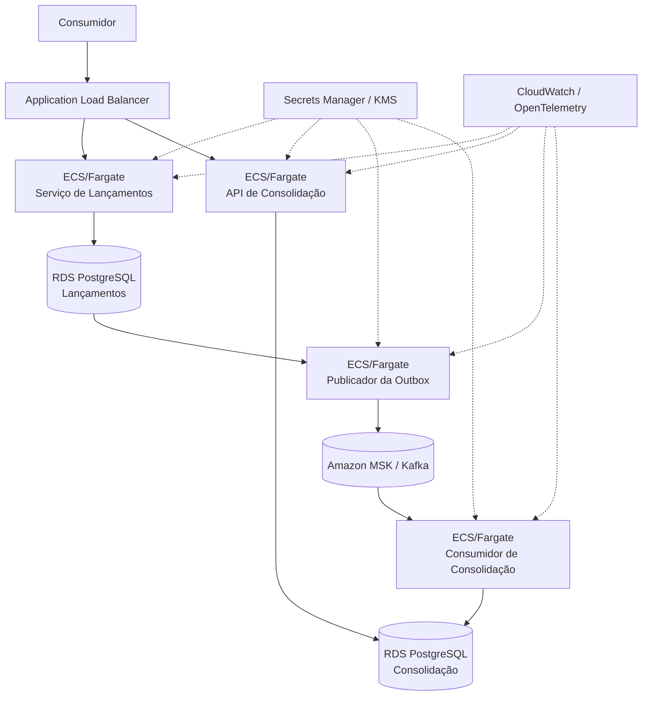

# Arquitetura-alvo na AWS

- **Status:** ARQUITETURA-ALVO DOCUMENTADA
- **Objetivo:** mapear as capacidades da arquitetura lógica para serviços AWS sem alterar os requisitos do desafio.

## 1. Região de referência

Para tornar a estimativa de custos reproduzível, adota-se **us-east-1 (Norte da Virgínia)** como região de referência. Essa escolha é somente uma premissa de cálculo, não um requisito de negócio.

A região de produção deverá ser validada conforme residência de dados, latência, requisitos regulatórios e estratégia corporativa.

## 2. Mapeamento da arquitetura lógica

| Capacidade | Serviço AWS de referência | Justificativa |
|---|---|---|
| Entrada HTTPS e balanceamento | Application Load Balancer (ALB) | entrada HTTPS, distribuição das requisições e verificações de saúde |
| Serviço de Lançamentos | Amazon ECS com AWS Fargate | contêineres sem administração de servidores e escala horizontal independente |
| API de Consolidação | Amazon ECS com AWS Fargate | mesma plataforma operacional com escala independente |
| Publicador da Outbox | Amazon ECS com AWS Fargate | processamento independente do caminho síncrono da API |
| Consumidor de Consolidação | Amazon ECS com AWS Fargate | processamento assíncrono e escala independente |
| Registro de imagens | Amazon ECR | armazenamento gerenciado das imagens de contêiner |
| Persistência de Lançamentos | Amazon RDS for PostgreSQL | banco relacional gerenciado e transacional |
| Persistência de Consolidação | Amazon RDS for PostgreSQL | propriedade de dados independente entre contextos |
| Fluxo de eventos | Amazon MSK (Kafka) | preserva a decisão de retenção, reprocessamento e recuperação de backlog do ADR-002 |
| Segredos | AWS Secrets Manager | externalização de credenciais e suporte à rotação |
| Chaves criptográficas | AWS KMS | gerenciamento de chaves para criptografia quando aplicável |
| Logs e métricas | Amazon CloudWatch | integração nativa com os serviços AWS |
| Rastreamento distribuído | OpenTelemetry + CloudWatch | instrumentação padronizada e portável |

## 3. Visão de implantação

## 4. Disponibilidade e isolamento

A arquitetura permite distribuir tarefas dos serviços entre **Zonas de Disponibilidade (Availability Zones — AZs)** e configurar os bancos de acordo com a disponibilidade necessária.

O desafio, porém, **não fornece SLA, RTO ou RPO**. Por isso, Multi-AZ, quantidade fixa de réplicas e recuperação entre regiões não são apresentados como requisitos obrigatórios.

A independência exigida pelo desafio é preservada pela separação dos serviços e de suas persistências: uma falha na Consolidação não deve impedir que o Serviço de Lançamentos confirme novas transações válidas.

Na estimativa de custos são apresentados cenários com premissas explícitas para permitir comparação econômica sem transformar essas hipóteses em requisitos.

## 5. ECS/Fargate versus EKS

EKS não agrega benefício proporcional ao escopo atual. Existem poucos componentes executáveis, não há requisito de Kubernetes e o objetivo é demonstrar isolamento, escalabilidade e operação da solução.

ECS/Fargate reduz a sobrecarga operacional de plataforma e atende aos requisitos de contêineres, escala horizontal e implantações independentes. A decisão está formalizada no ADR-006.

## 6. Kafka/MSK versus fila gerenciada

Kafka foi escolhido arquiteturalmente por retenção de eventos, reprocessamento e recuperação de backlog. O requisito de 50 req/s, isoladamente, **não justifica Kafka**.

Uma alternativa como Amazon SQS possui menor complexidade operacional e pode apresentar custo inferior quando o requisito for apenas entrega assíncrona confiável. A comparação e suas consequências estão registradas no ADR-007 e na estimativa de custos.

## 7. Ambiente local → arquitetura-alvo

| Ambiente local | Arquitetura-alvo AWS |
|---|---|
| contêineres Docker | Amazon ECS + AWS Fargate |
| PostgreSQL em contêiner | Amazon RDS for PostgreSQL |
| Kafka em contêiner | Amazon MSK |
| variáveis e segredos locais | AWS Secrets Manager / AWS KMS |
| logs, métricas e rastreamento locais | Amazon CloudWatch + OpenTelemetry |

O ambiente local não pretende reproduzir alta disponibilidade de nuvem. Ele deve reproduzir contratos, persistência, integração, falhas e comportamento verificável.

## 8. Segurança da infraestrutura

Na arquitetura-alvo:

- tráfego externo utiliza HTTPS/TLS;
- bancos e broker não são expostos diretamente à Internet;
- grupos de segurança restringem comunicação aos componentes necessários;
- credenciais e segredos ficam fora do código-fonte;
- permissões dos componentes seguem o princípio do menor privilégio;
- criptografia em repouso utiliza os recursos dos serviços gerenciados e KMS quando aplicável;
- autenticação/autorização do consumidor da API deverá seguir o provedor de identidade corporativo quando este for conhecido.

## 9. Observabilidade operacional

A infraestrutura deverá permitir observar, no mínimo:

- taxa, erros e latência das APIs;
- saúde e prontidão dos componentes;
- quantidade e idade dos registros pendentes na Outbox;
- atraso do consumidor e tamanho do backlog;
- falhas e tentativas de reprocessamento;
- defasagem do consolidado;
- correlação entre requisição, lançamento, evento e consolidação.

Limiares de alerta dependem dos SLOs/SLA produtivos ainda não informados.

## 10. Custos

A composição de custos, as hipóteses de dimensionamento, os valores unitários e os totais mensais são mantidos separadamente em `estimativa-custos.md`, evitando misturar decisão de implantação com cálculo financeiro.