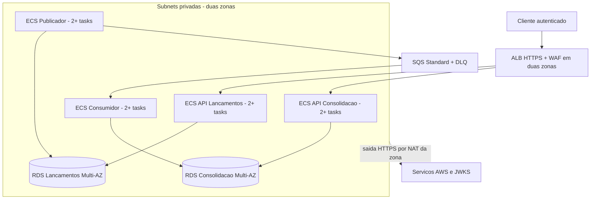

# Arquitetura-alvo na AWS

**Estado: DOCUMENTAÇÃO APROVADA; NÃO PROVISIONADA.** Região técnica de referência us-east-1. A adoção em cliente real requer confirmar residência de dados antes de armazenar dados reais; isso não impede a homologação com dados sintéticos.

## Topologia de referência

VPC com duas zonas de disponibilidade, duas subnets públicas para ALB/NAT e subnets privadas para aplicações e bancos. Um NAT Gateway por zona, rotas de saída na mesma zona e endpoint gateway S3. Sem IP público em tasks/RDS. Essa escolha torna o custo de conectividade explícito; endpoints de interface são otimização futura mediante medição.

Quatro ECS Services Fargate Linux x86, um por processo. Cada serviço inicia com duas tasks de 0,5 vCPU/1 GiB distribuídas entre zonas. APIs mínimo 2/máximo 6; Workers mínimo 2/máximo 4. Rolling deployment com minimumHealthyPercent 100 e maximumPercent 150, circuit breaker e rollback de deployment; capacidade temporária adicional prevista. Não confundir quatro ECS Services com quatro domínios de negócio.

Dois RDS PostgreSQL 17 separados, cada um Multi-AZ com standby, classe inicial db.t4g.small e 100 GiB gp3 por banco. CPU credit de instância burstable é risco monitorado; trocar classe após medição se carga sustentada exigir. Backups/PITR 35 dias, criptografia, proteção contra exclusão e parâmetros de conexão TLS. Instância por contexto evita falha/saturação causada pela Consolidação no banco de Lançamentos.

SQS Standard principal com 7 dias de retenção e DLQ com 14 dias; SSE-KMS, políticas por papel, long polling e timeout conforme tabela normativa. Os nomes são lógicos e a infraestrutura permite criar uma geração física nova de fila/DLQ em restore da fonte. Cognito para clientes técnicos conforme ADR-011, ALB/ACM para HTTPS, WAF, ECR, Secrets Manager, CloudWatch e OpenTelemetry com destino AWS X-Ray.

## Rede e acesso

Security Group do ALB aceita 443 externo; tasks aceitam porta HTTPS apenas do ALB; RDS aceita 5432 apenas dos papéis de rede de seu contexto e ferramenta autorizada. Workers sem entrada pública. Administração por task eventual/SSM autorizada, sem SSH público. HTTPS nas tasks usa certificado interno por ambiente, armazenado no Secrets Manager, renovado antes do vencimento por deployment; sem chave privada na imagem. O certificado público do ALB é gerenciado pelo ACM. Restringir egress por destinos/portas compatíveis com serviços utilizados e auditar via Flow Logs; NAT não é firewall de aplicação.

Task Role por processo; Execution Role separada; permissões KMS/SQS/ECR/logs/secrets conforme [segurança](../04-visoes/seguranca-resiliencia-observabilidade.md). Identidade de clientes segue o [ADR-011](../06-adr/adr-011-autenticacao-e-autorizacao-das-apis.md). Não usar fila pública ou credenciais AWS em arquivos. Health do ALB direcionado à readiness privada; APIs de Lançamentos não verificam fila/Consolidação para ficar prontas.

## Escala e capacidade

APIs escalam por CPU alvo 60% e latência observada; memória 75% gera alerta. Publicador escala pela quantidade/idade da Outbox, consumidor por backlog por task e idade SQS. Threshold inicial de backlog por task 100, com cooldown de scale-out 60 s e scale-in 300 s; recalibrar no ensaio. Não escalar o publicador somente pela fila: quando SQS está vazio e Outbox cheia esse sinal seria incorreto.

Limitar pool de cada processo a 5 conexões. Por contexto, os máximos de 6 APIs e 4 Workers chegam a 15 tasks durante rolling a 150%: até 75 conexões de aplicação. Reservar até 20 para operação/migration e configurar referência de max_connections=120, deixando margem para administração. Validar consumo de memória desse limite na classe inicial e rejeitar promoção se houver saturação; ampliar classe antes de aumentar pools. A projeção diária é linha disputada; UPSERT preserva correção, mas teste concorrente é obrigatório. Não presumir throughput de escrita a partir das 50 consultas/s do enunciado.

## Alta disponibilidade e recuperação

Duas tasks por processo e Multi-AZ são decisões aprovadas da referência de produção. Objetivos internos e ensaios estão nos [parâmetros](parametros-operacionais.md). Failover de zona não substitui PITR; Multi-AZ não impede erro lógico. Restore da fonte bloqueia escrita, isola a fila anterior, cria fila/DLQ novas e reconstrói a projeção conforme o [procedimento](recuperacao-e-reconciliacao.md). DR automático entre regiões não está no escopo; risco regional é declarado e não se promete RPO zero.

## Passagem do local para AWS

Mesmo domínio e contratos, adaptadores RabbitMQ/SQS diferentes. Configuração `Messaging__Provider=Sqs`, URLs/ARNs, emissor Cognito e segredos AWS. Migrations equivalentes por contexto, imagens versionadas e testes de homologação com SQS real antes de promover. Fluxo completo em [implantação e operação](implantacao-e-operacao.md); custos calculados para esta topologia em [estimativa](estimativa-custos.md).
