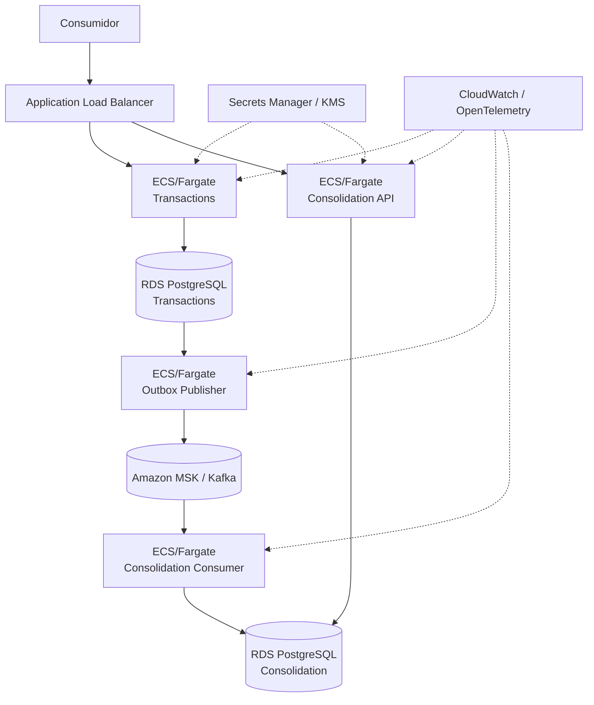

# Arquitetura-alvo AWS

- **Status:** PROPOSTO
- **Objetivo:** mapear as capacidades da arquitetura lógica para serviços AWS sem alterar os requisitos do desafio.

## Região de referência

Para permitir uma estimativa reproduzível, adota-se **us-east-1 (N. Virginia)** como região de referência de custo. Essa escolha é uma premissa de estimativa, não um requisito de negócio. A região produtiva deverá ser validada conforme residência de dados, latência, compliance e estratégia corporativa.

## Mapeamento

| Capacidade | AWS de referência | Racional |
|---|---|---|
| Edge HTTP | Application Load Balancer | entrada HTTPS e health checks para os serviços containerizados |
| Transactions Service | ECS + Fargate | containers sem administração de nós; scale-out independente |
| Consolidation API/Consumer | ECS + Fargate | mesmo modelo operacional, com escala independente |
| Imagens | ECR | registry gerenciado |
| Persistência Transactions | RDS for PostgreSQL | banco relacional gerenciado e transacional |
| Persistência Consolidation | RDS for PostgreSQL | ownership lógico independente; evita transação distribuída |
| Event streaming | Amazon MSK | preserva a decisão Kafka do ADR-002 |
| Segredos | Secrets Manager | externalização/rotação de credenciais |
| Chaves | KMS | criptografia gerenciada quando aplicável |
| Logs/métricas | CloudWatch | integração nativa com workloads AWS |
| Tracing | OpenTelemetry + backend observável | mantém instrumentação portável |

## Deployment view

## Alta disponibilidade

A arquitetura permite distribuir tasks HTTP/worker entre Availability Zones e configurar os bancos conforme a disponibilidade requerida. **Não se afirma Multi-AZ, quantidade fixa de réplicas, RTO ou RPO como requisito do case**, porque essas metas não foram fornecidas.

Para a estimativa de referência será mostrado separadamente o efeito de um cenário enxuto e de um cenário produtivo com redundância, evitando transformar uma hipótese de custo em requisito.

## Decisão ECS/Fargate versus EKS

EKS não agrega valor suficiente para este desafio: há poucos workloads, nenhum requisito de Kubernetes e o objetivo é demonstrar isolamento, escalabilidade e operação da solução, não administração de plataforma. ECS/Fargate reduz superfície operacional e continua atendendo containers, scale-out e deployments independentes.

## Kafka/MSK versus mensageria mais simples

A arquitetura mantém Kafka como referência por retenção, replay, backlog e capacidade de reprocessamento. Entretanto, 50 req/s não justificam Kafka por throughput. Uma alternativa como SQS reduz custo e complexidade quando o requisito for somente entrega assíncrona confiável.

Essa comparação será mantida na Cost View: **Kafka é uma decisão arquitetural com benefício funcional/operacional, não uma escolha gratuita nem motivada por volume**.

## Local → target

| Local | Target AWS |
|---|---|
| containers Docker | ECS/Fargate |
| PostgreSQL container | RDS PostgreSQL |
| Kafka container | Amazon MSK |
| variáveis/secrets locais | Secrets Manager/KMS |
| logs/metrics/traces locais | CloudWatch + OpenTelemetry |

O ambiente local não pretende reproduzir HA de cloud; ele deve reproduzir contratos, persistência, integração, falhas e comportamento verificável.