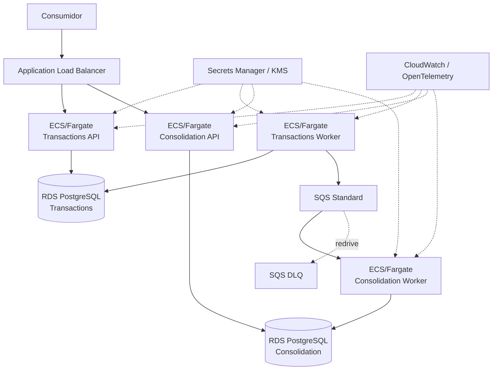

# Arquitetura-alvo na AWS

- **Status:** EM REVISÃO FINAL — aguardando validação humana
- **Objetivo:** mapear a arquitetura lógica para AWS com simplicidade, isolamento e rastreabilidade aos requisitos.

## 1. Região de referência

`us-east-1` é usada apenas para estimativas. Região produtiva depende de residência de dados, latência, regulação e estratégia corporativa.

## 2. Mapeamento

| Capacidade | Serviço AWS | Justificativa |
|---|---|---|
| entrada HTTPS | Application Load Balancer | TLS, health checks e balanceamento para as APIs |
| Transactions API | ECS/Fargate | processo stateless e escala independente |
| Transactions Worker | ECS/Fargate | Outbox Publisher fora do caminho HTTP |
| Consolidation API | ECS/Fargate | leitura e escala independente |
| Consolidation Worker | ECS/Fargate | consumo assíncrono independente |
| imagens | ECR | registro gerenciado |
| dados de Lançamentos | RDS PostgreSQL | atomicidade de lançamento/idempotência/Outbox |
| dados de Consolidação | RDS PostgreSQL | projeção e deduplicação com ownership separado |
| integração | SQS Standard | desacoplamento, backlog, redelivery e baixo overhead |
| mensagens problemáticas | SQS DLQ | isolamento e redrive operacional |
| segredos | Secrets Manager | externalização/rotação |
| chaves | KMS | criptografia gerenciada |
| logs/métricas | CloudWatch | integração AWS |
| traces | OpenTelemetry + destino compatível | instrumentação portável |

## 3. Implantação

São **2 serviços de negócio / 4 processos executáveis**, não quatro microsserviços.

## 4. Rede e segurança

- ALB é o único componente público quando exposição externa for necessária;
- tasks ficam em subnets privadas; RDS não possui endpoint público;
- acesso à SQS preferencialmente por VPC endpoint quando custo/topologia justificarem; caso contrário, egress controlado deve ser explicitado;
- Security Groups permitem apenas fluxos necessários;
- IAM Task Roles separados por processo e menor privilégio;
- Transactions Worker: `sqs:SendMessage` na fila principal;
- Consolidation Worker: permissões de receive/delete/change-visibility na fila principal; redrive administrativo separado do runtime quando possível;
- Secrets Manager/KMS sem credenciais no código;
- TLS externo e criptografia em repouso;
- OAuth2/OIDC/JWT no boundary HTTP quando o IdP corporativo for definido.

O case não fornece RBAC de negócio, portanto perfis não são inventados.

## 5. Disponibilidade e escala

O requisito explícito é independência da Consolidação. A topologia permite escala horizontal dos quatro processos e isolamento dos bancos. Multi-AZ, quantidade mínima de réplicas, RTO/RPO e cross-region dependem de objetivos não fornecidos.

Autoscaling pode usar CPU/memória nas APIs e idade/profundidade da fila nos workers. Limiares são definidos após teste/observação, não arbitrariamente como requisitos.

## 6. ECS/Fargate versus EKS

ECS/Fargate é suficiente para quatro processos containerizados e reduz operação. EKS só seria reavaliado por padrão corporativo, escala/plataforma compartilhada ou capacidades Kubernetes realmente necessárias.

## 7. SQS versus Kafka/MSK

ADR-007 seleciona SQS Standard porque os requisitos atuais pedem desacoplamento, recuperação e tratamento de falhas, não event streaming/replay histórico. Kafka/MSK permanece alternativa futura, não componente da arquitetura-alvo atual.

## 8. Local → AWS

| Local | AWS |
|---|---|
| Docker containers | ECS/Fargate |
| PostgreSQL (databases separados) | RDS PostgreSQL com ownership separado |
| broker/fila compatível com semântica at-least-once | SQS Standard + DLQ |
| configuração/secrets de desenvolvimento | Secrets Manager/KMS |
| logs/métricas/traces locais | CloudWatch + OpenTelemetry |

## 9. Observabilidade

Além de taxa/erro/latência das APIs: Outbox pendente e idade mais antiga, falhas/tentativas do Publisher, `ApproximateNumberOfMessagesVisible`, `ApproximateAgeOfOldestMessage`, DLQ > 0, falhas de consumo e idade do evento ao ser consolidado. Correlation/trace context atravessa HTTP, Outbox e atributos da mensagem.

## 10. Custos

`estimativa-custos.md` usa SQS como baseline e trata MSK apenas como comparação de sensibilidade. NAT Gateway, VPC endpoints, WAF e outros itens condicionais precisam ser explicitados quando incluídos/excluídos para evitar custo oculto.