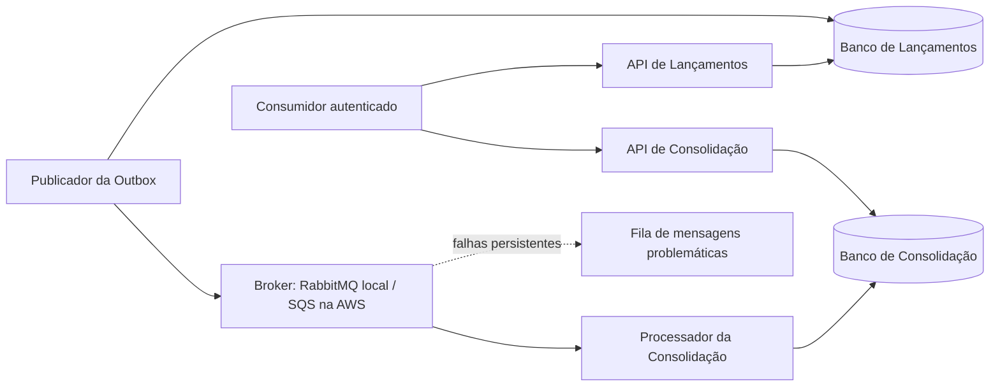

# Arquitetura de Fluxo de Caixa

Este repositório apresenta a arquitetura e a implementação incremental de uma solução de controle de lançamentos financeiros e consolidação diária, com foco em independência entre capacidades, consistência, resiliência e rastreabilidade entre requisitos, decisões, código e testes.

## Solução

Dois serviços de negócio, Lançamentos e Consolidação, com quatro processos: duas APIs e dois Workers. PostgreSQL por contexto, Outbox transacional, entrega pelo menos uma vez e consumidor idempotente. O lançamento confirma após commit local, independentemente da Consolidação e do broker.

## Estado da implementação

A documentação arquitetural está concluída para o escopo definido e a implementação começou pelo bootstrap da solução .NET. Requisitos funcionais, persistência, mensageria, consolidação, segurança e evidências operacionais serão implementados incrementalmente conforme a [matriz de escopo de implementação](docs/01-requisitos/escopo-implementacao.md).

## Execução local

O ambiente-alvo local usa Docker Compose, PostgreSQL, RabbitMQ e, quando necessário aos cenários de segurança, Keycloak. Não exige conta AWS. O [guia local](docs/07-infraestrutura/execucao-local.md) define pré-requisitos, serviços, portas, sequência de inicialização, comandos e critérios de aceite a implementar.

RabbitMQ é a implementação de mensageria do ambiente local, não um emulador do SQS. O [ADR-010](docs/06-adr/adr-010-mensageria-local-rabbitmq-e-aws-sqs.md) registra as diferenças. A validação real do adaptador SQS pertence à homologação AWS e não é requisito para executar a entrega local.

## Caminho para AWS

A [arquitetura AWS](docs/07-infraestrutura/arquitetura-aws.md) especifica ECS/Fargate, dois RDS PostgreSQL Multi-AZ, SQS e DLQ, ALB, Cognito, IAM, KMS e observabilidade. O [plano de implantação](docs/07-infraestrutura/implantacao-e-operacao.md) define provisionamento, promoção, reversão, restauração e critérios de liberação. Essa topologia está projetada; não foi provisionada e sua validação integral é evolução/homologação, não pré-requisito da execução local.

## Trilhas de leitura

Para avaliação de **Arquitetura de Soluções**: conformidade e requisitos → ASRs e capacidades → DAS → C4 e visões → ADRs → arquitetura AWS, custos, implantação e recuperação → testes e rastreabilidade.

Para avaliação de **Arquitetura de Software**: conformidade e requisitos → SDD e componentes → contratos HTTP, dados e fluxos → ADRs 003–005 e 008–011 → parâmetros, execução local e recuperação → testes e rastreabilidade.

Ordem completa:

1. [Conformidade com os PDFs](docs/01-requisitos/matriz-conformidade.md).
2. [Requisitos funcionais](docs/01-requisitos/requisitos-funcionais.md), [não funcionais](docs/01-requisitos/requisitos-nao-funcionais.md), [premissas](docs/01-requisitos/premissas.md), [restrições](docs/01-requisitos/restricoes.md) e [escopo de implementação](docs/01-requisitos/escopo-implementacao.md).
3. [Requisitos arquiteturalmente significativos](docs/02-asr/asr.md) e [capacidades e domínios](docs/03-arquitetura-solucao/capacidades-e-dominios.md).
4. [Documento de arquitetura da solução](docs/03-arquitetura-solucao/das.md).
5. [C4](docs/04-visoes/c4.md), [dados](docs/04-visoes/visao-dados.md), [integração](docs/04-visoes/visao-integracao.md), [fluxos](docs/04-visoes/visoes-dinamicas.md) e [segurança e observabilidade](docs/04-visoes/seguranca-resiliencia-observabilidade.md).
6. [Design de software](docs/05-arquitetura-software/sdd.md), [componentes](docs/05-arquitetura-software/c4-componentes.md) e [contratos HTTP](docs/05-arquitetura-software/contratos-http.md).
7. ADRs em [docs/06-adr](docs/06-adr): fonte normativa das decisões e dos trade-offs, incluindo [identidade e autorização](docs/06-adr/adr-011-autenticacao-e-autorizacao-das-apis.md).
8. [Parâmetros operacionais](docs/07-infraestrutura/parametros-operacionais.md), [recuperação](docs/07-infraestrutura/recuperacao-e-reconciliacao.md), [custos](docs/07-infraestrutura/estimativa-custos.md) e guias local/AWS.
9. [Estratégia de testes](docs/05-arquitetura-software/estrategia-testes.md) e [rastreabilidade](docs/01-requisitos/matriz-rastreabilidade.md).

## Fontes normativas e evolução

Cada regra possui uma fonte principal: contratos HTTP no documento de contratos; evento no ADR-008; idempotência no ADR-005; mensageria no ADR-010; identidade e autorização no ADR-011; recuperação no procedimento operacional; valores e metas na tabela de parâmetros. As demais visões explicam responsabilidades e referenciam essas fontes.

A documentação define a arquitetura-alvo. A implementação e as evidências são produzidas incrementalmente e só são consideradas demonstradas quando existem código e testes executáveis correspondentes. Mudanças posteriores exigem atualização da decisão, dos contratos e dos testes associados.
