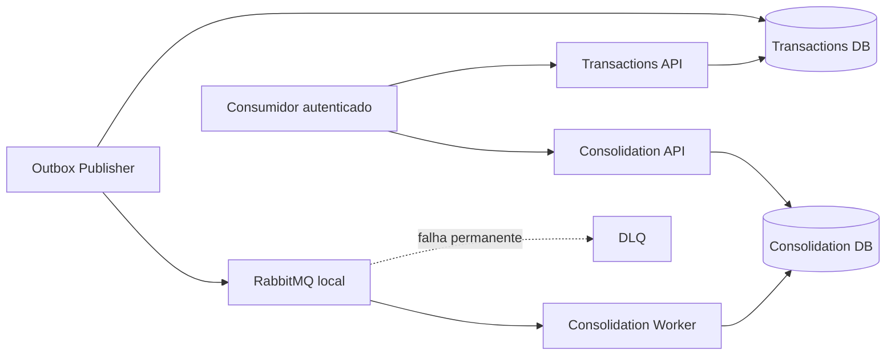

# Arquitetura de Fluxo de Caixa

Solução para controle de lançamentos financeiros e consolidação diária, construída para demonstrar independência entre capacidades, consistência, resiliência e rastreabilidade entre requisitos, decisões, código e testes.

## Solução

Dois serviços de negócio — **Lançamentos** e **Consolidação** — executados em quatro processos: Transactions API, Transactions Worker/Outbox Publisher, Consolidation API e Consolidation Worker. Cada contexto possui seu PostgreSQL. A integração é assíncrona, com Transactional Outbox, entrega at-least-once e consumidor idempotente. O lançamento é confirmado após commit no banco de Transactions e não depende da disponibilidade da Consolidação nem do broker.



## O que está implementado

O corte local executável usa Docker Compose, dois PostgreSQL, RabbitMQ, Keycloak e Jaeger. As APIs validam JWT e permissões por cliente. Os quatro processos emitem logs estruturados, métricas e traces OpenTelemetry. O Transactions Publisher implementa publisher confirms e circuit breaker; o Consolidation Worker faz ACK após commit, retry/DLQ e processamento idempotente. Um [Recovery administrativo](docs/07-infraestrutura/recuperacao-e-reconciliacao.md) recompõe a projeção em nova geração sob lease/fencing PostgreSQL.

RabbitMQ é o único transporte implementado. **SQS Standard é a escolha da arquitetura-alvo AWS, mas o adaptador SQS não foi implementado nem homologado.** O [ADR-007](docs/06-adr/adr-007-estrategia-de-mensageria.md) registra a escolha e o [ADR-010](docs/06-adr/adr-010-mensageria-local-rabbitmq-e-aws-sqs.md) descreve as diferenças semânticas.

## Comece aqui: executar e validar

Pré-requisitos: Docker com Compose v2, SDK .NET 10, `curl` e acesso à internet no primeiro build.

Em um clone novo, a validação local completa é executada com **um único comando**:

```sh
sh tools/validate-local.sh
```

Não é necessário criar o `.env` manualmente. O script carrega `.env.example` como baseline e, quando `.env` não existe, cria automaticamente uma cópia local antes de subir o ambiente. Se `.env` já existir, ele é tratado como override local. O `.env.example` contém somente credenciais demonstrativas para o ambiente local; não reutilize esses valores em ambiente compartilhado ou produção.

O script:

1. carrega a configuração local e cria `.env` automaticamente quando necessário;
2. deriva as connection strings e a URI RabbitMQ usadas pelos testes a partir das mesmas credenciais do Compose;
3. sobe toda a topologia com `docker compose up -d --build --wait`;
4. valida readiness das APIs;
5. executa `dotnet restore --locked-mode` e `dotnet build --no-restore`;
6. executa unit, contract, integration e E2E com `dotnet test --no-build`.

Se qualquer etapa falhar, o script encerra com código diferente de zero.

Para somente subir a aplicação, sem executar o gate completo de validação:

```sh
cp .env.example .env
docker compose up -d --build --wait
docker compose ps
```

Transactions API: `127.0.0.1:8081`; Consolidation API: `127.0.0.1:8082`; Keycloak: `127.0.0.1:8080`; Jaeger: `127.0.0.1:16686`.

O [guia de execução local](docs/07-infraestrutura/execucao-local.md) contém obtenção de token, chamadas HTTP, testes e ensaios operacionais. HTTP/AMQP sem TLS e a dependência de startup do Jaeger são conveniências do ambiente demonstrativo, não decisões de disponibilidade para produção.

## Evidência executada

As [evidências locais finais](docs/08-testes/validacao-local-final.md) registram os limites de cada ensaio:

- E2E autenticado: CREDIT 100 + DEBIT 20 → créditos 100, débitos 20, saldo 80, contagem 2.
- T06: com Consolidation API, Worker e banco parados, Transactions permaneceu live/ready e aceitou dois POSTs 201; após restauração, a projeção convergiu.
- T09: mensagem permanentemente inválida chegou à DLQ; redrive completo não foi executado.
- T13: 401 sem token, 403 sem permissão, 201 em escrita autorizada e 200 em leitura autorizada.
- T14: trace atravessou API → Outbox → Worker → RabbitMQ → Worker → banco de Consolidação no Jaeger local.
- T15: 6.000/6.000 GETs em 120 s a 50 req/s, 0 falhas, 0 dropped iterations, P95 4,372 ms e P99 6,052 ms.
- T18: bootstrap local limpo com migrations, serviços saudáveis, token e primeiro POST 201.
- Regressão local da revisão atual pelo golden path `tools/validate-local.sh`: `restore` PASS, `build` PASS e **90 passed, 0 failed, 0 skipped** (13 Transactions Unit + 1 Consolidation Unit + 1 Contract + 18 Transactions Integration + 55 Consolidation Integration + 2 E2E).

Esses resultados são evidência **local**, não GitHub CI e não validação AWS. A [rastreabilidade de testes](docs/08-testes/production-grade-local-traceability.md) distingue estratégia normativa, cobertura automatizada e ensaios operacionais limitados.

## Arquitetura-alvo AWS

O corte distribuído local está implementado com os componentes acima. A [arquitetura-alvo AWS](docs/07-infraestrutura/arquitetura-aws.md) projeta ECS/Fargate, RDS, SQS Standard, ALB, Cognito, IAM, KMS e observabilidade gerenciada. Nenhuma infraestrutura AWS foi provisionada ou testada neste estudo. A adoção exige implementação do adaptador SQS, infraestrutura, configuração de identidade e homologação AWS.

## Guia de avaliação

Para **Arquitetura de Soluções**: [conformidade](docs/01-requisitos/matriz-conformidade.md) → [requisitos](docs/01-requisitos/requisitos-funcionais.md) e [RNFs](docs/01-requisitos/requisitos-nao-funcionais.md) → [ASRs](docs/02-asr/asr.md) → [capacidades](docs/03-arquitetura-solucao/capacidades-e-dominios.md) → [DAS](docs/03-arquitetura-solucao/das.md) → [C4 e visões](docs/04-visoes/c4.md) → [ADRs](docs/06-adr) → [AWS](docs/07-infraestrutura/arquitetura-aws.md), [custos](docs/07-infraestrutura/estimativa-custos.md) e [evidências](docs/08-testes/validacao-local-final.md).

Para **Arquitetura de Software**: [SDD](docs/05-arquitetura-software/sdd.md) → [componentes](docs/05-arquitetura-software/c4-componentes.md) → [contratos HTTP](docs/05-arquitetura-software/contratos-http.md) → [dados](docs/04-visoes/visao-dados.md) e [fluxos](docs/04-visoes/visoes-dinamicas.md) → ADRs 003–005 e 008–011 → [estratégia de testes](docs/05-arquitetura-software/estrategia-testes.md) → [evidências finais](docs/08-testes/validacao-local-final.md).

O [escopo de implementação](docs/01-requisitos/escopo-implementacao.md) é a referência para distinguir **implementado**, **demonstrado localmente**, **arquitetura-alvo** e **evolução**.