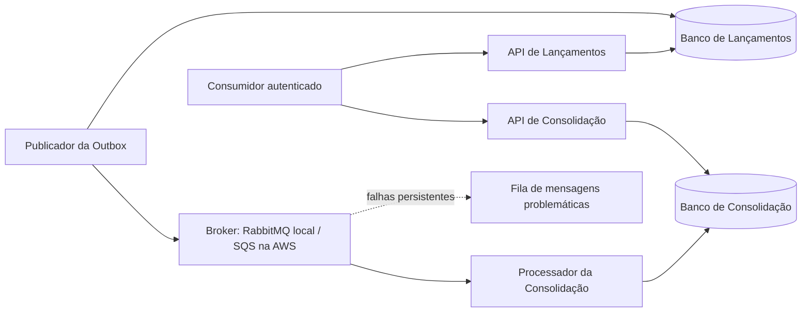

# Arquitetura de Fluxo de Caixa

Documentação de arquitetura de solução e de software para os desafios Keyrus de Arquiteto de Soluções e Arquiteto de Software.

**Estado: DOCUMENTAÇÃO APROVADA.** Esta branch conclui a especificação. Implementação C#, infraestrutura como código, Docker Compose e execução dos testes pertencem à etapa seguinte e não foram iniciados. Aprovação documental não significa aplicação implementada, desempenho comprovado ou atendimento integral dos critérios executáveis dos PDFs.

## Solução

Dois serviços de negócio, Lançamentos e Consolidação, com quatro processos: duas APIs e dois Workers. PostgreSQL por contexto, Outbox transacional, entrega pelo menos uma vez e consumidor idempotente. O lançamento confirma após commit local, independentemente da Consolidação e do broker.

## Execução local

O ambiente especificado usa Docker Compose, PostgreSQL, RabbitMQ e Keycloak local. Não exige conta AWS. **Ainda não existem aplicação ou comandos executáveis nesta branch.** O [guia local](docs/07-infraestrutura/execucao-local.md) define pré-requisitos, serviços, portas, sequência de inicialização, comandos previstos e critérios de aceite a implementar.

RabbitMQ é uma decisão para desenvolvimento local, não um emulador do SQS. O [ADR-010](docs/06-adr/adr-010-mensageria-local-rabbitmq-e-aws-sqs.md) fixa as diferenças e a validação obrigatória de ambos os adaptadores.

## Caminho para AWS

A [arquitetura AWS](docs/07-infraestrutura/arquitetura-aws.md) especifica ECS/Fargate, dois RDS PostgreSQL Multi-AZ, SQS e DLQ, ALB, Cognito, IAM, KMS e observabilidade. O [plano de implantação](docs/07-infraestrutura/implantacao-e-operacao.md) define provisionamento, promoção, reversão, restauração e critérios de liberação. Essa topologia está projetada; não foi provisionada.

## Ordem de leitura

1. [Conformidade com os PDFs](docs/01-requisitos/matriz-conformidade.md).
2. [Requisitos funcionais](docs/01-requisitos/requisitos-funcionais.md), [não funcionais](docs/01-requisitos/requisitos-nao-funcionais.md), [premissas](docs/01-requisitos/premissas.md) e [restrições](docs/01-requisitos/restricoes.md).
3. [Requisitos arquiteturalmente significativos](docs/02-asr/asr.md) e [capacidades e domínios](docs/03-arquitetura-solucao/capacidades-e-dominios.md).
4. [Documento de arquitetura da solução](docs/03-arquitetura-solucao/das.md).
5. [C4](docs/04-visoes/c4.md), [dados](docs/04-visoes/visao-dados.md), [integração](docs/04-visoes/visao-integracao.md), [fluxos](docs/04-visoes/visoes-dinamicas.md) e [segurança e observabilidade](docs/04-visoes/seguranca-resiliencia-observabilidade.md).
6. [Design de software](docs/05-arquitetura-software/sdd.md), [componentes](docs/05-arquitetura-software/c4-componentes.md) e [contratos HTTP](docs/05-arquitetura-software/contratos-http.md).
7. ADRs em [docs/06-adr](docs/06-adr): fonte normativa das decisões e dos trade-offs.
8. [Parâmetros operacionais](docs/07-infraestrutura/parametros-operacionais.md), [recuperação](docs/07-infraestrutura/recuperacao-e-reconciliacao.md), [custos](docs/07-infraestrutura/estimativa-custos.md) e guias local/AWS.
9. [Estratégia de testes](docs/05-arquitetura-software/estrategia-testes.md) e [rastreabilidade](docs/01-requisitos/matriz-rastreabilidade.md).
10. [Registro de resolução da revisão](docs/01-requisitos/resolucao-da-revisao.md).

## Fontes normativas e evolução

Cada regra possui uma fonte principal: contratos HTTP no documento de contratos; evento no ADR-008; idempotência no ADR-005; recuperação no procedimento operacional; valores e metas na tabela de parâmetros. As demais visões explicam responsabilidades e referenciam essas fontes.

Todos os textos e decisões estão aprovados para o escopo definido. Questões de expansão do negócio não bloqueiam a implementação desse escopo. Mudanças posteriores exigem atualização da decisão, dos contratos e dos testes associados.

A próxima etapa, fora desta branch documental, é implementar o desenho e produzir evidências. Não há desenvolvimento, deploy, PR ou merge incluído nesta entrega documental.

## Convenção de nomenclatura

Arquivos de documentação e diretórios usam minúsculas e kebab-case, sem acentos nos caminhos. Os nomes descritivos são em português; siglas e identificadores técnicos convencionais, como `readme`, `c4`, `asr`, `das`, `sdd`, `adr`, `http` e `aws`, são preservados em minúsculas nos caminhos. Títulos e conteúdo usam português com acentuação normal. Renomeações devem atualizar links e referências textuais no mesmo conjunto de alterações.
