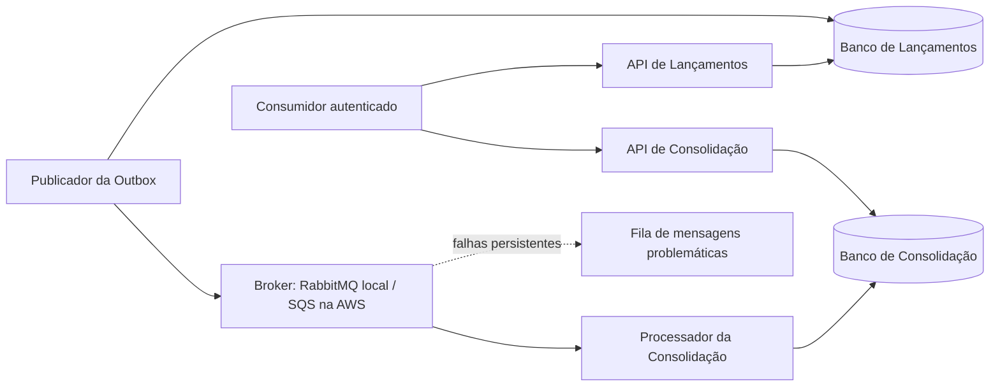

# Arquitetura de Fluxo de Caixa

Este repositório apresenta a arquitetura e a implementação local de uma solução de controle de lançamentos financeiros e consolidação diária, com foco em independência entre capacidades, consistência, resiliência e rastreabilidade entre requisitos, decisões, código e testes.

## Solução

Dois serviços de negócio, Lançamentos e Consolidação, com quatro processos: duas APIs e dois Workers. PostgreSQL por contexto, Outbox transacional, entrega pelo menos uma vez e consumidor idempotente. O lançamento confirma após commit local, independentemente da Consolidação e do broker.

## Estado da implementação

A entrega local implementa Transactions API, Transactions Worker / Outbox Publisher, Consolidation Worker e Consolidation API como processos independentes, com PostgreSQL separado por bounded context e RabbitMQ local. O fluxo usa Transactional Outbox, consumo at-least-once e idempotência para evitar efeito financeiro duplicado. As APIs usam autenticação e autorização locais com Keycloak/JWT e expõem health/readiness. Há testes automatizados, E2E contra Docker Compose real, teste de independência T06 e teste de carga T15. O [escopo de implementação](docs/01-requisitos/escopo-implementacao.md) distingue a entrega local das evoluções projetadas.

As [evidências finais da validação local](docs/08-testes/validacao-local-final.md) registram: E2E **PASS**; T06 **PASS**, com Transactions live/ready e POSTs HTTP 201 enquanto Consolidation API, Worker e banco estavam indisponíveis; T15 **PASS**, com 6.000/6.000 requisições, 50 req/s, 0 falhas, failure rate de 0%, 0 iterações perdidas, P95 de 4,52 ms e P99 de 5,97 ms. A suíte de regressão local terminou com **80 passed, 0 failed, 0 skipped**.

## Execução local

O ambiente local executável usa Docker Compose, PostgreSQL, RabbitMQ e Keycloak. Não exige conta AWS. O [guia local](docs/07-infraestrutura/execucao-local.md) descreve pré-requisitos, serviços, portas, inicialização e comandos reproduzíveis de validação.

RabbitMQ é a implementação de mensageria do ambiente local, não um emulador do SQS. O [ADR-010](docs/06-adr/adr-010-mensageria-local-rabbitmq-e-aws-sqs.md) registra as diferenças. A validação real do adaptador SQS pertence à homologação AWS e não é requisito para executar a entrega local.

## Caminho para AWS

A arquitetura distribuída completa está implementada e validada localmente com Docker Compose, PostgreSQL e RabbitMQ. A [arquitetura de produção projetada para AWS](docs/07-infraestrutura/arquitetura-aws.md) usa serviços gerenciados como ECS/Fargate, RDS e SQS, além de DLQ, ALB, Cognito, IAM, KMS e observabilidade. Nenhuma infraestrutura AWS foi provisionada como parte deste estudo de caso, e a AWS não foi testada. O [plano de implantação](docs/07-infraestrutura/implantacao-e-operacao.md) documenta os passos futuros de provisionamento, promoção, reversão, restauração e liberação.

## Trilhas de leitura

Para avaliação de **Arquitetura de Soluções**: conformidade e requisitos → ASRs e capacidades → DAS → C4 e visões → ADRs → arquitetura AWS, custos, implantação e recuperação → testes e rastreabilidade.

Para avaliação de **Arquitetura de Software**: conformidade e requisitos → SDD e componentes → contratos HTTP, dados e fluxos → ADRs 003–005 e 008–011 → parâmetros, execução local e recuperação → testes e rastreabilidade.

Ordem completa:

1. [Conformidade com os PDFs](docs/01-requisitos/matriz-conformidade.md).
2. [Requisitos funcionais](docs/01-requisitos/requisitos-funcionais.md), [não funcionais](docs/01-requisitos/requisitos-nao-funcionais.md), [premissas](docs/01-requisitos/premissas.md), [restrições](docs/01-requisitos/restricoes.md) e [escopo de implementação](docs/01-requisitos/escopo-implementacao.md).
3. [Requisitos arquiteturalmente significativos](docs/02-asr/asr.md) e [capacidades e domínios](docs/03-arquitetura-solucao/capacidades-e-dominios.md).
4. [Documento de arquitetura da solução](docs/03-arquitetura-solucao/das.md).
5. [C4](docs/04-visoes/c4.md), [dados](docs/04-visoes/visao-dados.md), [integração](docs/04-visoes/visao-integracao.md), [fluxos](docs/04-visoes/visoes-dinamicas.md) e [segurança e observabilidade](docs/04-visoes/seguranca-resiliencia-observabilidade.md).
6. [Design de software](docs/05-arquitetura-software/sdd.md), [componentes](docs/05-arquitetura-software/c4-componentes.md) e [contratos HTTP](docs/05-arquitetura-software/contratos-http.md).
7. ADRs em [docs/06-adr](docs/06-adr): fonte normativa das decisões e dos trade-offs, incluindo [identidade e autorização](docs/06-adr/adr-011-autenticacao-e-autorizacao-das-apis.md).
8. [Parâmetros operacionais](docs/07-infraestrutura/parametros-operacionais.md), [recuperação](docs/07-infraestrutura/recuperacao-e-reconciliacao.md), [custos](docs/07-infraestrutura/estimativa-custos.md) e guias local/AWS.
9. [Estratégia de testes](docs/05-arquitetura-software/estrategia-testes.md) e [rastreabilidade](docs/01-requisitos/matriz-rastreabilidade.md).

## Fontes normativas e evolução

Cada regra possui uma fonte principal: contratos HTTP no documento de contratos; evento no ADR-008; idempotência no ADR-005; mensageria no ADR-010; identidade e autorização no ADR-011; recuperação no procedimento operacional; valores e metas na tabela de parâmetros. As demais visões explicam responsabilidades e referenciam essas fontes.

A documentação também define a arquitetura-alvo. As evidências locais correspondem aos testes executáveis registrados; recursos de produção projetados dependem de implementação e homologação futuras. Mudanças posteriores exigem atualização da decisão, dos contratos e dos testes associados.
